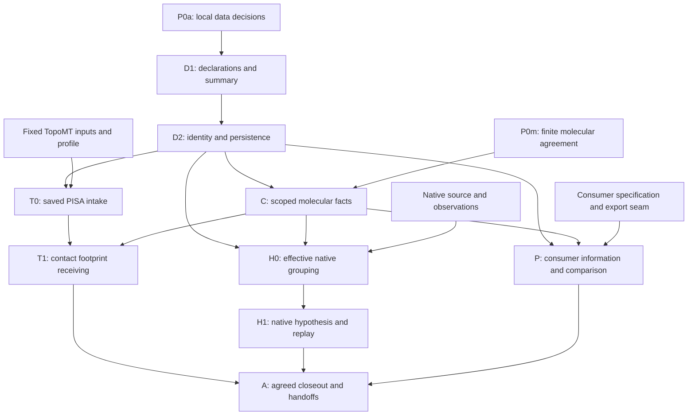

# BindingInterface implementation and work plan

Owner: [BindingMT #112](https://github.com/uibcdf/bindingmt/issues/112).
Recorded: 2026-11-12. Work-plan revision **1**.
Status: **maintainer-requested plan; runtime implementation pending**.
This plan turns the [reviewed second design](binding_interface_design.md) into
bounded, independently useful implementation and receiving increments. It is
the interface counterpart of the [BindingSite work plan](binding_site_implementation_plan.md),
not a package version, shared-schema freeze or release schedule.

The maintainer requests evaluation of the three second-round responses and a
written plan before implementation. That request ends the preceding wait for
feedback for planning purposes. This increment changes documentation only; it
does not execute the proposed APIs or new molecular calculations.

## 1. Assessment of the second review and starting evidence

The reviewed scientific source is revision 2 at
`5aa21b1aaf27ee7708e5a7bb4fe58bd0300d49f0`. The later `e05a622` checkpoint
records publication/waiting state without changing that proposed contract.
All three second-round responses support retaining the architecture and
preparing a bounded implementation plan:

- [TopoMT](https://github.com/uibcdf/bindingmt/issues/112#issuecomment-6834726114)
  identifies no conceptual blocker, supplies exact participant/contact-group
  expectations and confirms failed-capture metadata. It requests a precise
  internal-ZIP versus external-reference distinction.
- [PharmacophoreMT](https://github.com/uibcdf/bindingmt/issues/112#issuecomment-6834704067)
  considers all four previous recommendations addressed at specification level.
  It supports the strict native query proposal while separating exclusivity
  from complete chemical-feature and converter eligibility.
- [PeptideMT](https://github.com/uibcdf/bindingmt/issues/112#issuecomment-6834795711)
  identifies no new planning blocker. It supports the concrete empty-contact
  control and requests a simpler declaration-only example with no implied
  molecular match.

These are favorable design reviews, not frozen public signatures, implemented
compatibility or component adoption. MolSysMT has no reply in the complete
11-comment #112 review baseline inspected for this plan; the finite molecular
fact/check agreement remains an operation-specific item.

TopoMT's fixed receiving inputs exist at
`3a8ee979db8de6f6345de74558a878bb96ba3234`. Its expectations below are owner-
supplied artifact inspection, not new BindingMT measurements. PharmacophoreMT
`ecd16946` and MolSysMT `ff25f120` remain inspected API/design baselines; the
native pharmacophoric and PeptideMT specifications are offered, with exact
execution inputs still to receive/select. Refresh actual source/native closure
before executed receiving. These identities are not public dependency floors.

## 2. Useful outcomes and preserved boundaries

The first ordinary user must be able to declare a binding question, inspect
available analysis/evidence and limitations, save/read it, and explicitly derive
one qualified participant footprint from a recovered saved PISA analysis.
Expert inspection exposes exact owner/run/record/occurrence references, selected
contact groups, source/local maps, checks, preconditions and refusal causes.

Preserve the design's ownership and scientific distinctions:

- BindingMT owns the binding question/characterization and its interpretation.
  TopoMT keeps canonical topographic associations/realizations and provider
  meanings; MolSysMT keeps molecular facts/maps/analyses; PharmacophoreMT keeps
  native feature, hypothesis and matching semantics.
- Analysis outcome, artifact availability, current correspondence/applicability
  and biological support are separate dimensions. Completed zero, no supplied
  analysis, original failure, missing proof and contradiction stay distinct.
- Native coordinates remain in MolSys; no second molecular model, trajectory
  store, universal receipt, mutation observer or generic execution framework.
- Interface composition is not a BindingSite subtype, a union of sites, a
  detector run or an intrinsic affinity/quality calculation.
- Core preservation, explicit native recovery, molecular correspondence and
  current-finding applicability retain their separate requirements. Unsupported
  stronger requests refuse without silently returning weaker success.
- Existing problem/result/search-domain behavior and scientific producers remain
  intact. No first-profile success qualifies native Topography, every provider,
  all modalities or scientific energy/biological-interface accuracy.

## 3. First-profile decisions to record

These are proposed local resolutions, not delivered public callables. Close the
decisions needed by the first data slice before construction; actual emitted-
record tests and native receiving follow implementation. Do not create a circular
entry gate requiring outputs from an API that has not been written.

| Decision | Proposed first resolution | Closure/evidence owner |
| --- | --- | --- |
| F1: minimal question | Required `question` mapping with `kind="association"` and optional description; participants/grouping identify the contextual endpoints separately. No new global question registry or implied biological observation. | BindingMT closes the initial spelling/admission record; other required kinds are unsupported until admitted. |
| F2: data entry point/result | One useful public declaration/composition operation, working name `characterize_interface`, returning an immutable inspectable result. `BindingInterface` remains a result name, not a class hierarchy requirement. | BindingMT records actual required/optional fields and result methods before code; publish only delivered exports. |
| F3: analysis intake | Optional named analyses/references plus analysis-qualified findings. No supplied analysis differs from a supplied completed-zero carrier. First typed foreign route admits TopoMT ProviderOutput and confirmed ProviderRun failure evidence through the adapter. | Local core contract first; TopoMT adapter agreement before T0 qualification. |
| F4: admitted assurances | Declaration/composition defaults to `preserved_evidence`; the first current-context PISA footprint requires/defaults to its qualified `molecular_correspondence` profile and explicit source. Supplying a molecular handle alone does not upgrade preservation. Initially refuse unqualified `current_finding` explicitly. | BindingMT/affected owners agree meanings; C/T record only the scopes actually qualified. |
| F5: context-policy applicability | Proposed default: no context policy for preservation; ordinary examples omit it and summary says `not_required`, never `match`. An explicitly supplied `require_match` is retained as a request with visible non-applicability, not a performed match. Correspondence normalizes to effective `require_match`. | Close exact defaults/admission in P0a; negative controls prove no inferred check. Additional trust policies remain unsupported initially. |
| F6: identity/version | Exact declaration, owner analysis/run, finding and observation references; faithful copy/read identity; immutable parents and original claim associations. Explicit experimental format/version admission. | Local decision before D1/D2; API-emitted round trips supply later evidence. No legacy missing-version admission inherited automatically. |
| F7: contact requests | Require a nonempty ordered unique selection from initially supported `other-bonds`/`h-bonds`; a combination means union of their mapped endpoint memberships with separate per-group provenance. Reject duplicate/unknown names; additional known owner groups remain explicitly unsupported until admitted. | BindingMT/TopoMT profile, including known-empty, mixed-group, empty-request and unknown-group controls. |
| F8: footprint result | Detached unique source-index membership plus complete contact/participant provenance, coverage and value state. Known empty is a valid evaluated-empty footprint, not a positive region or implicit site. | Exact source endpoints independently checked in T1; optional later site construction requires its own admission. |
| F9: failure and recovery | Preserve owner `execution_status="failed"`, `failure_stage="analysis"` and diagnostic references. External absence may remain reference-only; an internally incomplete/corrupt native ZIP fails owner recovery. | TopoMT facts are supplied; T0 tests actual metadata and owner-reader outcomes. Current parser errors never relabel original science. |

Optional site links are exact references. No initial live BindingSite object,
site projection or mandatory #111 implementation dependency is required for the
data/PISA profile. Explicit native recovery remains the owner's public operation,
not a hidden side effect of summary, read or composition.

## 4. Dependency order and current status



P0 is an umbrella, not a global barrier. D1/D2 need the minimal local decisions,
not every foreign input or molecular guarantee. T0 needs its TopoMT profile and
owner recovery boundary; T1 closes the molecular rows needed by its footprint.
H/P can advance independently with their own sources and public seams. Shared
coordination runs alongside the work and precedes freezing exercised shared
meanings; whole-suite adoption is not a local-core entry condition. C's prerequisites
are the rows needed by the actual operation, not every possible molecular fact.
Arrows into A collect dispositions/evidence for the agreed scope; they do not
make every later consumer profile a prerequisite for a useful M1/M2 checkpoint.

| Increment | Current state | Completion boundary |
| --- | --- | --- |
| P0a | Local decisions next | Actual minimal question/intake/identity/version/default/refusal contract recorded before the first slice. |
| P0m/P0s | Finite agreement/coordination pending | Named molecular facts/checks/preconditions and exercised shared meanings have owning dispositions. |
| P0t | Fixed artifacts and expectations supplied | Confirm input hashes, carrier/group/participant interpretation and exact first public contract. Not executed client receiving. |
| P0h/P0p | Specifications offered | Receive exact native inputs/expected outcomes and actual consumer export boundary; do not guess scientific choices. |
| D1/D2 | Runtime pending | Useful public declarations/summary and faithful immutable safe persistence. |
| C | Pending operation-specific facts | Required checks, map/state/frame scope, lifetime and refusal implemented and tested. |
| T0/T1 | Runtime pending | Actual saved analysis intake and exact participant-contact footprint/replay, including adverse controls. |
| H0/H1 | Inputs and runtime pending | Effective grouping, native construction, observation/site correspondence and native saved replay. |
| P | Input/seam and runtime pending | Actual K/N payloads, native/derived-context and comparison controls under a declared policy. |
| A | Evidence pending | Declared acceptance scope, exact evidence, shared disposition and per-consumer follow-ups are recorded honestly. |

## 5. P0: finite decisions, owner inputs and coordination

### 5.1 Local data contract

Record F1–F6's core decisions in the design/owning record. Specify required
versus optional fields, accepted references, safe unknowns, identity/parent
semantics, quantity/version rules and actual summary/save/read surface. Candidate
records help decide this contract; handwritten records are not later evidence
that the API emitted a compatible format.

For the proposed first core, require the minimal question, at least two declared
participant references and explicit nonempty grouping using known local IDs.
Analyses, site links and resolved molecular context are optional for preservation;
missing source/coordinates remain explicit. A stronger operation supplies its
required source/structure/state facts. Overlapping underlying molecular membership
is not a universal core error; the chosen PISA/native projection profiles impose
their own actual participant/selection eligibility.

Reuse existing local argument/diagnostic/quantity and file-lifecycle patterns.
The current private `validate_schema_version` admits missing-version legacy
1.0 for existing record types; that is not automatic policy for a new interface
record. Do not change unrelated record admission to simplify the new reader.

### 5.2 Molecular and shared agreement

Use the design's [fact/check/precondition matrix](binding_interface_design.md#102-fact-check-and-caller-precondition-matrix)
as the finite request. For each selected operation retain the public owner call
and source revision, actual checked facts/coverage, remaining preconditions,
check/use lifetime and outcome for absence/contradiction. Matching counts,
labels, a handle or a content digest alone is not universal correspondence.

Search/reuse owning MolSysMT and MolSysSuite topics before opening a new one.
Before concluding absence, acquire the complete declared repository/endpoint/
state/filter scope through all pages using qualified owner tooling. A bounded
search helps discovery, not an absence claim. Report concrete provider gaps in
their owner with consumer evidence and link the local workaround/removal condition.
MolSysMT #624 and TopoMT #60/#61/#62 retain their broader separate scopes.

Coordinate exercised compatibility/ownership in MolSysSuite; identity adoption
under #190 is a separate topic. Check participating worktrees through the suite's
registered status route before coordinated changes, preserving dirty/human work.
This plan changes no sibling source, environment or native extension.

### 5.3 Inputs and custody

For every receiving profile record producer/source versions, artifact names and
SHA-256, participant/index/structure/state/frame associations, requested route,
independent expectations and scope limits. Distinguish offered, received,
admitted, executed and qualified. A delayed H/P input does not block D/T.

TopoMT's frozen input set is already supplied; receive it without regeneration.
PharmacophoreMT supplies a native source/analyses and expected grouping/reuse/
alternative/refusal outcomes. PeptideMT supplies K/N/native-derived/comparison
specifications and the actual export seam. Missing choices remain owned pending
items, not invented molecular preparation, site or threshold selections.

## 6. D1: declaration, analysis outcomes and ordinary inspection

Deliver one complete public data slice, then its D2 round trip before expanding
every convenience factory. Expected code areas are core/public exports, owned
argument contracts/diagnostics and focused tests; the module split is an
implementation choice, not one class per record role.

The core must preserve:

- Question, participants/grouping, explicit declared/inferred status and exact
  source/context references without requiring coordinates or optional providers.
- Analysis outcome independently of findings: completed nonempty, completed zero,
  no supplied analysis, original failure and unresolved/reference-only evidence.
- Separate native-asset availability and current application assessment. Wrong
  current context does not rewrite a preserved original outcome.
- Detached ownership and a useful actual `summary()` identifying the question,
  original analysis/outcome, available findings/footprints, coverage, checks and
  remaining limitations. Summary performs no detection, lookup or recovery.
- Preservation-only inspection showing molecular matching as `not_required`.
  A policy label alone never produces a performed check or successful match.

Caller-authored analysis descriptors retain their declared authority. Construction
or successful JSON admission does not turn them into owner-verified outcomes;
native receipts in T0 retain exactly what the owner recovered/checked.

Use existing ArgDigest/SMonitor/PyUnitWizard integration rather than a competing
validator, unit codec or generic provenance service. Add no empty future classes.
The root's existing core dependencies remain required; do not promise import of
BindingMT without MolSysMT merely because the new record is data-only.

**Exit:** an ordinary user constructs and inspects a meaningful declaration and
analysis-level cases through actual public APIs. Tests inspect independent
expected fields, reject malformed known inputs and prove inputs/old evidence
are unchanged. No native adapter or biological claim is implied by labels.

## 7. D2: immutable identity, references and safe persistence

Implement faithful copy/read identity, exact analysis/run/finding/occurrence
references and bounded immutable derivation. Reinterpreting evidence retains
its original claim/context association and adds an explicit new interpretation;
it creates no new measurement or automatic independent support.

Emit an explicit experimental versioned record with required discriminants,
shared sealed quantities and receiver field/unit/dimension handshakes. Preserve
optional namespaced owner data without dynamic imports. Unsupported required
semantics refuse typed admission or the affected operation. Hashes identify
content, not chemical/biological equivalence.

Save/read must use exclusive creation by default, preserve an existing valid
file on failure, detach recovered data and perform no automatic asset lookup,
engine invocation or restoration of active application settings. Native artifacts
keep their owner persistence; local references are exact and bounded, not a
recursively embedded scientific history or duplicate molecular trajectory.

Exercise two distinct missing-data boundaries:

| Boundary | Required outcome |
| --- | --- |
| External native artifact referenced by an admitted BindingMT record is absent | Core record remains readable/reference-only; explicit recovery/application needing the asset refuses its absence. |
| A native TopoMT ZIP lacks an internal manifest-declared artifact or has corrupt/unsafe data | Owner recovery fails. No partially recovered native result, completed-empty analysis or unknown-success downgrade. |

**Exit:** real API-emitted declarations and all analysis outcomes survive
copy/save/read/revision with original contexts, producer/quantity meanings and
honest unknowns. Malformed/tampered/unsupported cases and I/O failures preserve
source data. Fresh core readback needs no original optional scientific engine,
GPU/network or foreign reader unless native decoding is explicitly requested.

## 8. C: scoped molecular correspondence and use boundary

Implement only the admitted facts required by the first operations. Delegate
selections, source/local correspondence, chemistry and coordinates/transforms
to public MolSysMT operations. Keep performed checks, coverage/authority and
caller unchanged-input preconditions separate. Unknown required proof refuses
the stronger use; do not mark it checked because an ID or shape matches.

The first footprint uses the complete matching original source and saved owner
selection/frame/reference-state context. No overriding that reader context to
transfer a finding. Nonidentity atom/structure maps and original 2 → local 0
belong to separately identified native/derived controls when the frozen PISA
source does not itself exercise them. Do not alter the frozen source and claim
the same saved source-bound recovery.

Check the actual selected/exported input at use, retaining normalization maps.
A relevant coordinate/chemistry/member edit between checks and application needs
reassessment or refusal. An unaffected historical observation remains on its
own context under its actual dependency guarantees. No generic observer or
atomic behavior under concurrent edits is promised.

`current_finding` remains unsupported until its full producer input/query and
lifetime facts are independently qualified. Footprint positions alone are
insufficient. Scope admission and requested/effective context policy are visible
in the public result, including `not_required` in a preservation-only request.

**Exit:** matching, missing-proof, contradictory and unsupported cases produce
their actual diagnoses; nonidentity/source-local and relevant-edit controls pass
under the admitted profile without changing historical evidence.

## 9. T0: explicit optional saved-PISA analysis intake

Implement the actual optional TopoMT adapter used by public composition. Guard
and lazily import TopoMT through existing DepDigest integration on that route.
Reading a saved BindingMT record or its owner reference needs no TopoMT engine.
Do not add a mandatory reverse dependency or a new raw XML/ZIP parser.

Use public `tmt.load_provider_output(bundle, molecular_system=complete_source)`
for source-bound positive/empty recovery. For original failure evidence use
`topomt.provider_output.ProviderRun.load` and its confirmed owner metadata:

```text
execution_status: failed
failure_stage: analysis
```

Retain the diagnostic references and exact original outcome. A current parser,
file, integrity or correspondence error is not evidence that the original
scientific calculation failed. A bundle filename or valid checksum does not
establish its scientific outcome. Success carriers preserve their analysis even
when `output.interfaces` is empty; never require a positive record to admit
completed analysis evidence.

Preserve original provider/backend/run identity, scoped record IDs, assembly
policy, saved context, participant/contact/group meanings, known measurements,
units, original bibliography and capability/availability limits. Use attributed
native quantities for interpreted values; unknown raw fields remain opaque.

**Exit:** public import/summary/save/read covers positive, completed-zero,
no-analysis, confirmed failure and unresolved evidence. Contradictory/malformed
required data and incomplete/corrupt ZIPs fail honestly without owner-output
mutation, optional-engine execution or new original-engine credit.

Create incomplete/corrupt archive controls only as named derived test variants in
owned temporary storage; never modify the frozen owner inputs or their hashes.

## 10. T1: exact PISA participant-contact footprint and complete replay

### 10.1 Frozen inputs and independent expectations

Use [TopoMT's frozen PISA fixture directory](https://github.com/uibcdf/topomt/tree/3a8ee979db8de6f6345de74558a878bb96ba3234/tests/data/original_local/pisa)
at `3a8ee979db8de6f6345de74558a878bb96ba3234`, retaining `protocol.json` and
its input/output hashes. Key original SHA-256 values from that owner manifest are:

| Artifact | SHA-256 |
| --- | --- |
| `input.pdb` | `9d23b0a83f59f67306961874d8f4879ab51768d9d409b594f2909da248e6194d` |
| `pisa.zip` | `7bbfa0aa23e62384b301096c4b0a80ee85c0367d07e87b6ad72c9f973bc30770` |
| `empty_input.pdb` | `a39034567a0d043d2cbd5ca3df936cd0a41bee6d0b3421ec18bbda5c5b476504` |
| `pisa-empty.zip` | `7ece5e4227baf674acac761e6bd7f0aaf5ddce7841749b1ce2358a02d232fcf7` |
| `pisa-failed.zip` | `08d7ec9b0c8d7fead453a36c1b841057a75591c575d64522b9cff0df0c8395fd` |

For positive run-scoped `source_id == '1'`, choose `other-bonds` explicitly.
TopoMT supplies these exact original zero-based source expectations:

```text
A: [0, 1, 2, 3, 5, 6, 7, 8, 10, 11, 12, 13, 15, 16, 17, 18]
B: [21, 22, 24, 26, 27, 29, 31, 32, 34, 36, 37, 39]
```

They arise from 24 reported contacts, with 16 distinct atoms on A and 12 on B.
Check exact membership, original contact endpoints and their participant map,
not only cardinalities. Combined membership has 28 contact atoms; PISA's 20
buried atoms are a different population. No buried-atom map, continuous patch,
full functional site or biological/energy accuracy is inferred.

These are owner-supplied expected outputs, not a passed BindingMT test. Verify
the actual consuming source/artifact identities and observations during receiving.

### 10.2 Public projection and required controls

Use a real public path:

`recover original PISA analysis → compose A | B → summary → save/read → project A's selected reported-contact footprint`

Add B as a companion control. Select the original mapped contact endpoints on
the named participant; combined `interface.atom_indices` does not itself give
A's footprint. Retain the exact original run/record, chosen groups, contact-row/
endpoint-to-member provenance, source/local maps, coverage and derivation.
Return detached unique membership while retaining all contributing observations.

| Request/control | Required outcome |
| --- | --- |
| Existing interface, `other-bonds`, A/B | Exact corresponding source arrays above, original group/contact identities and qualified correspondence. |
| Existing interface, known `h-bonds` with zero contacts | Evaluated-empty footprint under that known criterion; preserve completion/coverage and source assessment. No positive region/site fabricated. |
| Explicit `h-bonds` + `other-bonds` combination | Union of mapped endpoints with each selected group's separate provenance/empty status; membership agrees with `other-bonds` for this fixture. No implicit selection of other groups or extra evidence. |
| Empty requested group list, duplicate names or unknown name | Actionable invalid-request outcome, not evaluated-empty evidence. Known but unimplemented group capability remains unsupported. |
| Completed zero-interface analysis | Analysis remains inspectable; no positive finding exists for a footprint. Distinct from an existing finding with zero contacts. |
| No supplied analysis or confirmed original failure | Preserve their respective scientific states and references, not a completed-empty projection. |
| Missing correspondence or external asset | Preserve admitted reference-only evidence; refuse required projection/recovery facts. Zero membership never bypasses required correspondence checks. |
| Wrong source/state/frame, relevant edit or internally incomplete/corrupt ZIP | Refuse the affected operation, preserving original evidence/outcome. No silent downgrade or partial native recovery. |
| Requested unqualified `current_finding` | Explicit unsupported outcome before scientific execution, not correspondence success under another name. |

First close and qualify the chosen group policy and exact summary/footprint
output fields. The proposed two-group contract includes explicit endpoint union
and separate group provenance. A later scope change needs an explicit recorded
disposition, not an unannounced reduction to one-group-only behavior.

**Exit:** the complete positive/empty/failure public workflow, companion B and
adverse controls pass with actual emitted and recovered records under ordinary
and pm/fs unit policies. Shared quantities retain independent reader handshakes.
Replay needs neither PISA nor its resources/server, and credits no new original
analysis. Provider tests alone are not this cross-component receiving evidence.

## 11. H0/H1: native grouping, pharmacophoric construction and replay

Receive the promised exact native source/analysis inputs and expectations before
executing this independent profile. Do not convert PISA counts into native
Interactions or require this route before the useful data/PISA milestone.

H0 uses the admitted MolSysMT native query to select actual observations for
`(A+B) | C`, with internal A–B and unrelated C–D retained separately. The proposed
`between_selections(..., exclusive=True)` requires two disjoint selections and
all relation atoms in their union. It is a strict chosen policy, not universal
multimolecular semantics. Qualify whole chemical participants, source/maps and
consumer eligibility separately; exclusivity alone proves none of those.

Retain original analysis-qualified relation/occurrence keys, query/structure/
coverage and correspondence through each view/remap/serialization. `to_dict`
is selected-column inspection, not the complete typed native persistence route.
If a required owner capability is missing, report it there instead of introducing
a competing BindingMT molecular filter or parser.

H1 uses public `from_interactions` or `from_interaction_collection` for the
observed participant. A complementary receptor-derived hypothesis is separate.
Use the same unchanged complete source, an admitted compatible subset, one common
evaluated local structure and explicit common chemical state. Atomic H-bond/
hydrophobic conversion retains the source reference-state condition; other native
routes keep their own contracts.

Required controls include two labelled analyses supporting one compatible typed
feature/site, retained contributions without weight inflation, a separate
alternative pose/state, incompatible source/maps/state or incomplete chemical
participants, evaluated-empty versus unsupported/failed conversion, and equivalent-
unit saved readback. No failed required child yields apparently complete partial
chemistry or a successful empty query.

Persist the native H0 artifact and exact output-site/contribution references
derived from I0; I1 associates those exact records without retargeting H0 to a
future interpretation. Replay uses owner readers and no recognition. Missing
native assets remain references until an explicitly supported recovery succeeds.

Observed-interaction and explicit receptor-projection constructors initially
produce essential positive sites of weight one. Separate curated native-hypothesis
controls exercise essential-at-zero-weight, exclusion veto and positive fit with
a failed decision. Do not invent those options on every constructor or interpret
their flags/weights as binding importance. Same-candidate construction/evaluation
retains consistency-control status.

**H0 exit:** effective consumed membership excludes C–D/internal A–B as requested,
with intact original analysis/correspondence and whole chemical participants.
**H1 exit:** actual native public construction, inspection, persistence and
I0/H0/I1 readback preserve all stated native meanings and refusal boundaries.

## 12. P: consumer information, native/derived context and comparisons

Receive the actual consumer inputs/export seam, not just a statement of intent.
Use real public operations when implemented; a manually authored expected payload
is not proof that a consumer exported it. No new provider execution is required
merely to inspect a supported public request/export boundary.

- **K/N:** construct K with permitted site information and independent N without
  supplied localization. Both retain the reference partner pose for evaluation.
  Inspect selected/exported populations: N inherits no localization from that
  reference, K-derived poses/contacts/crops/restraints, previous requests or viewer
  state. Any required independent global-domain policy keeps its own provenance.
- **Native/derived:** retain native prediction and an owner-derived context with
  retained/removed/generated maps, one dependent observation and a separately
  scoped receptor-reference observation. Moving existing atoms also reassesses
  affected geometry. Missing reevaluation is unavailable, not zero; unaffected
  historical evidence keeps its actual context/guarantees.
- **Comparison:** start with two poses of one molecular pair and one declared
  observable/criterion, frame relation, coverage and normalization if used. Add
  a changed-criterion/coverage/partner variant with a declared meaningful or
  unsupported comparison. No universal identical-participant or quality rule.

Information role belongs to each application: later use can explicitly supply
an earlier observation, but cannot rewrite what a previous prediction received.
Requested, resolved, exported/submitted, execution-observed and enforcement-
qualified facts retain separate boundaries. Export inspection does not establish
all internal scientific influence. Holo geometry, training/template exposure and
human knowledge still prevent a blind-benchmark claim from these controls.

**Exit:** actual public receiving and saved records demonstrate each admitted
consumer control and its limits. Exact MDM2–p53 sites, thresholds and provider
configurations remain separate scientific decisions, not choices made by this
plan. Consumer adoption is recorded separately from our successful test.

## 13. Relationship to BindingSite and local reusable work

Both #111 and #112 preserve context, quantities, immutable references and safe
persistence. Reuse existing owned helpers where they actually fit. A small local
common helper can serve demonstrated duplication, without a new shared package,
base-class hierarchy or prematurely universal scientific schema.

Initial interface records can preserve optional exact site references without
requiring a live BindingSite implementation. The T1 result is a criterion-bound
participant footprint. An optional public footprint-to-BindingSite convenience
needs #111's real declaration/admission surface and its own meaningful test; it
does not justify a placeholder import or silently claim a complete functional
site. Record that specific later dependency rather than blocking D/T globally.

The H/P inputs or evidence may be reusable across plans, but receiving receipts
must name the actual public entry point and scope. One profile's pass is not
automatic qualification/adoption of the other entity or every consumer.

## 14. Milestones, acceptance evidence and closeout

| Milestone | Required delivery/evidence | Scope that can remain pending |
| --- | --- | --- |
| M1: data core | P0a/D1/D2: useful declaration/analysis summary, immutable revision and actual safe emitted/read records. | Foreign recovery, molecular applicability, H/P adoption and later providers. |
| M2: first PISA application | T0/C/T1: full saved analysis intake, exact A/B/group controls, ordinary summary/records and admitted assurance/refusal boundaries. | Native Topography, `current_finding` beyond its actual qualification, H/P profiles and richer geometry. |
| M3: independent native/consumer receiving | H0/H1 and each admitted P control close with concrete inputs, actual public outputs and owner-native readback. | Other chemical/modal/ensemble/provider profiles and general scientific campaigns. |

Useful M1/M2 checkpoints do not require M3 to finish simultaneously. A closes
the declared implementation/receiving scope, shared-boundary disposition and
actual consumer state. Preserve agreed initial obligations: independent does not
mean silently optional. If an agreed H/P case remains required, execute it or
obtain an explicit maintainer scope decision with an owning follow-up and revisit
condition; do not remove it to declare #112 complete.

Close #112 only when its agreed scope is actually evidenced, following the report
lifecycle. A successful local test or favorable owner intent does not mean every
consumer adopted it. A milestone is not a tag, package release, whole-suite
scientific qualification or automatic completion of the original #73 objective.

For each implemented increment retain exact BindingMT/provider sources, relevant
native identity, fixture/artifact hashes, commands/selection, unit policy,
actual counts/skips/warnings/failures, resource outcome and limits. Preserve failed,
corrected and interrupted attempts separately. Owner-supplied expected vectors
and authored JSON/sketches are not produced runtime evidence.

Planned selectors such as `tests/test_binding_interface*.py` describe future
focused tests, not existing guards. Register actual durable addressable guards
only after they exist and protect the failure mechanism. Cover the new behavior
and focused existing record/BoxRegion/problem/result compatibility where affected;
syntax, collection or an adapter's presence alone is not executed acceptance.

## 15. Execution, installed boundaries and checkpoints

Routine source development uses the declared Python 3.14 Conda environment and
editable participating clones; source support retains Python 3.11–3.14. Verify
interpreter, dependency health and actual import origins before runtime receiving.
Record source/native closure before scientific/native calls. Source availability
does not qualify a public package, and a pull does not rebuild a changed extension.
Do not replace sibling/native state merely to simplify a test.

Keep agent-run qualification serial on one allowed logical CPU at low priority,
with native/build workers limited to one including descendants. Check scheduler,
RAM/CPU/swap/pressure/load before costly cells, record a conservative task reserve
and monitor owned work; free RAM is not a reservation. Start small when use is
uncertain. Stop only owned work if reserve is threatened and preserve interrupted
attempts. The existing full scientific selection remains on resource hold and
must not restart automatically.

Use focused `pytest --receptor=llm` selections for runtime increments. Run applicable
Ruff, format, report-index, shared-resource and Conda-contract gates after final
edits, including a fresh committed export. Documentation checks do not qualify
new runtime/native behavior. Broaden tests only for changed scope or unresolved
failures, not as a substitute for identifying the affected boundary.

For shipped modules/exports and installed selections, run the appropriate import,
resource and dependency-closure checks. Keep scientific helpers unshipped in
`bmt_test_support`; update exact `devtools/conda-build/resources.toml` declarations
when consumed helper/data inputs change. Freeze live-guide fixtures at immutable
paths, preserve original staged targets, native artifact hashes and historical
scientific producers. Do not build a new package for every source/doc edit or
call a source pytest pass installed/platform evidence.

Every increment updates the owning report/design, actual PUBLIC_API when delivered,
README/document map and current ROADMAP/PRE_STABILIZATION_PLAN/MACHINE_HANDOFF
checkpoint. Record actual behavior, exact evidence, pending owners and next action.
Use direct commits/pushes with `[skip ci]` under the maintainer authorization;
no recurring permission round is added. Batch hosted validation at explicit
authorized checkpoints. Skipped CI is not a pass; #30/MolSysSuite #190 keep their
exact-head hosted scope. This plan triggers no manual remote CI, tag or release.

## 16. Next actionable checkpoint

Close P0a's minimal local question/intake/identity/version/default/refusal decisions
and implement the first complete D1/D2 declaration/analysis-summary round trip
when implementation proceeds. It can advance independently of future native
profiles and unresolved molecular facts not required by that data slice.

In parallel coordinate P0m/P0s for their exercised boundaries, confirm the frozen
TopoMT carrier/contact policy and receive the promised H/P inputs. Then implement
the explicit T0 adapter and C/T1 exact reported-contact route. Retain actual public
summary/save/read and known-empty/invalid/missing/corrupt/contradictory controls.
Do not mark these increments complete from this document or owner expectations.

The delivered checkpoint here is the written plan after evaluating all three
second-round replies. The next development receipt should name closed local
decisions, actual owning agreements/input handoffs or a real implemented/tested
slice, keeping planning, implementation, receiving and adoption distinct.
