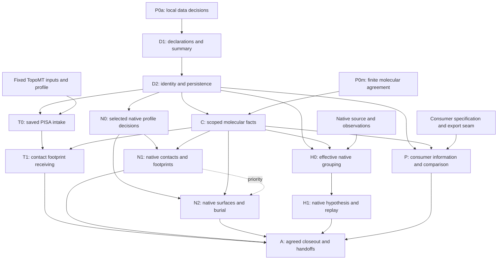

# BindingInterface implementation and work plan

Owner: [BindingMT #112](https://github.com/uibcdf/bindingmt/issues/112).
Recorded and reviewed: 2026-11-12. Work-plan revision **4**.
Status: **first native Cartesian contact/footprint source profile delivered; N2 admission next**.
This plan turns the [reviewed second design](binding_interface_design.md) into
bounded, independently useful implementation and receiving increments. It is
the interface counterpart of the [BindingSite work plan](binding_site_implementation_plan.md),
not a package version, shared-schema freeze or release schedule.

The maintainer requests a third revision incorporating TopoMT's native catalogue,
followed by a fresh reading of the complete proposal and a fourth revision.
The [initial work plan at `dd089db`](https://github.com/uibcdf/bindingmt/blob/dd089dbb096c1b8b1fa20c55317cf8d47a769de2/devguide/binding_interface_implementation_plan.md)
remains the historical baseline. [Work-plan revision 2 at `d69315d`](https://github.com/uibcdf/bindingmt/blob/d69315dfebc49ddd8c2da1999955edc078fd8893/devguide/binding_interface_implementation_plan.md)
supplies derived-footprint persistence, crossed outcome/availability/current-use
controls, overlapping-group coverage and deterministic membership/map ordering.
This revision retains them and adds the ordinary native contacts and surface
calculation route. The scientific information model remains design revision 2;
the calculation roadmap is extended explicitly rather than inferred from its
old PISA example. This increment executes no proposed API or molecular calculation.

The [third revision at `66d8ba9`](https://github.com/uibcdf/bindingmt/blob/66d8ba9ed19026ef7431aacf155d54f1eb069778/devguide/binding_interface_implementation_plan.md)
was preserved before a second complete post/proposal reading. The
[fourth-revision review](binding_interface_plan_review.md) records coverage of all
source sections, catalogue entries and independent controls, identified gaps and
the corrections below. This fourth revision is the maintained work order;
favorable planning evidence is still separate from actual scientific receiving.
The final TopoMT, PharmacophoreMT and PeptideMT responses to source `a3d8476`
are recorded below. Their acceptance details remain within revision 4; they
request no further general design iteration. The
[readiness assessment](binding_interface_plan_review.md#8-sufficiency-for-the-agreed-implementation-programme)
identifies what can start and which finite decisions/inputs still precede use.

The [first implemented data profile](binding_interface_data_core.md) closes P0a
for declaration/persistence, with actual public APIs and bounded source receiving.
The [native contact admission/receiving](binding_interface_contacts.md) now closes
the selected N0/C/N1 source profile, including independent footprints. Surface,
typed-provider, installed/public and consumer profiles keep their gates.

## 1. Assessment of the second review and starting evidence

The reviewed scientific source is revision 2 at
`5aa21b1aaf27ee7708e5a7bb4fe58bd0300d49f0`. The later `e05a622` checkpoint
records publication/waiting state without changing that proposed contract.
All three second-round responses support retaining the architecture and
preparing a bounded implementation plan:

- [TopoMT](https://github.com/uibcdf/bindingmt/issues/112#issuecomment-6834726114)
  identifies no conceptual blocker, supplies exact participant/contact-group
  expectations and confirms failed-capture metadata. It requests a precise
  internal-ZIP versus external-reference distinction.
- [PharmacophoreMT](https://github.com/uibcdf/bindingmt/issues/112#issuecomment-6834704067)
  considers all four previous recommendations addressed at specification level.
  It supports the strict native query proposal while separating exclusivity
  from complete chemical-feature and converter eligibility.
- [PeptideMT](https://github.com/uibcdf/bindingmt/issues/112#issuecomment-6834795711)
  identifies no new planning blocker. It supports the concrete empty-contact
  control and requests a simpler declaration-only example with no implied
  molecular match.

These are favorable design reviews, not frozen public signatures, implemented
compatibility or component adoption. The subsequent bounded MolSysMT offer under
#734 is now published and recorded in section 5.4. Actual client admission,
source/native receiving and operation-specific application choices remain separate.

TopoMT's fixed receiving inputs exist at
`3a8ee979db8de6f6345de74558a878bb96ba3234`. Its expectations below are owner-
supplied artifact inspection, not new BindingMT measurements. PharmacophoreMT
`ecd16946` and MolSysMT `ff25f120` remain inspected API/design baselines; the
native pharmacophoric and PeptideMT specifications are offered, with exact
execution inputs still to receive/select. Refresh actual source/native closure
before executed receiving. These identities are not public dependency floors.

### 1.1 Native catalogue contribution and planning disposition

The [new TopoMT post](https://github.com/uibcdf/bindingmt/issues/112#issuecomment-6836773833)
and its [complete proposal at `a13b9b2`](https://github.com/uibcdf/topomt/blob/a13b9b2725bd8a4edd851441d1a5a53720e0f3ea/devguide/binding_interface_native_catalogue_plan.md)
extend the numerical roadmap while retaining the favorable model assessment.
BindingMT leads binding-domain characterization; the first ordinary numerical
milestone is native contacts, followed by surfaces/burial. PISA becomes a separate
optional interoperability/comparison branch, with its previous obligations intact.
The maintained catalogue and work order below are BindingMT's planning authority;
TopoMT's dated contribution retains its identity rather than a second editable
implementation roadmap. Local review remains in
[TopoMT #197](https://github.com/uibcdf/topomt/issues/197); finite shared agreements
belong in [MolSysSuite #195](https://github.com/uibcdf/molsyssuite/issues/195).

During final fourth-revision readback, the later
[TopoMT clarification](https://github.com/uibcdf/bindingmt/issues/112#issuecomment-6837860911)
and [proposal revision 2 at `0400821`](https://github.com/uibcdf/topomt/blob/04008217e6a568213c05d037ebeb6d543ca24803/devguide/binding_interface_native_catalogue_plan.md)
add independent regional physicochemistry under
[TopoMT #198](https://github.com/uibcdf/topomt/issues/198). This fourth revision
receives that clarification as well. Scientific question and actual support,
rather than exclusive ownership of a chemical descriptor name, separate molecular,
regional and association-specific characterization. Native contact/surface
priority and the numerical independence from TopoMT remain unchanged.

The maintainer commissions careful planning revisions here. Native profile/default
admission, owner agreement, code, numerical receiving and consumer adoption remain
separate pending work. This does not make every catalogue candidate a #112,
BindingSite, stabilization or release gate.

### 1.2 Final collaborator responses and recorded disposition

All three responses review work-plan revision 4 at
`a3d84764672849cb9517802eb9640fa5860b7a02`, its completeness review and the
regional-physicochemistry clarification. They support implementation and identify
no conceptual blocker requiring another general design round:

| Component response | Recorded disposition | Concrete remaining contribution |
| --- | --- | --- |
| [TopoMT](https://github.com/uibcdf/bindingmt/issues/112#issuecomment-6838730972) | Closes its current design-feedback round, confirms complementary ownership and native contact/surface independence. | Existing #197 handoff, #198 regional data/public readback and regional chemical/support controls; #60/#61/#62 retain their own scope. |
| [PharmacophoreMT](https://github.com/uibcdf/bindingmt/issues/112#issuecomment-6838729596) | Supports revision 4 and the retained H0/H1 obligations; adds two nonblocking consumer refinements. | Section 12.1 records regional annotation/recognized feature/query-site distinctions and evidence/query-semantic controls. Exact small native H inputs remain to receive. |
| [PeptideMT](https://github.com/uibcdf/bindingmt/issues/112#issuecomment-6838743888) | Supports closing this planning round and progressing through finite admissions. | Section 13.1 records native/derived, sequence/original/local-group and full-system contribution-view cases. Exact inputs and export/result seams remain to receive/admit. |

These are planning dispositions, not executed interoperability or acceptance of
every public field/default. The input outlines are received; their exact fixtures
are still offered work. Record selected-case admissions and any explicit deferral
with owner/revisit conditions. H/P and optional regional refinements do not become
new entry gates for D1/D2 or native N1/N2. #112 remains open for its agreed delivery.

## 2. Useful outcomes and preserved boundaries

The first ordinary user must be able to declare a binding question, request an
admitted native contact calculation, inspect its characterization/limitations,
and save/read both the characterization and its participant footprints without
PISA or TopoMT. The next numerical milestone adds accessible surfaces and burial.
Composing supplied analyses and receiving saved PISA remain useful explicit routes.
Expert inspection exposes exact owner/run/record/occurrence references, selected
contact groups, source/local maps, checks, preconditions and refusal causes.

Preserve the design's ownership and scientific distinctions:

- BindingMT owns the binding question/characterization and its interpretation.
  TopoMT keeps canonical topographic associations/realizations, regional
  physicochemical observations and provider meanings; MolSysMT keeps molecular
  facts/maps/analyses and generic chemical tools; PharmacophoreMT keeps
  native feature, hypothesis and matching semantics.
- Native calculation means BindingMT composes public MolSysMT operations for a
  binding question. It does not mean another contact/surface kernel, a native
  Topography promotion or a fabricated MolSysMT typed-analysis receipt.
- Analysis outcome, artifact availability, current correspondence/applicability
  and biological support are separate dimensions. Completed zero, no supplied
  analysis, original failure, missing proof and contradiction stay distinct.
- Native coordinates remain in MolSys; no second molecular model, trajectory
  store, universal receipt, mutation observer or generic execution framework.
- Interface composition is not a BindingSite subtype, a union of sites, a
  detector run or an intrinsic affinity/quality calculation.
- Core preservation, explicit native recovery, molecular correspondence and
  current-finding applicability retain their separate requirements. Unsupported
  stronger requests refuse without silently returning weaker success.
- Existing problem/result/search-domain behavior and scientific producers remain
  intact. No first-profile success qualifies native Topography, every provider,
  all modalities or scientific energy/biological-interface accuracy.

## 3. First-profile decisions to record

The [data-profile admission](binding_interface_data_core.md#p0a-decisions-closed-for-this-slice)
now fixes the first F1-F6 spellings/defaults and declaration-only identity/format
contract. The contact profile additionally closes the selected F8/F10-F12 public
call, maps, resource and footprint surface. The table retains programme decisions: foreign adapters, footprint
results, quantities and native execution still need their own admission. Do not
infer those later capabilities from the implemented first slice.

| Decision | Proposed first resolution | Closure/evidence owner |
| --- | --- | --- |
| F1: minimal question | Required `question` mapping with `kind="association"` and optional description; participants/grouping identify the contextual endpoints separately. No new global question registry or implied biological observation. | BindingMT closes the initial spelling/admission record; other required kinds are unsupported until admitted. |
| F2: data entry point/result | One useful public declaration/composition operation, working name `characterize_interface`, returning an immutable inspectable result. `BindingInterface` remains a result name, not a class hierarchy requirement. | BindingMT records actual required/optional fields and result methods before code; publish only delivered exports. |
| F3: analysis intake | Optional named analyses/references plus analysis-qualified findings. No supplied analysis differs from a supplied completed-zero carrier. First typed foreign route admits TopoMT ProviderOutput and confirmed ProviderRun failure evidence through the adapter. | Local core contract first; TopoMT adapter agreement before T0 qualification. |
| F4: admitted assurances | Declaration/composition defaults to `preserved_evidence`; the first current-context PISA footprint requires/defaults to its qualified `molecular_correspondence` profile and explicit source. Supplying a molecular handle alone does not upgrade preservation. Initially refuse unqualified `current_finding` explicitly. | BindingMT/affected owners agree meanings; C/T record only the scopes actually qualified. |
| F5: context-policy applicability | Proposed default: no context policy for preservation; ordinary examples omit it and summary says `not_required`, never `match`. An explicitly supplied `require_match` is retained as a request with visible non-applicability, not a performed match. Correspondence normalizes to effective `require_match`. | Close exact defaults/admission in P0a; negative controls prove no inferred check. Additional trust policies remain unsupported initially. |
| F6: identity/version | Exact declaration, owner analysis/run, finding and observation references; faithful copy/read identity; immutable parents and original claim associations. Explicit experimental format/version admission. | Local decision before D1/D2; API-emitted round trips supply later evidence. No legacy missing-version admission inherited automatically. |
| F7: PISA contact requests | Require a nonempty ordered unique selection from initially supported `other-bonds`/`h-bonds`; a combination means union of their mapped endpoint memberships with separate per-group provenance. These owner labels do not define native geometric contact criteria. Reject duplicate/unknown names; additional known owner groups remain explicitly unsupported until admitted. | BindingMT/TopoMT profile, including known-empty, mixed-group, empty-request and unknown-group controls. |
| F8: footprint result | Detached unique original-source indices in ascending order within the identified source atom axis; target-local indices align position by position through the qualified map, without independent sorting. Preserve all contributing contacts/groups, coverage and value state. The actual result has public save/read support; known empty remains evaluated-empty, not a positive region or implicit site. | Close the concrete result/persistence surface before N1/T1 code; exact endpoints, aligned maps, complete contributors and independent saved-footprint readback qualify each actual route. Optional later site construction needs its own admission. |
| F9: failure and recovery | Preserve owner `execution_status="failed"`, `failure_stage="analysis"` and diagnostic references. External absence may remain reference-only; an internally incomplete/corrupt native ZIP fails owner recovery. | TopoMT facts are supplied; T0 tests actual metadata and owner-reader outcomes. Current parser errors never relabel original science. |
| F10: explicit native execution | A separate explicit calculation request invokes selected public molecular tools and returns the same inspectable result model. Composition, summary, copying and core reading calculate nothing. Bind actual entry-point names/defaults before code; a concise routine call and composable expert operations are both required. | BindingMT N0; no speculative public export is added by this plan. |
| F11: initial molecular profile | Two resolved nonempty disjoint participant populations on one explicit Cartesian structure; fixed admitted chemistry, no inter-participant covalent link, implicit reconstruction, completion, relaxation or alignment. Surface occluders are exactly A union B. | BindingMT/MolSysMT close the actual selections, maps, required facts, radius/H rules and refusal contract for N1/N2 separately. |
| F12: definition and execution record | Distinguish observable definition/version, algorithm/backend/version, parameters and scientific resources. BindingMT owns its composed calculation record and references actual owner calls/results; raw arrays do not acquire invented foreign analysis IDs. | N0 records the selected per-entry contract; source/native closure and actual emitted/read records qualify it. |
| F13: burial definition | Retain both participant SASA losses, their sum and an explicitly named optional mean-side convention. Fixed geometry/chemistry/radii/probe and exact output/occluder populations are required. | N2 closes the public owner composition or concrete reusable gap, numerical tolerances and mapped contribution contract before code. |

Optional site links are exact references. No initial live BindingSite object,
site projection or mandatory #111 implementation dependency is required for the
data/native/PISA profiles. Explicit native recovery remains the owner's public operation,
not a hidden side effect of summary, read or composition.

## 4. Dependency order and current status



P0 is an umbrella, not a global barrier. D1/D2 need the minimal local decisions,
not every foreign input or molecular guarantee. T0 needs its TopoMT profile and
owner recovery boundary; T1 closes the molecular rows needed by its footprint.
N0 closes each selected native profile's own facts; the surface contract does
not block N1. The dashed N1-to-N2 edge records delivery priority, not a claim that
geometric contacts are a numerical prerequisite for SASA. Each operation closes
its actual data/context/tool prerequisites; native contacts do not wait for PISA,
chemical recognition, PharmacophoreMT or neutral Topography adoption.
H/P can advance independently with their own sources and public seams. Shared
coordination runs alongside the work and precedes freezing exercised shared
meanings; whole-suite adoption is not a local-core entry condition. C's prerequisites
are the rows needed by the actual operation, not every possible molecular fact.
Arrows into A collect dispositions/evidence for the agreed scope; they do not
make every later consumer profile a prerequisite for a useful data/native checkpoint.

| Increment | Current state | Completion boundary |
| --- | --- | --- |
| P0a | Closed for the first declaration/persistence profile | Actual question/intake/identity/version/default/refusal contract is in the data-profile admission. Later profiles close their own choices. |
| P0m/P0s | Restricted #734 offer and first local native contact source receiving delivered | Actual shared/consumer-wide acceptance and remaining surface facts stay under #195 and their owners. |
| P0t | Fixed artifacts and expectations supplied | Confirm input hashes, carrier/group/participant interpretation and exact first public contract. Not executed client receiving. |
| P0h/P0p | Case outlines received; exact inputs/seams pending | Receive/admit the H and P specifications and independently expected outputs; do not invent fixtures or scientific choices from favorable review. |
| D1/D2 | First experimental data profile implemented and source-tested | Actual declaration/summary, copy/reinterpretation, content integrity and exclusive save/read. No molecular/foreign adapter receiving is inferred. |
| C | Selected Cartesian contact facts/maps received | Exact public calls, tested source/frame/maps and caller preconditions are in the contact contract. Foreign/current-finding assurances remain unqualified. |
| N0/N1 | First bounded native source profile implemented and received | Actual MolSysMT contacts/distances, group witnesses and independent positive/empty footprints, without PISA/TopoMT. Larger profiles and installed/public receiving remain separate. |
| N2 | Next numerical milestone planned | Public owner SASA composition, both side losses and mapped contributions, convergence and honest readback/refusal. |
| T0/T1 | Runtime pending | Actual saved analysis intake and exact participant-contact footprint/replay, including adverse controls. |
| H0/H1 | Inputs and runtime pending | Effective grouping, native construction, observation/site correspondence and native saved replay. |
| P | Input/seam and runtime pending | Actual K/N payloads, native/derived-context and comparison controls under a declared policy. |
| A | Evidence pending | Declared acceptance scope, exact evidence, shared disposition and per-consumer follow-ups are recorded honestly. |

## 5. P0: finite decisions, owner inputs and coordination

### 5.1 Local data contract

Record F1–F6's core decisions in the design/owning record. Specify required
versus optional fields, accepted references, safe unknowns, identity/parent
semantics, quantity/version rules and actual summary/save/read surface. Candidate
records help decide this contract; handwritten records are not later evidence
that the API emitted a compatible format.

For the proposed first core, require the minimal question, at least two declared
participant references and explicit nonempty grouping using known local IDs.
Analyses, site links and resolved molecular context are optional for preservation;
missing source/coordinates remain explicit. A stronger operation supplies its
required source/structure/state facts. Overlapping underlying molecular membership
is not a universal core error; the chosen PISA/native projection profiles impose
their own actual participant/selection eligibility.

Reuse existing local argument/diagnostic/quantity and file-lifecycle patterns.
The current private `validate_schema_version` admits missing-version legacy
1.0 for existing record types; that is not automatic policy for a new interface
record. Do not change unrelated record admission to simplify the new reader.

### 5.2 Molecular and shared agreement

Use the design's [fact/check/precondition matrix](binding_interface_design.md#102-fact-check-and-caller-precondition-matrix)
as the finite request. For each selected operation retain the public owner call
and source revision, actual checked facts/coverage, remaining preconditions,
check/use lifetime and outcome for absence/contradiction. Matching counts,
labels, a handle or a content digest alone is not universal correspondence.

Search/reuse owning MolSysMT and MolSysSuite topics before opening a new one.
Before concluding absence, acquire the complete declared repository/endpoint/
state/filter scope through all pages using qualified owner tooling. A bounded
search helps discovery, not an absence claim. Report concrete provider gaps in
their owner with consumer evidence and link the local workaround/removal condition.
MolSysMT #624 and TopoMT #60/#61/#62 retain their broader separate scopes.

Coordinate exercised native definitions/maps/quantities/attribution and receiving
in [MolSysSuite #195](https://github.com/uibcdf/molsyssuite/issues/195); record each
actual owner decision and consumer state there. Completed identity/domain receiving
under #190 is historical context. Check participating worktrees through the suite's
registered status route before coordinated changes, preserving dirty/human work.
This plan changes no sibling source, environment or native extension.

### 5.3 Inputs and custody

For every receiving profile record producer/source versions, artifact names and
SHA-256, participant/index/structure/state/frame associations, requested route,
independent expectations and scope limits. Distinguish offered, received,
admitted, executed and qualified. A delayed H/P input does not block D/T.

TopoMT's frozen input set is already supplied; receive it without regeneration.
PharmacophoreMT supplies a native source/analyses and expected grouping/reuse/
alternative/refusal outcomes. PeptideMT supplies K/N/native-derived/comparison
specifications and the actual export seam. Missing choices remain owned pending
items, not invented molecular preparation, site or threshold selections.

Native controls use separately authored small molecular inputs and independent
geometric/analytic expectations, acquired through public MolSysMT construction.
Freeze exact populations, parameter/resource identities, unit policies and
tolerances before interpreting outputs. An owner artifact reused as an input
does not make its PISA answer the definition of a native expected result.

### 5.4 Restricted MolSysMT operation offer received

[MolSysMT #734](https://github.com/uibcdf/molsysmt/issues/734) is closed for its
finite owner review. Its [contract at `04bf561`](https://github.com/uibcdf/molsysmt/blob/04bf56131fd0cea94359e1f0f9307d0f0e36b3cb/devguide/native_interface_contacts_sasa_contract.md)
and [source receiving receipt](https://github.com/uibcdf/molsysmt/blob/04bf56131fd0cea94359e1f0f9307d0f0e36b3cb/devtools/data/native_interface_handoff_receiving_734_20261112.json)
offer existing operations for the restricted first Cartesian contacts and
bundled-element-vdW SASA profile. No new generic operation gap is established
for that profile; client code should compose the supplied public route.

| Supplied boundary | Facts to preserve in the local profile |
| --- | --- |
| Contacts/distances | The explicit all-cross-pairs mode is `pairs=False`; pair-output representation is a separate option. The predicate includes equality without silently added tolerance. Input-system atom indices, requested axes and original-source labels remain distinct. |
| Extraction/correspondence | Extraction sorts retained source atoms. Public permutation and map composition recover admitted local order, with aligned source-sorted footprints, explicit source structure 2 -> local 0 and retained state association. Checked map consistency does not authenticate arbitrary foreign molecular assets. |
| Native surface contexts | Extract A, B and A union B from one admitted source structure, retaining actual maps/geometry/chemistry/radii. Output selection preserves all input occluders. The actual radius route is the bundled element-vdW table; arbitrary radius arrays or ProtOr selectors are not `get_sasa` arguments. |
| Consumer choices/limits | BindingMT chooses cutoff, probe/sampling, numerical/convergence and positive-loss criteria, result fields/persistence and use guarantees. Fixture values/tolerances are not scientific application defaults. Alternate radii, periodic/GPU/covalent/large-input profiles need their own agreement. |

The provider reports 104 selected source cases, including 16 new controls, with
zero warnings/skips, and retains failed pilot/launcher attempts in the receipt.
The reviewed runtime source is `501e02b40e409ad08fda2885a143e8fda6897dbd`;
the critical operation files match the inspected `ff25f120` baseline. The reported
unchanged native SHA-256 is
`4ffb82e4250a1862fff17dbe7725fb8f0770d613ffef2648370389a66983d345`.
Those are owner evidence, not measurements or installed acceptance in this checkout.
Verify actual source/import/native identity and admitted conditions before client
execution; this recording reinstalls or rebuilds nothing.

Accept the restricted offer as the basis for N0/C, then qualify BindingMT's actual
composition and saved results. MolSysSuite #195 remains partial for client/shared
agreements and receiving; the closed provider issue is no longer a reason to wait
for an unspecified new tool. D1/D2 needs neither those molecular calls nor H/P inputs.

## 6. D1: declaration, analysis outcomes and ordinary inspection

Deliver one complete public data slice, then its D2 round trip before expanding
every convenience factory. Expected code areas are core/public exports, owned
argument contracts/diagnostics and focused tests; the module split is an
implementation choice, not one class per record role.

The core must preserve:

- Question, participants/grouping, explicit declared/inferred status and exact
  source/context references without requiring coordinates or optional providers.
- Analysis presence and original outcome independently of findings: no supplied
  analysis, supplied analysis with unresolved outcome, completed nonempty,
  completed zero and confirmed original failure retain their distinct meanings.
- Native-asset availability/recovery and current application assessment as
  separate axes. A reference-only carrier can retain a known original outcome;
  wrong current context does not rewrite it. Unknown original outcome stays
  unknown even when an asset is present or has a valid checksum.
- Detached ownership and a useful actual `summary()` identifying the question,
  original analysis/outcome, available findings/footprints, coverage, checks and
  remaining limitations. Summary performs no detection, lookup or recovery.
- Preservation-only inspection showing molecular matching as `not_required`.
  A policy label alone never produces a performed check or successful match.

Caller-authored analysis descriptors retain their declared authority. Construction
or successful JSON admission does not turn them into owner-verified outcomes;
native receipts in T0 retain exactly what the owner recovered/checked.

Use existing ArgDigest/SMonitor/PyUnitWizard integration rather than a competing
validator, unit codec or generic provenance service. Add no empty future classes.
The root's existing core dependencies remain required; do not promise import of
BindingMT without MolSysMT merely because the new record is data-only.

**Exit:** an ordinary user constructs and inspects a meaningful declaration and
analysis-level cases through actual public APIs. Tests inspect independent
expected fields, reject malformed known inputs and prove inputs/old evidence
are unchanged. No native adapter or biological claim is implied by labels.

## 7. D2: immutable identity, references and safe persistence

Implement faithful copy/read identity, exact analysis/run/finding/occurrence
references and bounded immutable derivation. Reinterpreting evidence retains
its original claim/context association and adds an explicit new interpretation;
it creates no new measurement or automatic independent support.

Emit an explicit experimental versioned record with required discriminants,
shared sealed quantities and receiver field/unit/dimension handshakes. Preserve
optional namespaced owner data without dynamic imports. Unsupported required
semantics refuse typed admission or the affected operation. Hashes identify
content, not chemical/biological equivalence.

Save/read must use exclusive creation by default, preserve an existing valid
file on failure, detach recovered data and perform no automatic asset lookup,
engine invocation or restoration of active application settings. Native artifacts
keep their owner persistence; local references are exact and bounded, not a
recursively embedded scientific history or duplicate molecular trajectory.

Exercise two distinct missing-data boundaries:

| Boundary | Required outcome |
| --- | --- |
| External native artifact referenced by an admitted BindingMT record is absent | Default read performs no availability probe. Core evidence remains readable, including a sufficient saved footprint; explicit recovery/application needing the absent asset refuses, retaining the reference and original outcome. |
| A native TopoMT ZIP lacks an internal manifest-declared artifact or has corrupt/unsafe data | Owner recovery fails. No partially recovered native result, completed-empty analysis or unknown-success downgrade. |

### 7.1 Crossed states and historical checks

Record original scientific outcome, asset-check/recovery result and current-use
assessment separately, with their own authority/context. A saved check receipt
retains its original scope and time; reading it does not perform that check on a
new live system. Ordinary summary distinguishes that historical receipt from
an assessment of the current application, without silently rewriting either.
Default core read neither finds assets nor checks source correspondence.

Use crossed controls rather than testing each dimension only in isolation:

| Preserved evidence and present condition | Required read/recovery/use behavior |
| --- | --- |
| Completed-zero analysis; external native asset has since disappeared | Core read preserves completed zero and its original authority. Only an explicit availability/recovery operation discovers the absence; required recovery refuses. Neither a positive footprint nor original calculation failure is invented. |
| Confirmed original failed capture; capture is available and integrity checks pass | Preserve original failure, stage and diagnostic references. Successful access to the capture is not a successful scientific ProviderOutput. |
| Completed nonempty analysis; a proposed current source contradicts the saved context | Core preservation succeeds; the affected correspondence/application refuses with its actual cause. The original analysis remains completed. |
| Saved `match` for context C0; a relevant source edit yields C1 before fresh-process read/use | Read retains the scoped C0 receipt as history, not a current C1 guarantee. Explicit stronger use reassesses its required facts or refuses; it does not reuse a label as proof. |
| Known original outcome; referenced native ZIP is internally incomplete/corrupt | Core evidence and original outcome remain inspectable. Explicit native recovery fails without a partial native result; no current parser error is relabelled as original scientific failure. |
| No supplied analysis; a plausible asset happens to exist nearby | Preserve no-analysis status. No automatic file discovery, detector call or inferred outcome. |

An unresolved external reference can therefore coexist with a known original
outcome. Conversely, accessible bytes need not establish that outcome. Biological
support remains a separate scientific interpretation, unaffected by successful
I/O or matching. Inspect original and recovered records to prove these axes and
their historical receipts survive copy/save/read without unwanted I/O.

At D1/D2, admitted declared carriers and historical check metadata exercise
faithful storage, no lookup and no inferred active assessment under their actual
declared authority. Actual owner recovery and molecular refusal are qualified
later in T0/C/T1 with those implementations and inputs. The crossed matrix does
not make native recovery or molecular checking a new prerequisite for D2.

**Exit:** real API-emitted declarations and all analysis outcomes survive
copy/save/read/revision with original contexts, producer/quantity meanings and
honest unknowns. Malformed/tampered/unsupported cases and I/O failures preserve
source data. Fresh core readback needs no original optional scientific engine,
GPU/network or foreign reader unless native decoding is explicitly requested.

## 8. C: scoped molecular correspondence and use boundary

Implement only the admitted facts required by the first operations. Delegate
selections, source/local correspondence, chemistry and coordinates/transforms
to public MolSysMT operations. Keep performed checks, coverage/authority and
caller unchanged-input preconditions separate. Unknown required proof refuses
the stronger use; do not mark it checked because an ID or shape matches.

The saved PISA footprint uses the complete matching original source and saved owner
selection/frame/reference-state context. No overriding that reader context to
transfer a finding. Nonidentity atom/structure maps and original 2 → local 0
belong to separately identified native/derived controls when the frozen PISA
source does not itself exercise them. Do not alter the frozen source and claim
the same saved source-bound recovery.

Native N1/N2 instead check their actual selected molecular input, output and
environment populations. Preserve original/local atom and structure maps,
chemistry/radius policies and effective frame/image. Eligibility follows the
selected native profile, without imposing PISA's complete-source recovery rules
on every independent calculation or weakening either route's requirements.

Check the actual selected/exported input at use, retaining normalization maps.
A relevant coordinate/chemistry/member edit between checks and application needs
reassessment or refusal. An unaffected historical observation remains on its
own context under its actual dependency guarantees. No generic observer or
atomic behavior under concurrent edits is promised.

A stored `match` is evidence about its checked source/context, coverage and
preconditions, not a persistent guarantee for an arbitrary recovered handle.
On a new use, check the admitted facts again or demonstrate the admitted unchanged
immutable-input closure explicitly. A default read has no active molecular-use
assessment. Retain historical source/local maps as historical maps; do not apply
them to a changed target merely because they round-tripped. Edit controls change
facts relevant to the admitted profile; unrelated evidence keeps its own actual
dependencies rather than being invalidated wholesale.

`current_finding` remains unsupported until its full producer input/query and
lifetime facts are independently qualified. Footprint positions alone are
insufficient. Scope admission and requested/effective context policy are visible
in the public result, including `not_required` in a preservation-only request.

A newly requested native calculation records what actually ran on its admitted
input/context and the facts checked for that profile. It does not need a blanket
imported-finding revalidation claim, and does not upgrade another preserved
observation. Before child calls, establish a stable owner-supported input or
record/test the exact unchanged-input preconditions. N2's isolated/combined inputs
must come from that same qualified baseline. Recheck or refuse a contradictory
required fact; concurrent mutation is not made atomic by a digest or observer.

**Exit:** matching, missing-proof, contradictory and unsupported cases produce
their actual diagnoses; nonidentity/source-local and relevant-edit controls pass
under the admitted profile without changing historical evidence.

## 9. N0/N1/N2: native characterization catalogue and calculations

### 9.1 BindingMT catalogue and staged admission

This is the maintained BindingMT catalogue. Entry identifiers are descriptive,
independent of display order and not frozen callable names. Separate observable
definition/version from algorithm/backend/version, effective parameters and
scientific resources. A change of meaning needs a new definition version and an
explicit compatibility decision; two algorithms targeting the same observable
do not acquire numerical equivalence by sharing a name.

| Candidate entry | Scientific meaning and owner boundary | Planned admission / later trigger |
| --- | --- | --- |
| `atomic_contacts` | Exact inter-participant atom pairs, distances and counts under an explicit geometric predicate; public MolSysMT geometry. | N1 first native calculation. |
| `residue_contacts` | Unique residue/group-pair reduction and participant populations, retaining atom witnesses and MolSysMT grouping. | N1 with an admitted reduction/count policy. |
| `contact_footprints` | Each participant's unique contacted atoms/residues and all contact contributors. | N1; public independent footprint persistence required. |
| `steric_overlaps` | Radius-model-dependent overlap witnesses and summaries, distinct from a contact cutoff. | Later geometric profile once radii and independent controls are admitted; no quality verdict. |
| `solvent_accessibility` | Atomic/aggregated SASA with explicit output and occluder populations, probe and radius model. | N2 using public MolSysMT SASA. |
| `interface_burial` | Both participant SASA losses, total loss, optional mean-side convention and mapped contributions. | N2 after the owner composition/decomposition contract closes. |
| `chemical_interactions` | Family-specific admitted chemical observations, retaining chemistry, effective state, recognition coverage and original occurrences. | Each selected MolSysMT family needs its own native receiving; distance alone admits no chemical classification. |
| `physicochemical_partition` | Explicit chemical-class counts or area contributions over a named membership/measure. | Owner classifications plus BindingMT association-specific aggregation or qualified TopoMT regional observations; admit scope, overlap/additivity and denominators first. |
| `buried_unsatisfied_polar_sites` | Buried recognition sites lacking an evaluated partner under a stated chemical/environment criterion. | Require qualified burial, complete recognition chemistry and evaluated partner coverage; unavailable analysis is not negative evidence. |
| `interaction_network` | Residue/group edges and scoped connectivity descriptors derived from explicit observations. | Admit edge definitions, multiplicity and comparison policy; no automatic affinity prediction. |
| `topographic_organization` | Supported patches, gaps, concavities, cavities, channels or accessibility related to the binding question. | Optional qualified TopoMT support/context/relations; existing #60/#61/#62 gates apply. |
| `topographic_physicochemistry` | Spatial chemical character on an identified topographic support, including eligible region-facing contributions and chemical patches. | Independent TopoMT #198 capability; BindingMT receives qualified references when useful, while MolSysMT retains generic chemical tools. Not a native N1/N2 prerequisite. |
| `geometric_complementarity` | An explicit fit/orientation/separation measure on admitted geometric supports. | Later TopoMT-supported surface model, numerical reference and comparison-eligibility profile. |
| `pose_comparison` | Differences between compatible contact/surface/topographic observations. | Exact observable, correspondence, coverage and normalization; distinguish poses of one pair from different partners. |
| `ensemble_statistics` | Per-structure observations and later contact/burial persistence summaries. | Sampling, structure correspondence and weighting qualification; frame frequency is not automatically a thermodynamic population. |
| `energetic_observables` | A specified energy or thermodynamic endpoint under an admitted method/model. | Separate process, states, conditions, uncertainty/convergence and method-owner receiving. |
| `assembly_inference` | A stated model's assembly or biological-interface inference. | Separate future decision and predictive validation; descriptive contact/area evidence does not admit it. |

BindingMT owns these binding-domain definitions/compositions; molecular and
topographic numerical kernels/resources keep their respective owners. Selected
N0/N1/N2 work is bounded below. Other rows remain explicit candidates in #112,
with the trigger above; create an independently closable issue or bounded #112
part when selected. Their presence here requires no placeholder code or global
plugin/schema framework, and does not turn them all into initial delivery gates.

### 9.2 N0: public request, context and exact owner route

Close F10/F11/F12 for contacts before N1 and F13's additional surface facts before
N2. Ordinary users request a small named calculation set through one concise
operation and inspect/save the returned characterization. Experts can compose
operations and inspect definitions, parameters, original owner outputs, maps,
contributions, checks and limitations. Neither route requires manually building
a persistence record. Keep calculation explicit and composition faithful.

The proposed first native request policy is a nonempty ordered unique set of
known admitted calculations. Reject explicit empty, duplicate or unknown requests
before scientific child calls; a known unavailable method has its explicit
unsupported/capability outcome. Settle omitted-argument behavior under N0: an
admitted documented finite default profile or a required argument, never an
empty successful calculation or automatic dispatch to PISA/topography. Record
requested and effective calculations/parameters and required/optional children.

The first native profile uses one chosen Cartesian structure and two resolved,
nonempty, disjoint participant populations A/B. Require admitted reference
chemistry and explicit hydrogen/radius policies where relevant. Exclude
inter-participant covalent links. Preserve the coordinates; perform no implicit
completion, relaxation, alignment, crystal expansion or periodic reconstruction.
For N2 the environment is exactly A union B. Solvent, cofactors, metals, ions and
other chains require explicit inclusion/interpretation under a supported profile,
never silent stripping or inferred experimental conditions. Missing required
radii or unsupported chemistry refuses the affected calculation, not zero area.

Retain resolved effective selections, source occurrences, original/local atom
and structure maps, state/frame/image, effective parameters and check coverage.
Required missing/contradictory facts refuse the requested operation. A raw owner
array/pair result does not certify those facts or become an invented owner-native
Interactions/analysis object. BindingMT records its actual composed calculation,
producer and child calls; owner analysis references are present only where real.

Record requested versus required/optional observations, evaluated coverage and
per-child outcomes. A failed required child cannot yield an apparently complete
successful characterization. Preserve genuinely completed children and their
attribution; an admitted partial result exposes each omission and its application/
comparison limits. Unknown, unrequested, undefined, unsupported and failed values
remain distinct from a computed zero. No single quality/validity scalar replaces
these facts.

Inspected MolSysMT baseline `ff25f120243319ca9515009b4971e24a2eb0dc22`:

| Public operation | Starting capability / admission boundary |
| --- | --- |
| [`structure.get_contacts`](https://github.com/uibcdf/molsysmt/blob/ff25f120243319ca9515009b4971e24a2eb0dc22/molsysmt/structure/get_contacts.py) | Geometric map/pairs and explicit endpoint/index controls; pair output still retains a resident Boolean map. It does not itself return a complete typed scientific receipt. |
| [`structure.get_distances`](https://github.com/uibcdf/molsysmt/blob/ff25f120243319ca9515009b4971e24a2eb0dc22/molsysmt/structure/get_distances.py) | Public exact endpoint-distance route; close the paired/index/frame contract if used to retain contact distances. |
| [`structure.get_neighbors`](https://github.com/uibcdf/molsysmt/blob/ff25f120243319ca9515009b4971e24a2eb0dc22/molsysmt/structure/get_neighbors.py) | Candidate public CSR neighbor route with distances; qualify eligibility, threshold and source/local index semantics before selecting it for a larger population. |
| [`physchem.get_sasa`](https://github.com/uibcdf/molsysmt/blob/ff25f120243319ca9515009b4971e24a2eb0dc22/molsysmt/physchem/get_sasa.py) | Shrake-Rupley native surface route with probe/sampling/periodic controls. Selection filters output while every input atom remains an occluder. |
| [`physchem.get_area_buried`](https://github.com/uibcdf/molsysmt/blob/ff25f120243319ca9515009b4971e24a2eb0dc22/molsysmt/physchem/get_area_buried.py) | Rose tabulated residue descriptor; not the conformational interface burial needed here. Tabulated surface descriptors likewise do not substitute for SASA. |

These are inspected sources, not minimum dependency versions, installed/native
qualification or accepted public call recipes. Refresh exact source/native/import
origins before receiving. Use existing public tools if sufficient; hand a concrete
generic molecular/decomposition gap to MolSysMT before a consumer workaround.
Keep the actual exercised agreement and owner disposition in MolSysSuite #195.
The source table above preserves the inspected starting point. Section 5.4 now
supplies an owner-reviewed restricted call route; use it for the first bounded
receiving before selecting a separately qualified neighbor/alternate profile.

#### N0 admission record for each selected calculation

Close this finite documentation record before the corresponding code/receiving;
it is not another shared receipt class or a universal schema framework.

| Required decision | Recorded evidence and closure |
| --- | --- |
| Observable | Definition ID/version, question, formula/predicate, physical units and supported domain; distinguish algorithm/backend/version and parameters. |
| Populations | Resolved participants/grouping, output granularity, all occluders/environment, structure/state/frame/image and requested/evaluated coverage. |
| Molecular facts | Exact source occurrences and atom/group/structure maps, performed owner checks, authority and remaining caller preconditions/lifetime. |
| Actual public route | Named owner calls and effective arguments/defaults, original outputs and real owner references where present; actual BindingMT composition identity. |
| Numerical/resources | Required radius/H/chemistry models, probe/sampling, source/version/digest/acquisition terms, independent tolerances, backend/fallback eligibility and monitored memory/CPU envelope. Mark irrelevant facts `not_required`. |
| Outcome and partial work | Required/optional children, computed nonzero/zero, unevaluated/unavailable/undefined/unsupported/failed causes, preservation of completed children and limits of an admitted partial result. |
| Portable result | Actual result/footprint fields, quantities, ordered membership/aligned maps, all contributors and exact parents, public safe save/read and historical/current-use distinction. |
| Qualification/ownership | Frozen inputs and independently authored expectations, actual future guard selection, source/native identity, offline bibliography/real attribution controls, owning issue, admission status and revisit condition. |

Required molecular facts remain operation-specific:

| Operation | Facts needed before use | Facts outside that operation's entry gate |
| --- | --- | --- |
| D1/D2 preservation | Admitted declared fields, identity/version/quantity and safe I/O rules. | Native execution, live correspondence and foreign recovery. |
| N1 geometric contacts | Actual A/B populations, one qualified Cartesian input, finite coordinates, criterion/boundary, frame/state/map facts required by that profile. | SASA radii/probe, donor/acceptor recognition and TopoMT/PISA. Do not silently turn surface/chemical completeness into a geometric prerequisite. |
| N2 surface/burial | N2's own source/maps, unchanged geometry/chemistry/radii, exact output/occluder populations, probe/sampling and admitted owner construction/SASA route. | A prior contact result or every later chemical/topographic analysis. |
| T0/T1 saved PISA | Its real owner carrier, source-bound recovery/context and required complete original source/correspondence. | Qualification of every independent native descriptor. |
| H/P profiles | Their selected native chemical/consumer facts, complete recognition participants or actual export/comparison seam as applicable. | Universal adoption of all catalogue families. |

N0 closes only the rows/fields exercised by the selected operation. Its contact
contract can be completed while the surface/decomposition agreement is pending.
Handwritten records and source signatures help decide admission, but never count
as API emission, actual checks or received owner/native compatibility.

### 9.3 N1: native contacts, residue reduction and participant footprints

The first bounded [contact profile](binding_interface_contacts.md) now delivers
this source milestone using real MolSysMT operations, sealed quantities and
independent positive/empty footprint persistence. The requirements below retain
their scientific meaning and scope; no large-input/provider-wide qualification
is inferred from the tiny native controls.

Request the selected geometric criterion on the actual A/B populations, with an
explicit distance cutoff, inclusion/tolerance, Cartesian policy and index/frame
semantics. Do not inherit generic owner defaults as an unstated scientific
definition. Preserve pairs and distances; state whether counts mean unique
cross-participant pairs, directed occurrences, contacted atoms or unique
residue/group pairs. A chemical interaction or radius overlap remains distinct.

Grouping selects the consumed pairs: internal participant observations and
unrelated C-D contacts cannot enter an A-B characterization. Repeated selections
or copied observations cannot create extra atoms/independent evidence; retain
meaningful request/delivery multiplicity separately. Derive residue/group results
through owner correspondence and an admitted aggregation policy, preserving all
atom witnesses and contributor identities.

Return detached participant footprints under F8's canonical source order and
position-aligned local maps, retaining every contributor and exact parent/criterion.
Two nonempty participants with no contacts yield completed evaluated-zero analysis
and empty footprints. Empty/unresolved required participants, unsupported criteria
or a failed numerical child retain their different outcomes. No positive site,
continuous patch, biological association or binding strength is fabricated.

Before a cell, estimate map/output/child working memory, including pair boxing and
coordinate preparation. Select bounded inputs; admit a public owner neighbor route
where its semantics and resource behavior are qualified. Do not duplicate a search
kernel in BindingMT or equate a provider allowance with RSS/reserved system RAM.
Larger-system performance needs its own measured evidence.

In particular, a CSR selector is not proof that every eligible/edge request avoids
a dense intermediate. Qualify the chosen public route's index labels, strictness,
zero-cutoff/other fallback behavior, output multiplicity and working memory against
the same independent contact definition. Record actual dispatch. A fallback must
retain the admitted meaning and resource envelope; otherwise refuse before the
expensive call or use a separately qualified bounded request. No silent weakening
of a requested guarantee or hidden all-core/GPU setting is admitted.

**Exit:** actual public native calculation -> characterization -> ordinary/expert
inspection -> public save/read, plus the positive/empty footprint's own save/read
and independent core inspection. The native calculation runs with PISA/TopoMT
unavailable in task-owned isolation. Exact independent contacts/distances,
atom/residue membership/maps/contributors, unit-policy and refusal controls pass.
Data preservation does not claim broad chemical recognition or native Topography.

### 9.4 N2: native SASA, both side losses and mapped burial

For fixed coordinates, chemistry, radii, probe and surface policy:

```text
L_A = SASA_A(A) - SASA_A(A union B)
L_B = SASA_B(B) - SASA_B(A union B)
total_burial = L_A + L_B
mean_side_area = (L_A + L_B) / 2
```

Subscripts identify output populations; parentheses identify all occluders.
Retain both side losses without assuming equality. The sum and optional named
mean-side convention are distinct reports. Preserve per-atom losses and their
residue/group reductions; contributions must sum to their own side and total
within the admitted numerical tolerance. Any positive-area membership threshold
is explicit and distinct from the geometric contact criterion.

Use owner-supported construction of A, B and A union B with exact original maps,
coordinates, chemistry and radius assignments retained. These isolated inputs
are counterfactual calculation contexts, not relaxed unbound molecular states.
Selecting A's output from A+B leaves B as an occluder and does not compute SASA_A(A).
Never silently cap bonds, add H, change protonation or retarget a state. Close the
exact public extraction/SASA composition, or the reusable MolSysMT decomposition
gap, before advertising a new owner API or duplicating a numerical operation.

Qualify the actual atom/structure maps, coordinates, chemistry and radius values
used in all three contexts from the same checked baseline. Retained names/counts
alone do not prove unchanged inputs. Record the real public radius/SASA route
and resource version; do not invent a radius-override argument on an API that
does not expose one. If the required invariance cannot be demonstrated through
the admitted owner operations, retain that profile as pending and hand the
concrete gap to MolSysMT. No consumer table/kernel fills it silently.

Record probe/radii identities, sample points/resolution and convergence controls.
Rigid rotation preserves a sampled estimate only within its justified tolerance;
convergence is not universally monotonic. Diagnose unexpected negative losses
rather than silently clamping inconsistent or numerically unresolved values.
An unknown radius/failed child does not become successful zero burial.

Keep raw mapped losses and numerical status when a value falls within an admitted
error band or violates expectations. Separate error tolerance, classification
threshold and any reported scientific uncertainty; do not invent confidence from
sampling count. An optional area-derived footprint requires its own admitted
membership criterion and F8 save/read, separate from the contact footprint.

Later environment-aware burial can compare A+C with A+B+C under another admitted
definition. Pairwise contributions in a multimolecular assembly need not add up
to a joint measure; geometric nonadditivity does not establish cooperativity.
Area contributions and contact counts are not energetic hot spots.

**Exit:** the real public owner composition yields both side losses, atomic/group
contributions, explicit total/mean conventions and numerical error/convergence limits.
Analytic references, environment/output-selection controls, missing-radius/refusal,
normal/pm-fs quantities and independent persisted readback pass. Native surface
receiving is separate from source inspection or agreement to use a known method.

### 9.5 Independent native receiving controls

Freeze inputs, exact criteria, numerical tolerances and independent expectations
before interpreting outputs. This table describes future meaningful guards,
not tests delivered by a Markdown document or reasons to run a scientific suite now.

| Control | Independently justified required result |
| --- | --- |
| Geometric contact reference | Hand-specified coordinates give exact inside/on/outside-cutoff pairs and distances, with exact source membership and declared boundary behavior. |
| Participant exchange | Under the admitted symmetric predicate, unique total contacts remain equal and participant footprints exchange through their maps; do not extend this to directional chemical roles. |
| Separated populations | Evaluated-zero contacts; zero burial only where the surface assumptions establish no cross-occlusion. Preserve completed-empty evidence. |
| One sphere | SASA matches `4*pi*(radius + probe_radius)**2` within the admitted error under the supported atomic/radius construction. |
| Two spheres | Analytic cap, containment and separation controls qualify the surface recipe independently of PISA. |
| Surface aggregation | Atomic/group contributions sum to each side and declared total/mean; fixed-sample added occluders cannot increase an atom's accessible fraction. |
| Sampling and rotation | A declared sampling sequence bounds error against independent references; no assumed universal monotonic convergence or exact rotational invariance. |
| Output versus environment | Output selection keeps full occlusion; isolated-input construction changes occluders deliberately while preserving source/maps/chemistry/radii. |
| Grouping/completeness | Actual consumed pairs exclude unrelated/internal observations; chemical profiles separately retain complete recognition participants. |
| Outcome distinctions | Completed no-contact, no analysis, unrequested, missing chemistry/radii, undefined, unsupported and failed calculations retain causes rather than fabricated zeros. |
| Maps/multiplicity | Reordering/extraction, original structure 2 -> local 0 and repeated delivery retain actual correspondence without extra independent support. |
| Footprint persistence | Actual positive/empty footprint records retain source order, aligned maps, every contributor and exact parents through independent core readback. |
| Crossed states | Completed zero with an unavailable asset, accessible failed evidence and historical C0 match/current C1 contradiction retain distinct outcomes; default read performs no discovery/reassessment. |
| Relevant edits | Geometry/chemistry/member/frame changes reassess the affected use; unchanged footprint positions do not verify an entire original calculation. |
| Units and admission | Ordinary and pm/fs policies preserve physical distances/areas, definition/producer identities and reader field/dimensionality checks; tampered/malformed records refuse. |
| Optional dependencies | Real native contacts/surface calculation succeeds without PISA/TopoMT; optional enrichment/recovery retains explicit dependency routes. |
| Attribution | Actual completed branches, evaluated-empty, enclosing workflows, reuse, optional absence/failure and fresh readers preserve reached methods without inventing a new originating execution. |

Also qualify native request admission before child execution (empty/duplicate/
unknown requests, invalid required coordinates/parameters), actual sparse/dense
fallback eligibility and resource refusal. Reader controls validate length fields
as `[L]`, areas as `[L]^2`, counts as counts and actual field identity through
PyUnitWizard. pm/fs is a receiving policy, not an excuse to fabricate a time
observable. Preserve known original definitions/units alongside standard values.

#### Ordinary and expert acceptance workflows

An ordinary user supplies a MolSys context, participants and one admitted contact
profile, receives an actual calculation result and sees the criterion, contact
counts, both footprints, completion/coverage and limitations in a concise summary.
They save/read the result and a footprint without owner recovery or recomputation.
Unavailable optional descriptors remain visibly unrequested/unavailable. The test
uses real public calls and emitted summaries/records, not an authored JSON facade.

An expert selects the surface profile and can trace each side loss to isolated/
combined inputs, original/local maps, unchanged radius/probe/sampling definitions,
per-atom/group contributions, exact child calls, numerical controls and attribution.
They can inspect or compose existing evidence without triggering calculation.
Counter-controls cover unsupported requests, partial required-child failure and
relevant edits; saved history stays intact. Both workflows retain normal/pm-fs
readback and meaningful diagnostics without forcing users into record internals.

Test optional unavailability through task-owned dependency/import isolation that
actually excludes TopoMT/PISA use, while preserving the normal core dependencies.
Do not uninstall packages from the shared prefix. Independent readers perform no
scientific calls, foreign asset discovery or new original-method credit. Apply
D2's exclusive creation, existing-file preservation and detached-copy rules to
the actual emitted native records and footprints as well.

### 9.6 Resources, attribution and later characterization families

Radii, chemical classifications, parameter sets and numerical reference resources
remain versioned in their molecular/specialist owner's normal data route. Retain
scientific meaning, units, supported chemistry, source/version/digest and acquisition
terms. Native baseline resources come independently of a PISA installation. Do
not copy competing tables into BindingMT/TopoMT to cover an unresolved owner gap.

Use existing argument, optional-dependency, diagnostic and quantity tools, plus
the admitted optional Ackredit integration. Retain offline bibliography, method
and implementation versions and only scientific methods actually reached,
including genuinely completed child operations. Executing an implementation of
a published algorithm does not claim execution of its reference program. Core
save/read and reuse preserve original attribution without new calculation credit.
Provider source API presence is not proof of its attribution boundary; report
actual gaps with consumer evidence and qualify real presence/absence/failure.

Later chemical partitions state the measured population, classification overlap,
additivity policy and fraction denominator; zero denominator is undefined where
appropriate. Native interaction/recognition receiving preserves complete chemistry,
actual state and relation occurrences. A network retains edge definitions and
multiplicity; unavailable recognition cannot establish an unsatisfied polar site.
Topographic enrichment retains its exact support/context, classification and
owner gates. Equal coordinates or atom sets do not equate a contact footprint
with a cavity wall; an interface needs neither a cavity nor two DFND banks.

Comparisons state definitions, intentionally differing inputs, correspondence,
coverage, frames and normalization. Ensembles require sampling/weights; energy
and assembly-inference endpoints retain separate models and predictive evidence.
PISA remains a useful optional provider/comparator under its original resource/
licence and source boundaries. Match input/chemistry/radii/surface conventions
before comparison, classify definition/numerical/domain/execution/defect differences,
and independently justify any accuracy/scope/usability/reproducibility/resource
improvement. Similar units do not transfer a PISA score's name or interpretation.
No general superiority, new campaign, DFND case or original-provider run follows
from this plan; TopoMT's existing synthetic sequence remains independently owned.

Keep existing owner destinations explicit: original PISA receiving/artifacts are
[TopoMT #194](https://github.com/uibcdf/topomt/issues/194), broader method/resource/
licence assessment is [#165](https://github.com/uibcdf/topomt/issues/165), and its
synthetic review sequence remains [#187](https://github.com/uibcdf/topomt/issues/187).
No adapter relocation is commissioned. A later change of adapter ownership needs
its own migration decision and consumer evidence. Proposed/shared/native work
under BindingMT #112, TopoMT #197 and MolSysSuite #195 retains separate acceptance.

Report a comparative finding through the owning component and the
[local evidence publication policy](validation/evidence_publication_policy.md),
retaining matched definitions, exact inputs/sources/resources, independent reference,
metric/error or resource envelope and the actual measured result/limits. One
matched PISA value, a greener administrative check or a faster incomparable run
establishes no general scientific advantage. The methods bibliography begins with
[Shrake and Rupley (1973)](https://doi.org/10.1016/0022-2836(73)90011-9) and, for
original PISA/model comparison, [Krissinel and Henrick (2007)](https://doi.org/10.1016/j.jmb.2007.05.022).
Each new admitted descriptor still needs its own primary-method/resource review;
these citations do not qualify the complete future catalogue.

#### Optional regional physicochemistry and association-specific use

TopoMT can characterize the chemical character presented by its own pocket,
wall, channel, protrusion or supported interface without a selected partner.
MolSysMT supplies molecular chemistry/state/annotations and generic tools;
TopoMT relates them to its actual support, distributions and chemical patches.
BindingMT can reuse those qualified observations for a specified association,
occupancy/burial/interaction question or directly compose MolSysMT without a
topographic analysis. Neither layer exclusively owns every chemical aggregate.

Regional receiving retains the actual support, mapped populations, effective
state/classification model, radius/probe/environment, weighting, coverage and
provenance. Atom-count, unique-group and area-weighted fractions remain distinct;
whole-atom SASA is not a regional wall-facing area. A residue-scale approximation
does not establish atom-specific polarity/recognition. Equal global fractions
can hide different spatial layouts; retain distributions where they are claimed.
Unqualified historical helper/renderer scores are not automatically admitted APIs.

An unavailable chemical annotation can coexist with valid geometry, including
synthetic DUM geometry without established chemical meaning. It is not zero
polarity or a new primary feature class. Annotation-only changes preserve the
existing geometric classification when its input dependencies are unchanged;
atom/radius/probe/coordinate changes reassess the affected geometry/use.

When this optional profile is selected, receive real public owner outputs and
save/read with exact references, not copied mutable regional records. Its controls
include mixed chemical atoms within one residue, equal fractions with different
spatial layouts, correct support/denominators/coverage and persisted positive/
empty/unknown results with honest historical checks/attribution. Keep authored
mapping controls distinct from actual chemical receiving. TopoMT #198 owns its
standalone implementation and guards; these later controls do not block N1/N2
or require a new regional registry, reverse import or mandatory TopoMT dependency.


## 10. T0: explicit optional saved-PISA analysis intake

Implement the actual optional TopoMT adapter used by public composition. Guard
and lazily import TopoMT through existing DepDigest integration on that route.
Reading a saved BindingMT record or its owner reference needs no TopoMT engine.
Do not add a mandatory reverse dependency or a new raw XML/ZIP parser.

Use public `tmt.load_provider_output(bundle, molecular_system=complete_source)`
for source-bound positive/empty recovery. For original failure evidence use
`topomt.provider_output.ProviderRun.load` and its confirmed owner metadata:

```text
execution_status: failed
failure_stage: analysis
```

Retain the diagnostic references and exact original outcome. A current parser,
file, integrity or correspondence error is not evidence that the original
scientific calculation failed. A bundle filename or valid checksum does not
establish its scientific outcome. Success carriers preserve their analysis even
when `output.interfaces` is empty; never require a positive record to admit
completed analysis evidence.

Preserve original provider/backend/run identity, scoped record IDs, assembly
policy, saved context, participant/contact/group meanings, known measurements,
units, original bibliography and capability/availability limits. Use attributed
native quantities for interpreted values; unknown raw fields remain opaque.

**Exit:** public import/summary/save/read covers positive, completed-zero,
no-analysis, confirmed failure and unresolved evidence. Contradictory/malformed
required data and incomplete/corrupt ZIPs fail honestly without owner-output
mutation, optional-engine execution or new original-engine credit.

Create incomplete/corrupt archive controls only as named derived test variants in
owned temporary storage; never modify the frozen owner inputs or their hashes.

## 11. T1: exact PISA participant-contact footprint and complete replay

### 11.1 Frozen inputs and independent expectations

Use [TopoMT's frozen PISA fixture directory](https://github.com/uibcdf/topomt/tree/3a8ee979db8de6f6345de74558a878bb96ba3234/tests/data/original_local/pisa)
at `3a8ee979db8de6f6345de74558a878bb96ba3234`, retaining `protocol.json` and
its input/output hashes. Key original SHA-256 values from that owner manifest are:

| Artifact | SHA-256 |
| --- | --- |
| `input.pdb` | `9d23b0a83f59f67306961874d8f4879ab51768d9d409b594f2909da248e6194d` |
| `pisa.zip` | `7bbfa0aa23e62384b301096c4b0a80ee85c0367d07e87b6ad72c9f973bc30770` |
| `empty_input.pdb` | `a39034567a0d043d2cbd5ca3df936cd0a41bee6d0b3421ec18bbda5c5b476504` |
| `pisa-empty.zip` | `7ece5e4227baf674acac761e6bd7f0aaf5ddce7841749b1ce2358a02d232fcf7` |
| `pisa-failed.zip` | `08d7ec9b0c8d7fead453a36c1b841057a75591c575d64522b9cff0df0c8395fd` |

For positive run-scoped `source_id == '1'`, choose `other-bonds` explicitly.
TopoMT supplies these exact original zero-based source expectations:

```text
A: [0, 1, 2, 3, 5, 6, 7, 8, 10, 11, 12, 13, 15, 16, 17, 18]
B: [21, 22, 24, 26, 27, 29, 31, 32, 34, 36, 37, 39]
```

They arise from 24 reported contacts, with 16 distinct atoms on A and 12 on B.
Check exact membership, original contact endpoints and their participant map,
not only cardinalities. Combined membership has 28 contact atoms; PISA's 20
buried atoms are a different population. No buried-atom map, continuous patch,
full functional site or biological/energy accuracy is inferred.

These are owner-supplied expected outputs, not a passed BindingMT test. Verify
the actual consuming source/artifact identities and observations during receiving.

### 11.2 Public projection and required controls

Use a real public path:

`recover original PISA analysis → compose A | B → summary → characterization save/read → project A's selected reported-contact footprint → footprint save/read → independent core inspection`

Add B as a companion control. Select the original mapped contact endpoints on
the named participant; combined `interface.atom_indices` does not itself give
A's footprint. Retain the exact original run/record, chosen groups, contact-row/
endpoint-to-member provenance, source/local maps, coverage and derivation.
Return detached unique membership while retaining all contributing observations.
For this first profile, canonical membership is ascending original-source atom
index within the identified source axis. A corresponding local-index vector
follows that source order through the qualified map; never sort the vectors
independently. Retain original owner contact occurrence/order, requested group
order and each member's complete contributor list separately. Canonical membership
does not erase repeated observations or make reordered requests identical records.
Unmapped/ambiguous endpoints refuse this complete projection profile; generated
or many-to-one mappings need their own admission rather than an arbitrary choice.

| Request/control | Required outcome |
| --- | --- |
| Existing interface, `other-bonds`, A/B | Exact corresponding source arrays above, original group/contact identities and qualified correspondence. |
| Existing interface, known `h-bonds` with zero contacts | Evaluated-empty footprint under that known criterion; preserve completion/coverage and source assessment. No positive region/site fabricated. |
| Explicit `h-bonds` + `other-bonds` combination | Union of mapped endpoints with each selected group's separate provenance/empty status; membership agrees with `other-bonds` for this fixture. This exercises empty plus nonempty composition, not two nonempty overlapping groups. |
| Two nonempty overlapping mapped-endpoint groups, separately authored as a local aggregation control | Exact deduplicated source membership, aligned nonidentity local map and every contributor survive; see section 11.3. This supplements rather than replaces native PISA receiving. |
| Empty requested group list, duplicate names or unknown name | Actionable invalid-request outcome, not evaluated-empty evidence. Known but unimplemented group capability remains unsupported. |
| Completed zero-interface analysis | Analysis remains inspectable; no positive finding exists for a footprint. Distinct from an existing finding with zero contacts. |
| No supplied analysis or confirmed original failure | Preserve their respective scientific states and references, not a completed-empty projection. |
| Missing correspondence or external asset | Preserve admitted reference-only evidence; refuse required projection/recovery facts. Zero membership never bypasses required correspondence checks. |
| Wrong source/state/frame, relevant edit or internally incomplete/corrupt ZIP | Refuse the affected operation, preserving original evidence/outcome. No silent downgrade or partial native recovery. |
| Requested unqualified `current_finding` | Explicit unsupported outcome before scientific execution, not correspondence success under another name. |

First close and qualify the chosen group policy and exact summary/footprint
output fields. The proposed two-group contract includes explicit endpoint union
and separate group provenance. A later scope change needs an explicit recorded
disposition, not an unannounced reduction to one-group-only behavior.

### 11.3 Nonempty overlap, ordering and complete contributors

The frozen PISA `h-bonds` population is empty, so its combination with
`other-bonds` cannot detect every union/deduplication defect. Add a small authored
control at the already mapped endpoint-aggregation boundary used by the real T1
implementation. The following are test-local group/contact IDs, not additional
admitted public contact names or a recovered PISA result:

```text
g1: c1 -> source 7; c2 -> source 2; c5 -> source 7
g2: c3 -> source 2; c4 -> source 11
source_to_local: {2: 6, 7: 1, 11: 4}
expected_source_members: [2, 7, 11]
expected_aligned_local_members: [6, 1, 4]
```

| Source member | Required contributors |
| --- | --- |
| 2 | g1/c2 and g2/c3 |
| 7 | g1/c1 and g1/c5 |
| 11 | g2/c4 |

Keep the expected membership, aligned map and contribution table independently
authored. Compare them with actual aggregation output; do not derive expectations
with the implementation under test. Reverse group/contact iteration order as a
companion control: canonical source membership and aligned local map stay the
same, while requested order and original occurrence provenance remain faithful.
Retaining c1 and c5 does not create additional independent support or weights.

Give this control its own synthetic producer/authority and exact input identity.
Never edit the frozen native ZIPs/ProviderRun, attach their run identity to these
authored observations or present this as native PISA acquisition/correspondence
evidence. It tests local aggregation/order/provenance only, through the same
owned aggregation boundary used by public T1. The actual public PISA workflow
and owner-supplied endpoints remain independently required.

### 11.4 Persist and independently read the resulting footprint

T1 is incomplete if only the parent characterization is saved. Once the actual
footprint kind is admitted, extend the D2 public persistence contract to that
result and exercise its own emitted save/read path. Settle the exact carrier and
methods under F8 before T1 code; no placeholder type is needed in D2 beforehand.

Preserve the footprint's exact parent/analysis/run/finding/participant references,
criterion and requested groups, ordered source membership, aligned local maps,
complete contact/endpoint contributors, coverage/value state and any retained
quantities.
Retain the scope/preconditions of historical correspondence receipts. Verify
positive A/B and evaluated-empty footprints, not only a manually written dict or
the parent analysis. Failed/invalid requests must not leave a successful result.

In an independent process read and inspect those saved footprint records with
the normal BindingMT core dependencies, without TopoMT/PharmacophoreMT recovery,
PISA, network access or automatic external-asset lookup. Isolate optional imports
for the check without uninstalling or changing the shared environment. Enough
saved core data supports membership/provenance inspection even when the native
artifact cannot be recovered; it does not certify applicability to a new source.
Native decoding and new molecular use retain their explicit owner/check needs.

Apply section 7.1's historical/current-use controls to an actual emitted saved
footprint. A stored C0 `match` survives as historical evidence after a relevant
C1 edit; fresh read does not endorse C1, and explicit correspondence use checks
the required facts or refuses. No original evidence or source artifact changes.

**Exit:** the complete positive/empty/failure public workflow, companion B and
adverse controls pass with actual characterization and derived-footprint emitted
records, saved readback and independent core inspection under ordinary and pm/fs
unit policies. The overlapping-group aggregation control additionally proves
canonical ordering, aligned maps and complete contributors within its stated
synthetic scope. Shared quantities retain independent reader handshakes. Replay
needs neither PISA nor its resources/server, and credits no new original analysis.
Provider tests alone are not this cross-component receiving evidence.

## 12. H0/H1: native grouping, pharmacophoric construction and replay

Receive the promised exact native source/analysis inputs and expectations before
executing this independent profile. Do not convert PISA counts into native
Interactions or require this route before the useful data/native milestones.

H0 uses the admitted MolSysMT native query to select actual observations for
`(A+B) | C`, with internal A–B and unrelated C–D retained separately. The proposed
`between_selections(..., exclusive=True)` requires two disjoint selections and
all relation atoms in their union. It is a strict chosen policy, not universal
multimolecular semantics. Qualify whole chemical participants, source/maps and
consumer eligibility separately; exclusivity alone proves none of those.

Retain original analysis-qualified relation/occurrence keys, query/structure/
coverage and correspondence through each view/remap/serialization. `to_dict`
is selected-column inspection, not the complete typed native persistence route.
If a required owner capability is missing, report it there instead of introducing
a competing BindingMT molecular filter or parser.

H1 uses public `from_interactions` or `from_interaction_collection` for the
observed participant. A complementary receptor-derived hypothesis is separate.
Use the same unchanged complete source, an admitted compatible subset, one common
evaluated local structure and explicit common chemical state. Atomic H-bond/
hydrophobic conversion retains the source reference-state condition; other native
routes keep their own contracts.

Required controls include two labelled analyses supporting one compatible typed
feature/site, retained contributions without weight inflation, a separate
alternative pose/state, incompatible source/maps/state or incomplete chemical
participants, evaluated-empty versus unsupported/failed conversion, and equivalent-
unit saved readback. No failed required child yields apparently complete partial
chemistry or a successful empty query.

Persist the native H0 artifact and exact output-site/contribution references
derived from I0; I1 associates those exact records without retargeting H0 to a
future interpretation. Replay uses owner readers and no recognition. Missing
native assets remain references until an explicitly supported recovery succeeds.

Observed-interaction and explicit receptor-projection constructors initially
produce essential positive sites of weight one. Separate curated native-hypothesis
controls exercise essential-at-zero-weight, exclusion veto and positive fit with
a failed decision. Do not invent those options on every constructor or interpret
their flags/weights as binding importance. Same-candidate construction/evaluation
retains consistency-control status.

**H0 exit:** effective consumed membership excludes C–D/internal A–B as requested,
with intact original analysis/correspondence and whole chemical participants.
**H1 exit:** actual native public construction, inspection, persistence and
I0/H0/I1 readback preserve all stated native meanings and refusal boundaries.

### 12.1 PharmacophoreMT consumer refinements

The [final PharmacophoreMT response](https://github.com/uibcdf/bindingmt/issues/112#issuecomment-6838729596)
supports this programme and adds the following receiving details. They refine
selected H applications, with no new global registry or molecular recognition
engine and no prerequisite for the first data/contact/surface delivery.

**H-R1: regional annotation, recognized feature and hypothesis site.** When a
regional-to-pharmacophoric path is selected, use an admitted prepared source
containing a complete aromatic ring or donor-H participant and a regional support
intersecting only part of it. Preserve the actual support/contributing atoms,
complete recognition context, exact owner inventory/result and scoped typed-feature
reference. Distinct features may share atoms; atom membership alone does not
identify a typed feature or a query site. Selecting recognition context performs
no chemical repair or hydrogen addition.

Admit the participation rule explicitly: atom intersection, whole-participant
containment or a qualified center/surface criterion need not select the same
features. Retain the decision and reason to keep, omit or refuse each projection.
Unavailable recognition may prevent that conversion while the regional geometry
and other observations remain useful. This case becomes required when that
regional conversion profile is admitted; it is not a silent extra prerequisite
for the initial native-observation H0/H1 route.

**H-R2: characterization evidence versus query semantics.** When retaining contact,
accessibility or burial evidence alongside a hypothesis, preserve definitions,
units, source/context, coverage and contributor relationships. Annotation alone
changes no essential flag, weight, direction, tolerance or exclusion. Exercise
before/after annotation and native save/read against independent expected query
fields and decisions. An explicit owner-supported construction/curation policy
may use such evidence, recording its choices, reasons and assumptions. Contact
criteria, burial-membership thresholds and pharmacophore matching tolerances keep
their distinct meanings.

Use the [existing native semantics at `ecd1694`](https://github.com/uibcdf/pharmacophoremt/blob/ecd16946d64dd5cdc64132b026aaf12be2c0ef3a/devguide/native_constraint_semantics.md)
as the review baseline, then refresh actual source/native inputs before receiving.
The promised small H specification still needs exact native inputs and expected
grouping, repeated compatible evidence, alternative/refusal and saved-reference
outcomes. Proposed cases or source inspection are not a received native hypothesis.

## 13. P: consumer information, native/derived context and comparisons

Receive the actual consumer inputs/export seam, not just a statement of intent.
Use real public operations when implemented; a manually authored expected payload
is not proof that a consumer exported it. No new provider execution is required
merely to inspect a supported public request/export boundary.

- **K/N:** construct K with permitted site information and independent N without
  supplied localization. Both retain the reference partner pose for evaluation.
  Inspect selected/exported populations: N inherits no localization from that
  reference, K-derived poses/contacts/crops/restraints, previous requests or viewer
  state. Any required independent global-domain policy keeps its own provenance.
- **Native/derived:** retain native prediction and an owner-derived context with
  retained/removed/generated maps, one dependent observation and a separately
  scoped receptor-reference observation. Moving existing atoms also reassesses
  affected geometry. Missing reevaluation is unavailable, not zero; unaffected
  historical evidence keeps its actual context/guarantees.
- **Comparison:** start with two poses of one molecular pair and one declared
  observable/criterion, frame relation, coverage and normalization if used. Add
  a changed-criterion/coverage/partner variant with a declared meaningful or
  unsupported comparison. No universal identical-participant or quality rule.

Information role belongs to each application: later use can explicitly supply
an earlier observation, but cannot rewrite what a previous prediction received.
Requested, resolved, exported/submitted, execution-observed and enforcement-
qualified facts retain separate boundaries. Export inspection does not establish
all internal scientific influence. Holo geometry, training/template exposure and
human knowledge still prevent a blind-benchmark claim from these controls.

**Exit:** actual public receiving and saved records demonstrate each admitted
consumer control and its limits. Exact MDM2–p53 sites, thresholds and provider
configurations remain separate scientific decisions, not choices made by this
plan. Consumer adoption is recorded separately from our successful test.

### 13.1 PeptideMT receiving cases

The [final PeptideMT response](https://github.com/uibcdf/bindingmt/issues/112#issuecomment-6838743888)
offers three small cases within P. They retain K/N and comparison obligations,
reuse planned maps/contributions/persistence and select no new site, threshold,
provider run, molecular kernel or ranking policy.

**P1: native representation and chemically complete derivative.** Receive a native
prediction and a separately prepared derivative, with retained/removed/generated
maps and changes to existing coordinates. Where its own facts are admitted, a
reduced representation can support geometric contacts while a particular surface
or recognition profile remains unavailable; required missing correspondence still
refuses the affected use. Preserve completed native observations on their original
context and label recalculated observations as derivative results. Generated atoms
gain no fabricated original identity or inherited prediction confidence. Moving
retained atoms reassesses affected geometry; missing reevaluation is unavailable,
not zero or silently current. Original confidence stays with the original producer.

**P2: sequence, original residues and local groups.** Receive extraction/capping
with nonidentity correspondence between sequence-relative positions, original
chain/residue addresses and local molecular groups. Keep mappings and scientific
sequence interpretation aligned through reorder/save/read. Generated terminal
groups retain their chemical role/provenance without becoming extra amino-acid
positions or acquiring deposited identities. Generation history and chemical role
are separate axes: a generated H on a core residue is not automatically a cap.
MolSysMT owns construction, chemistry and molecular correspondence; PeptideMT owns
its scientific sequence interpretation and receives the needed public maps.

**P3: full-system calculation and declared contribution views.** Preserve the
complete admitted chemistry, participants and occluders, then inspect explicit
subsets such as peptide core and terminal modifications through the actual
atom/group contributions. Record the reporting selection, coverage, denominator
and partition/overlap policy. Independently expected sums apply to the admitted
additive decomposition within that same calculation; they do not assert general
additivity of burial across different molecular systems.

A reporting view changes no original participants/occluders or numerical inputs
and silently calculates no smaller system. A covalently attached cap remains
part of its participant, not another molecular side. Caps are neither automatically
excluded nor assigned an unfavorable interpretation. A requested recalculation
after changing chemistry or population needs its own explicit context and method;
the complete selected chemistry remains the original scientific endpoint.

### 13.2 Case admission and evidence boundary

The case outlines are received; exact owner-supported inputs, expectation files
and actual public export/result seams are still to receive/admit. At P admission,
record which cases/fields apply and any explicit deferred case with owner/revisit
conditions. Once admitted, preserve their positive/empty/unavailable controls and
real emitted/public saved readback; a handwritten expected payload is no proof
of actual export or calculation. These consumer cases do not delay D1/D2/N1.

## 14. Relationship to BindingSite and local reusable work

Both #111 and #112 preserve context, quantities, immutable references and safe
persistence. Reuse existing owned helpers where they actually fit. A small local
common helper can serve demonstrated duplication, without a new shared package,
base-class hierarchy or prematurely universal scientific schema.

Initial interface records can preserve optional exact site references without
requiring a live BindingSite implementation. The T1 result is a criterion-bound
participant footprint. An optional public footprint-to-BindingSite convenience
needs #111's real declaration/admission surface and its own meaningful test; it
does not justify a placeholder import or silently claim a complete functional
site. Record that specific later dependency rather than blocking D/T globally.

The H/P inputs or evidence may be reusable across plans, but receiving receipts
must name the actual public entry point and scope. One profile's pass is not
automatic qualification/adoption of the other entity or every consumer.

## 15. Milestones, acceptance evidence and closeout

| Milestone | Required delivery/evidence | Scope that can remain pending |
| --- | --- | --- |
| M1: data core | P0a/D1/D2: useful declaration/analysis summary, immutable revision, safe emitted/read records and crossed data-only state-preservation/no-lookup controls. | Actual foreign recovery/molecular checking, H/P adoption and later providers. |
| MN1: first ordinary native calculation | N0/C/N1: public native contacts, atom/residue evidence and both participant footprints, ordinary/expert inspection, actual save/read and independent controls with PISA/TopoMT unavailable. | Surfaces, chemical recognition, optional external receiving and topographic enrichment. |
| MN2: native surfaces/burial | N0/C/N2: exact owner composition, both side losses, mapped contributions and explicit area convention, numerical convergence, ordinary/pm-fs and independent readback/refusal. | Later environment-aware, chemical, ensemble, energetic and predictive profiles. |
| M2: first PISA application | T0/C/T1: full saved analysis intake, exact A/B/group controls, supplemental nonempty-overlap aggregation control, canonical membership/aligned maps, actual saved footprints with independent core readback and historical/current-use refusals. | Native Topography, `current_finding` beyond its actual qualification, H/P profiles and richer geometry. |
| M3: independent native/consumer receiving | H0/H1 and each admitted P control close with concrete inputs, actual public outputs and owner-native readback. | Other chemical/modal/ensemble/provider profiles and general scientific campaigns. |

M1 -> MN1 -> MN2 records ordinary delivery priority; N2's numerical prerequisites
remain its actual data/context/surface facts rather than a required contact result.
M2 retains its earlier identity as optional-provider receiving, not the preferred
native route. Native milestones do not require M2/M3 to finish simultaneously.
N0/N1/N2 are the selected native programme, with MN1 independently deliverable;
the later catalogue rows remain candidates with their own admission triggers.
A closes
the declared implementation/receiving scope, shared-boundary disposition and
actual consumer state. Preserve agreed initial obligations: independent does not
mean silently optional. If an agreed H/P case remains required, execute it or
obtain an explicit maintainer scope decision with an owning follow-up and revisit
condition; do not remove it to declare #112 complete.
The same disposition rule applies to selected native work and the retained T0/T1
obligations. Changed priority records pending owners and evidence, not cancellation.

Close #112 only when its agreed scope is actually evidenced, following the report
lifecycle. A successful local test or favorable owner intent does not mean every
consumer adopted it. A milestone is not a tag, package release, whole-suite
scientific qualification or automatic completion of the original #73 objective.

For each implemented increment retain exact BindingMT/provider sources, relevant
native identity, fixture/artifact hashes, commands/selection, unit policy,
actual counts/skips/warnings/failures, resource outcome and limits. Preserve failed,
corrected and interrupted attempts separately. Owner-supplied expected vectors
and authored JSON/sketches are not produced runtime evidence.

Planned selectors such as `tests/test_binding_interface*.py` describe future
focused tests, not existing guards. Register actual durable addressable guards
only after they exist and protect the failure mechanism. Cover the new behavior
and focused existing record/BoxRegion/problem/result compatibility where affected;
syntax, collection or an adapter's presence alone is not executed acceptance.

## 16. Execution, installed boundaries and checkpoints

Routine source development follows the common qualified Python 3.14 workspace
and editable-clone route; source support retains Python 3.11–3.14. New Linux
development environments use `molsyssuite_dev@3.14` under the received common
guide. Preserve legacy `molsyssuite@uibcdf_3.14` identities and already recorded
scope during MolSysSuite #175/#82's controlled migration/shared-prefix pause.
This document creates, renames, repairs or reinstalls no environment. Verify
interpreter, dependency health and actual import origins before runtime receiving.
Record source/native closure before scientific/native calls. Source availability
does not qualify a public package, and a pull does not rebuild a changed extension.
Do not replace sibling/native state merely to simplify a test.

Keep agent-run qualification serial on one allowed logical CPU at low priority,
with native/build workers limited to one including descendants. Check scheduler,
RAM/CPU/swap/pressure/load before costly cells, record a conservative task reserve
and monitor owned work; free RAM is not a reservation. Start small when use is
uncertain. Stop only owned work if reserve is threatened and preserve interrupted
attempts. The existing full scientific selection remains on resource hold and
must not restart automatically.

Use focused `pytest --receptor=llm` selections for runtime increments. Run applicable
Ruff, format, report-index, shared-resource and Conda-contract gates after final
edits, including a fresh committed export. Documentation checks do not qualify
new runtime/native behavior. Broaden tests only for changed scope or unresolved
failures, not as a substitute for identifying the affected boundary.

For shipped modules/exports and installed selections, run the appropriate import,
resource and dependency-closure checks. Keep scientific helpers unshipped in
`bmt_test_support`; update exact `devtools/conda-build/resources.toml` declarations
when consumed helper/data inputs change. Freeze live-guide fixtures at immutable
paths, preserve original staged targets, native artifact hashes and historical
scientific producers. Do not build a new package for every source/doc edit or
call a source pytest pass installed/platform evidence.

Every increment updates the owning report/design, actual PUBLIC_API when delivered,
README/document map and current ROADMAP/PRE_STABILIZATION_PLAN/MACHINE_HANDOFF
checkpoint. Record actual behavior, exact evidence, pending owners and next action.
Use direct commits/pushes with `[skip ci]` under the maintainer authorization;
no recurring permission round is added. Batch hosted validation at explicit
authorized checkpoints. Skipped CI is not a pass; #30 retains component source/
public-delivery qualification and actual hosted evidence keeps its own checkpoint.
MolSysSuite #190 is historical identity/domain receiving, not the owner of these
new scientific profiles; #195 coordinates their exercised shared agreements.
This plan triggers no manual remote CI, tag or release.

## 17. Next actionable checkpoint

The first P0a/D1/D2 data profile is delivered through `characterize_interface`
and immutable `BindingInterface`, with experimental 0.1 records and explicit
receiver opt-in. Its [contract/evidence](binding_interface_data_core.md) records
actual declared outcomes, summary, copy/revision, integrity and exclusive save/read.
This source increment implements no numerical calculation or typed owner recovery.

The contact portion of N0/C and the first N1 source route are now delivered under
the [contact-profile contract](binding_interface_contacts.md). Next close N2's
radius/H/environment/probe/sampling and numerical acceptance, then compose the
actual MolSysMT SASA operations. Record shared/consumer disposition separately in
MolSysSuite #195; the local source pass does not imply owner-wide adoption.

Keep the explicit T0/C/T1 PISA route, complete footprint persistence/adverse
controls and promised H/P inputs on their independent owning branches. No source
inspection, owner expectation or document marks those increments complete.
Initial BindingSite work and TopoMT's current synthetic sequence remain independent.

The work order remains revision 4 after preserving revision 3 and
rereading the full post/proposal. The [review record](binding_interface_plan_review.md)
maps every proposal section, all catalogue families and independent controls,
records the corrections and distinguishes planned/deferred/qualified scope.
Next close surface-specific N0/C choices and implement N2. Exact H/P inputs,
T0/T1 and later application choices remain with the owners and gates in the
[readiness ledger](binding_interface_plan_review.md#8-sufficiency-for-the-agreed-implementation-programme).
No source-only profile closes provider adoption, hosted/platform acceptance or
all of #112. Preserve the separate exploratory failures under #113 and the
original missing-`unyt` attempts (resolved by the maintainer installation); no shared-prefix repair is authorized
by this increment.
