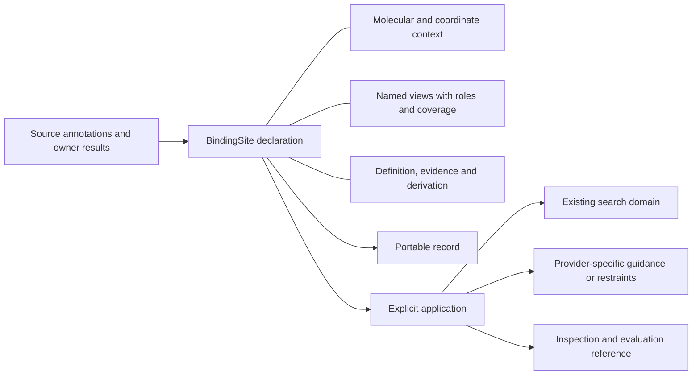

# Binding-site declarations and applications: design for review

Date: 2026-11-11. Owner: [BindingMT #111](https://github.com/uibcdf/bindingmt/issues/111).
Status: **maintainer-review draft; no runtime implementation or frozen schema**.
The maintainer commissioned this design before implementation. Names and examples
below are proposed API sketches, not currently executable public operations.
The [owning record](pending_proposals/binding_site_public_contract.md) tracks
disposition, evidence and the next step. Other components have not accepted this
proposal merely because their existing contracts are referenced here.

## 1. Design decision proposed

Introduce one public scientific entity, `BindingSite`: an immutable, contextual
declaration of a binding-region hypothesis or annotation. It can hold several
explicitly related views and retain incomplete information. It is independent
of `SearchDomain`, a molecular system, a topographic feature, a pharmacophore
interaction site and an execution request.

Keep three questions independent:

| Plane | Question | Examples |
| --- | --- | --- |
| Representation | What information is available? | Group membership; selected atom coordinates; sphere; oriented box; owner support reference. |
| Definition and evidence | Why was this region declared? | Curated annotation; a recorded contact criterion; provider topography; manual hypothesis. |
| Application | How is a particular operation allowed to use it? | Display; construct a search domain; guide sampling; impose an explicitly chosen restraint; evaluate a result. |

A pocket can motivate a binding hypothesis without establishing binding. A
membership list establishes neither a closed spatial region nor compulsory
contacts. A confidence, topographic measurement, interaction energy or affinity
endpoint keeps its original meaning and producer; there is no universal site
score or binding-probability field.

Calling a declaration factory without computed evidence records a caller's
binding-region hypothesis, with unknown biological support. It does not promote
a generic selection into an experimentally established site. Importing a
topographic record similarly retains the reported region and a new contextual
binding hypothesis as separate facts.

The catalogue enumerates representations and capabilities. Individual site
records contain particular contextual declarations; this proposal does not add
a site database, molecular ontology, scheduler or generic provenance service.

## 2. Use cases that shape the contract

| Consumer | Required exchange | Boundary that must survive |
| --- | --- | --- |
| Direct researcher / BindingMT | Declare a region, inspect it, save it and explicitly derive a Vina-compatible domain. | An enclosing box and its extra included space are a documented application. |
| MolSysMT | Supply molecular context, selections, maps and coordinate operations; receive explicit selections on a matching system. | BindingSite is not a new molecular-system form or topology. MolSysMT acquires no mandatory dependency on BindingMT. |
| TopoMT | Supply an attributed provider/native finding and available supports. | Keep original run/feature/support identities, atom roles and unsupported geometry. No binding-function promotion follows automatically. |
| PharmacophoreMT | Use a resolved region to delimit its own extraction or associate an existing hypothesis. | Preserve feature alternatives, directions, tolerances, exclusions, essential status and weights in the native owner. |
| PeptideMT | Supply permitted site information for one operation and retain the declarations actually used. | A no-supplied-site request does not acquire a site from evaluation references, previous requests or display state. |
| MolSysViewer | Display available molecular membership and geometric views. | Display IDs, regions, labels and visibility do not establish scientific site identity or geometry. |
| Praxis / project and recording owners | Reference the declaration/application and negotiate a method's supported capabilities. | Existing method, project, execution and artifact ownership remain intact; these are optional relationships. |

The first useful BindingMT workflow is explicit annotation or selection →
declared view → existing box/domain → ordinary problem construction, with
inspection and saved-record replay at every boundary. It needs no new engine.

## 3. Scientific object and identity

Conceptual composition, not a requirement for eight public Python classes:



`BindingSite` is one contextual occurrence, not a claim about every conformation
of a protein. Source annotation identity, this occurrence, and correspondence
between occurrences are separate:

- `annotation_refs` retain owner/source annotation IDs and their revisions.
- `site_id` identifies this declaration. A display `name` is only a label.
- An exact record digest identifies saved content, not chemical equivalence,
  binding-site equivalence or independent experimental evidence.
- Independent declarations with equal coordinates or membership remain distinct.
  A faithful copy preserves identity. A remap, transform, added view or revised
  hypothesis creates a new declaration with an explicit parent relationship.
- Across frames, assemblies or sources, use separate occurrences and an explicit
  owner-supported correspondence. A tuple of sites suffices initially; no new
  collection manager or automatic site clustering is required.

Views belong to the same declared occurrence/context, but their relationships
need explanation. A molecular membership and an enclosing box have a derivation
relationship; they are not interchangeable exact realizations. Adding a view
requires its role, dependencies and relationship to existing evidence. Views
from incompatible frames cannot be silently attached as equivalent alternatives.

## 4. Molecular context, addresses and frames

The context retains participants, original source references, available
topology/structure/chemical-state associations, assembly or symmetry occurrence,
coordinate-frame information and the strength of the available binding evidence.
Unavailable fields remain unavailable. BindingMT consumes owner descriptors;
it does not implement a second molecular snapshot or chemical-identity engine.

Three addressing cases must be unambiguous:

1. **Source annotations:** retain the original address scheme, entity/chain,
   residue/group ID and insertion-code information. Source IDs are not coerced
   into numerical indices. Sequence positions carry their source numbering base.
2. **Resolved MolSysMT membership:** indices are zero-based on a stated element
   axis of one identified source occurrence. Retain original addresses and maps
   where available. Group membership includes non-protein systems; residues are
   a convenience for a declared protein-residue addressing scheme.
3. **Unresolved or partial membership:** preserve every source entry and its
   position, with a mapping status and cause. Matching counts or labels do not
   supply a correspondence.

Known membership has unique indices on its declared axis; its recorded order
is preserved. Provider raw data retain original ordering/multiplicity. Any
normalization creates an explicit mapping rather than editing the native record.
Point and feature multiplicity follow their own owner semantics, not this
membership-set rule.

An arbitrary ID is a declared association, not verified origin. Distinguish
caller-declared context, a captured site-owned excerpt, and owner-verified source
binding. The extent of a receipt's guarantee is recorded. A selected coordinate
excerpt is useful geometry evidence but not a verified complete prepared system.
MolSysMT #624 is related snapshot/collection work, not an already available
universal snapshot API and not a prerequisite for coordinate-free declarations.

Geometry requires an explicit coordinate reference. An unknown molecular/frame
placement is readable but cannot be silently applied to a molecular problem.
Molecular/frame matching is distinct from unit conversion. The initial geometry
profile is a declared Cartesian snapshot/single image; PBC wrapping, image
choice, assembly generation and alignment require explicit owner operations.

### 4.1 Applicability checks and trust policy

The first implementation must name what each application checks, rather than
calling the whole site universally verified:

| Operation | Required binding | Behavior when it is unavailable |
| --- | --- | --- |
| Inspect or replay an annotation | Recognized core schema and valid declared fields. | Preserve unresolved source/mapping and explain it. |
| Enclose saved coordinates | Known point correspondence, units and coordinate frame. | Refuse the projection; never open an original provider or guess placement. |
| Expand groups against a source | The stated source/group axis and an explicit owner-supported correspondence. | Report missing/ambiguous entries; no positional reinterpretation. |
| Attach a derived domain to a problem | Compatible declared source/frame relationship and the application-relevant captured context. | Default to refusal before engine work unless the caller explicitly chooses a recorded declared-context policy. |
| Transfer a site to another source/frame | Explicit owner map/transform and relevant dependency coverage. | Keep the old declaration; no implicit transfer by matching IDs/counts. |

Propose `context_policy="require_match"` as the site-domain application default.
An advanced `context_policy="declared_frame"` admits an explicit caller guarantee
of placement while retaining unverified molecular context. It must never upgrade
to verified origin or silently repair an observed contradictory correspondence.
This choice is recorded in the domain derivation and checked at the problem/
execution boundary; it does not weaken existing plain-box or legacy derivation
validation. Concrete source-descriptor fields/checks need MolSysMT review before
this profile is implemented.

Use existing owner facts and the required site-owned excerpts to check scoped
consistency; do not infer molecular equivalence or implement a generic snapshot
engine. A source-byte digest, matching typed IDs, selected-coordinate comparison
and an owner's prepared-source receipt have different guarantees. Every check
records its scope and remaining caller trust preconditions. Applications that
do not need chemistry do not demand unrelated complete chemistry qualification.

## 5. Representation catalogue and first-profile boundaries

| View | Meaning | Proposed first profile | Prohibited inference |
| --- | --- | --- | --- |
| Atom membership | Selected/contacted/lining/delimiting atoms on one source axis. | Declaration, inspection, explicit mapping and optional captured coordinates. | Atom membership is not exact spatial support or a mandatory-contact list. |
| Residue/group membership | Annotated or resolved molecular groups. | Source-addressed unresolved records and resolved group indices. | Expansion into atoms, side chains or hydrogens is not implicit. |
| Sphere | Center, positive radius and frame. | Complete physical declaration and record round trip. | Radius is not a contact cutoff or a calibrated binding boundary. |
| Box | Center, full edge lengths, orientation and frame. | Explicit axis-aligned boxes; orientation retained in the proposed record contract. | A rotated box is not the same axis-aligned BoxRegion. |
| Points | Positions with attributed optional provider data. | Captured atom-position views; general provider point payloads remain capability-limited. | A point cloud has no implicit interior, interpolation or point radius. |
| Surface | Owner-defined recoverable patch and orientation if meaningful. | Owner reference and preserved available payload; numerical applications deferred. | A displayed mesh is not automatically a closed or analysis-ready boundary. |
| Volume | Owner-defined spatial support with inclusion/exclusion conventions. | Owner reference and preserved available payload; numerical applications deferred. | No exact volume is reconstructed from lining atoms or a bounding box. |
| Composite/disjoint support | Explicitly related component declarations/supports. | Preserve component references and their individual contexts. | A list does not automatically define a geometric union or an overlap-free sum. |

Use a small discriminated view vocabulary with immutable records, not one class
per catalogue spelling. `site_by_atoms` and related issue notation do not freeze
Python namespaces. Each view has a stable local key, kind, membership/support
role, context/dependencies, provenance, available payload and capability state.

The oriented-box decision is deliberately split: the portable declaration must
not lose axes, while the first guaranteed SearchDomain remains the existing
axis-aligned BoxRegion. General oriented-box projection/rotation can be a later
qualified capability; unsupported operations leave the original record intact.

For source selection, capture the requested expression/syntax and actual
resolved membership. `capture_coordinates=True` explicitly asks MolSysMT for
one frame/state's selected positions and retains their correspondence. It does
not add hydrogens, repair chemistry or infer a volume. A multi-frame input
requires an explicit structure choice; topology-only annotations remain useful.

Propose an explicit `chemical_state="structure"` default for coordinate-backed
selection capture, retaining the chosen structure/state association. A single
available frame may resolve `structure_index=None` to zero and record that
choice; multiple frames require a choice. Reference-state/topology-only
selection uses an explicit reference-state policy, not an automatic switch when
coordinates are absent. Pure annotation factories require neither frame lookup
nor molecular provider calls.

## 6. State, coverage and capability are different questions

Keep separate planes rather than one universal `valid` flag:

| Plane | Examples of states |
| --- | --- |
| Record interpretation | Recognized core schema; opaque extension; unsupported core schema. |
| Molecular resolution | Unresolved; partial; resolved; incompatible; context not verified. |
| View availability | Present payload; external reference; unavailable representation. |
| Computed evidence coverage | Not requested; not evaluated; completed populated; evaluated-empty; failed; unsupported. |
| Current application | Applicable under stated conditions; missing prerequisites; ambiguous; stale; unsupported. |

Manual annotations have no invented detector coverage. An empty resolved set
is inspectable, but cannot become an all-atom selection or full search. A
completed contact calculation returning zero observations is distinct from an
unresolved mapping or an absent calculation. Unknowns use explicit states and
causes, not NaN, a fabricated zero or an origin-centered geometric object.

`inspect()` reports these planes and each operation's missing prerequisites.
It performs no molecular calculation, external artifact retrieval or score
normalization. `describe()` formats that information for a human. Basic
inspection does not certify chemistry, applicability or the truth of metadata.

## 7. Proposed Python surface

One main public class; factories name the information supplied. These names
remain subject to review. Avoid parallel functional and classmethod spellings
for every operation in the first delivery.

Two representative signature proposals make the ordinary path precise:

```text
BindingSite.from_selection(
    molecular_system, selection="all", *, element="atom", syntax="MolSysMT",
    structure_index=None, chemical_state="structure",
    capture_coordinates=False, name=None,
) -> BindingSite

site.to_search_domain(
    *, method, view=None, padding=None, context_policy="require_match",
) -> BoxRegion
```

The first signature is a declaration/capture operation; the second is an
explicit application. Coordinate capture is opt-in. A source expression is
resolved by its declared MolSysMT syntax and element level; the effective
defaults are retained in the record. `padding=None` is suitable only where no
padding operation is requested; enclosing projections require a length quantity.

| Surface | Proposed behavior |
| --- | --- |
| `BindingSite.from_atoms(...)` / `.from_groups(...)` | Declare explicit membership with its source context and role; no selection or coordinate extraction. |
| `.from_residues(...)` | Declare source-addressed protein residue annotations, including absent 3D mapping; bare numbers need an explicit numbering scheme. |
| `.from_selection(system, selection=..., ...)` | Explicit MolSysMT-backed resolution/capture; record effective element axis, syntax, frame/state and coverage. |
| `.from_sphere(...)` / `.from_box(...)` | Declare explicit-unit geometry in a stated frame. Existing BoxRegion data can be copied without transferring its search intent. |
| `.from_topomt(record, ...)` | Optional, explicit adapter for the received ProviderRecord/run boundary; a later stage, not an assumed future Topography API. |
| `.views`, `.context`, `.definition`, `.evidence` | Read-only, detached information; no writable arrays or borrowed dictionaries. |
| `.inspect()` / `.describe()` | Structured capability/prerequisite report and human explanation. |
| `.to_dict()` / `.from_dict()`; `.save()` / `.load()` | One owned portable record profile, explicit schema admission and safe file lifecycle. |
| `.resolve(system, correspondence=..., ...)` | Return a new resolved declaration using owner maps; no source mutation or guessed numbering. |
| `.with_view(...)`, `.remap(...)`, `.transform(...)` | Explicit derivations with dependency handling; only qualified view/operation profiles are callable. |
| `.to_search_domain(method=..., ...)` | Return an existing BoxRegion with a complete site-application derivation. |

Nontrivial public normalization uses ArgDigest; physical admission uses
PyUnitWizard; actionable diagnostics use SMonitor with the operation, affected
view/field and missing prerequisite. Unsupported capability and malformed input
remain distinct. DepDigest guards only an explicitly selected optional adapter;
provider/import failures keep their cause instead of becoming absent data.
Reading/inspection never computes geometry or loads a referenced provider asset.
Large payload capture is explicit and needs a bounded receiving profile;
inspection reports existing counts/shapes without expanding them.

### Ordinary coordinate-backed workflow

Illustrative API sketch; `receptor` and `partner` are caller inputs. The group
indices and padding are arbitrary software-example parameters, not a scientific
prescription. Default element resolution is explicitly atom-level in the
record, including when the selection expression mentions groups.

```python
site = bmt.BindingSite.from_selection(
    receptor,
    selection="group_index in [2, 4]",
    capture_coordinates=True,
    name="region-A",
)
print(site.describe())

domain = site.to_search_domain(
    method="enclosing_box",
    padding="0.4 nm",
)
problem = bmt.DockingProblem(receptor, partner, search_domain=domain)
```

This path has one declaration and one explicit application. The declared
selection is frozen as membership; later mutation does not rerun the expression.
Projection from captured positions needs no live molecular source. Any binding
to a current problem checks the relevant frame/source conditions and records
the guarantee actually available; it does not silently call them verified.

### Coordinate-free annotation

The exact source/address field vocabulary remains an owner-review item. This
sketch intentionally supplies no molecular indices or coordinate frame:

```python
site = bmt.BindingSite.from_residues(
    source={"owner": "caller", "id": "target-A", "revision": "r1"},
    address_space="author_residue",
    residues=[{"chain": "A", "id": "12", "insertion_code": ""}],
    name="annotated region",
)
site.save("region.binding-site.json")
restored = bmt.BindingSite.load("region.binding-site.json")
print(restored.inspect())
```

The result is readable/unresolved and refuses geometric application until
required mapping/coordinates are supplied. Unknown insertion-code information
is distinct from an explicitly empty insertion code. Resolving against a
different source requires a correspondence; the integer-looking source ID
does not become a group index.

## 8. Explicit search-domain projection and other applications

Keep the BindingSite declaration independent of execution choices. A domain
application names its input view, algorithm, actual coordinates/frame, expansion
policy where needed, explicit padding, exclusions and approximation/losses.

- `method="identity"` is meaningful only for compatible axis-aligned box data
  without a requested geometric change.
- `method="enclosing_box"` requires declared length padding and a supported,
  recoverable geometric view. For memberships, atom expansion and coordinate
  capture must already be explicit or requested as a separate derivation.
- Bounds of selected points are a constructed domain, not an exact original
  region. Extra included space is reported as unquantified when no source
  volume is known. No invented difference-of-volumes number is emitted.
- A sphere's enclosure retains the original sphere and its enlargement. Exact
  containment, molecular exclusion and PBC claims require the relevant profile.
- Non-positive resulting box extents fail before use. No hidden minimum side
  length repairs a degenerate selection.
- When several views could supply different domains, the caller names one.
  The convenience case can omit `view` only when exactly one view is eligible.
  No arbitrary first-view or highest-score selection is introduced.

Return BoxRegion, not a second public search-domain class. Preserve application
provenance through its existing `derivation` seam so ordinary problem/result
save/read does not lose the relationship. The existing
`bindingmt.box_derivation@1` recipe has strict fields/methods; do not stuff new
meaning into it or weaken its validation. Propose a separate nested
`bindingmt.site_domain_derivation@1` profile binding the original site record or
recoverable content reference, input view/context, effective choices, output
box and losses. Keep old box recipes readable and unchanged. The new recipe's
reader and propagation require their own tests before implementation is received.

When a projection is checked against a live molecular problem, assess the
dependencies relevant to that application. A coordinate-only domain does not
claim chemical-state verification; a residue-to-contact application needs the
actual sequence/atom mapping. Missing proof is reported, and an operation that
requires it refuses. An explicit caller-declared common frame remains a stated
trust precondition, not a successful molecular-identity check.

HADDOCK active/passive interpretation and Boltz pocket/contact enforcement are
provider-adapter decisions under #109/#110. Neither is an automatic property
of the site. The current Vina protocol still rejects nonempty guidance and
constraints. Site presence does not enable those unsupported capabilities.
Application records distinguish requested meaning, accepted translation,
actual enforcement, omissions and information role. A projected request that
strengthens broad membership needs an explicit user/protocol choice.

For a no-supplied-site study arm, the request has no site application. It must
not acquire one through a cached declaration, previous run, known reference or
viewer. Consuming protocols own permitted-information rules; the declaration
retains evidence origins but is not an access-control or leakage-certification
system. Evaluation-only site information remains separately attributed.

No supplied site does not necessarily mean no search domain: a method may need
an independently declared global-domain policy. A method incapable of the
requested information regime reports that limitation; it must not derive a
domain from a withheld evaluation reference. Applications live in the consuming
request/result, not as an active engine choice inside BindingSite. Loading a
site never reactivates an earlier restraint or default sampling prior.

## 9. Lifecycle, transforms and changes to molecular inputs

Objects own their small records and quantities, not complete molecular systems.
Copy/read/inspection leaves inputs and native provider outputs unchanged.
Derived declarations carry parents; the original remains meaningful historical
evidence rather than being invalidated retroactively.

| Change | Required behavior |
| --- | --- |
| Atom/group permutation or extraction | Use an owner map; retain original positions/roles, omitted entries and correspondence coverage. No equal-count inference. |
| Missing members | Refuse an operation requiring complete membership; an explicitly requested partial derivation retains every unmapped entry and limitation. |
| Added atoms | No automatic inheritance of membership, contact evidence or prediction confidence. An explicit group-expansion policy can create a new view. |
| Coordinate/frame change | Geometry-dependent views require an explicit compatible transform or new capture. Topology-only annotations can remain available. |
| Rigid transform | Delegate XYZ rotation/translation to MolSysMT, preserve units and frame mapping, and transport only supported geometric views. Sphere radii and box edge lengths retain their declared meaning. |
| Rotated axis-aligned box | Retain orientation in a supported box view or refuse that transform; an enclosing axis-aligned box is a new explicit approximation. |
| Chemical-state change | Preserve source annotation history; reassess dependent membership/evidence through the owning molecular operation. Geometry alone does not verify chemistry. |
| Changed reference participant | Contact/interface observations retain their original context and become uncomputed for the new application until reevaluated. |
| Unknown provider geometry | Preserve the native reference in its original frame; do not silently mark it transformed/current. |

Dependency tracking is per view/evidence/application, not a global observer or
cache invalidation framework. Conservative refusal is appropriate when an
owner's dependency guarantee is unavailable. A partial transform explicitly
selects its views and retains other evidence as historical references, not as
active geometry in the new frame. Generic fitting, topology comparison,
chemical equivalence and molecular editing remain MolSysMT-owned.

## 10. Portable interchange and dependency direction

Proposed record family: `bindingmt.binding_site@1`, subject to review. The
minimum envelope has declaration identity, annotation references, context,
ordered named views, definition/evidence, derivation and namespaced extensions.
Unknown optional provider payloads can be preserved opaquely, with unavailable
operations. An unsupported required core schema is rejected by typed loading;
header inspection is separate. Stored code, arbitrary Python classes and
automatic network resolution are not part of the format.

Physical values use PyUnitWizard QuantityRecord/QuantityRecordBundle with named
field/dimension/shape handshakes. Do not introduce another quantity codec.
Preserve producer quantities and declared transformations, active unit policy
and the distinction between direction vectors and length-valued coordinates.
Equivalent units must preserve scientific values; byte hashes need not match
records that retain different original unit/provenance declarations.

The owning BindingMT implementation validates the scientific envelope; a
published schema and receiving examples support other components' bounded use.
Generic providers can consume a plain record or receive a validated explicit
selection/geometry projection. They need not import BindingMT, subclass its
class or emit its domain objects from their core APIs. Optional object adapters
belong at the consumer/integration boundary. No new shared package is proposed.

Replay levels must be stated precisely:

1. Plain record/known-field inspection is possible without BindingMT or original
   engines. Consumers use the shared quantity codec when interpreting values.
2. BindingMT's typed reader requires its declared core installation, but reading
   saved data invokes no molecular calculation, original pocket provider,
   pharmacophore engine, neural model, GPU or network.
3. Resolving molecular addresses or applying a new transform requires the
   appropriate qualified owner operation; absence is an explicit limitation.

The current package imports MolSysMT through its root/core. Therefore a claim
that `import bindingmt` works with MolSysMT entirely absent would require a
separate reviewed import/dependency change. This draft does not quietly promise
that stronger property or make a package-wide lazy-import rewrite a first-profile
prerequisite.

Initial persistence is one explicit JSON record with embedded known small views
and/or content-identified external owner references. A path alone is not durable
identity or proof of recoverability. Reading never silently fetches that path or
URL. New reports use exclusive creation by default; incomplete writes must not
replace an existing valid file. Generic large-asset stores, H5MSM integration,
archive formats and provenance services remain with their owners or later scopes.

### 10.1 Reviewable record outline

The following is a field proposal, not a released JSON schema. Provider-owned
subrecords keep their original identities and explicitly scoped guarantees.

```text
BindingSite record
  schema                 bindingmt.binding_site@1 (proposed)
  site_id, name          contextual identity; optional human label
  annotation_refs[]      source/owner/id/revision and evidence links
  context
    sources[]            owner descriptors and available integrity references
    participants[]       contextual roles; source selection and addresses
    structure/state      stated or unknown associations, with their index spaces
    frame                stated reference, Cartesian/PBC convention, transforms
    binding              declared/captured/owner-verified scope and evidence
  views[]                ordered named, discriminated view records
    key, kind, role      local key; representation and membership/support role
    context_ref          compatible site context/participant/frame
    availability         payload / external-reference / unavailable, with cause
    payload              typed indices/addresses/geometry or owned reference
    dependencies[]       the actual source/coordinate/state conditions
    provenance           original owner/run/support identity and derivations
  definition             criterion/method/policy, parameters and evidence refs
  evidence[]             attributed observations and actual coverage/state
  derivation             parent record references and explicit changes/losses
  extensions             preserved namespaced optional owner data
```

Required discriminants and core invariants are closed/validated; optional
namespaced owner payloads can remain opaque. An unsupported required section
prevents typed admission or the affected application, not a successful empty
result. The common record does not standardize every owner's feature dictionary.

For the elementary geometric profile, positions have shape `(3,)`, sphere radius
is a positive scalar length, box lengths are three positive full edge lengths,
and optional box axes have a declared orthonormal right-handed convention.
Captured atom coordinates are `(n_selected_atoms, 3)` with a matching ordered
atom correspondence, not residue centroids. Vector/normal conventions belong
to their supported view profile; arbitrary provider arrays are never coerced
into these meanings.

Known quantities use the shared sealed quantity record, including field and
dimension handshake. Missing data carry a state/cause rather than an invalid
known payload. JSON extension keys do not gain execution or dynamic import
semantics. Record ordering and repeated evidence occurrences are preserved.

History is bounded: store the complete current small declaration and parent/
owner content references, rather than recursively embedding every ancestor or
duplicating full molecular/provider assets. Embedded known views are sufficient
for their declared offline operations. A referenced-only rich support remains
unresolved until an explicit owner-supported resolution operation succeeds.
Schema/content consistency does not authenticate the original calculation.

## 11. Concrete cross-component integration proposals

| Boundary | First handoff | Decision needing owner review |
| --- | --- | --- |
| MolSysMT | Source-addressed and resolved membership examples; explicit group→atom expansion; XYZ transforms; permutation/extraction maps. | Supported source/state/frame descriptor and guarantee for verified rebinding; avoid turning related #624 into an unconditional full-collection dependency. |
| TopoMT | Adapter for current ProviderRecord/run, native role, available geometry and explicit unavailable mapping. | Recoverable support references and portable payload/profile guarantees; keep future public Topography adoption separate from current provider records. |
| PharmacophoreMT | Region-limited feature request or associated native hypothesis reference. | Coordinate/source applicability and preserving family coverage, essential/optional constraints, weights, directions and exclusions. A binding region never becomes one pharmacophore InteractionSite. |
| PeptideMT | Versioned site/application input separate from the evaluation reference and an absent supplied-site case. | Permitted-information policy and consumer receiving. No target-specific public fields or biological validation follows. |
| MolSysViewer | Resolved membership plus declared shapes in a matching source/frame, with unavailable-view explanation. | Attachment/remapping/cleanup through public host mechanisms; scientific identity remains BindingMT-owned. Live canvas is a separate receiving scope. |
| MolSysSuite | Shared vocabulary, ownership/dependency directions, portable record and adversarial examples. | Agreement/adoption record and receiving owners before claiming suite-wide compatibility. Rename #190 is a different coordination theme. |

For TopoMT specifically, consume attributed `record.measurements` when
interpreting physical quantities. Preserve raw `record.fields` in their original
provider conventions instead of assigning units or scientific equivalence to
similarly named numbers. `ProviderRun.save/load` preserves original evidence;
it does not by itself promise reconstruction of every parsed rich support.

Do not modify siblings or treat this document as their approval. Related provider
issues retain their scopes. New concrete provider gaps receive evidence in their
owning issue, with a proposed narrow operation and consumer acceptance case.

## 12. Delivery sequence and acceptance

| Stage | Delivered outcome | Required boundary before proceeding |
| --- | --- | --- |
| A: this design | Maintainer-review draft, source-backed owner matrix, API sketches, tradeoffs and explicit scope. | Maintainer disposition; no runtime is implemented by this stage. |
| B: small public core | Immutable declaration/inspection/JSON profile; atom/group/residue annotations including unresolved ones; sphere and axis-aligned box data; selected coordinate capture. | Accepted local contract and the cross-owner meanings required for the exercised profile. No assumption of whole-suite adoption. |
| C: useful application | Explicit site→existing BoxRegion derivation and the ordinary saved problem/result route; one received TopoMT-record bridge where its owner contract suffices. | Qualified maps/units/context/provenance and honest unavailable capabilities. Independently closable increments. |
| D: receiving | Source-pinned examples for interested owners and required central agreement/adoption records. | Each owner records actual adoption; engine-specific guidance/refinement/prediction and live browser evidence remain separate. |

Minimum independent controls for B/C:

1. An annotation without coordinates or current indices survives copy/save/read,
   and geometric application explains the missing prerequisites.
2. A group/residue annotation preserves source numbering/insertion codes and
   explicit expansion; reorder, partial mapping and added-atom controls retain
   roles and causes without changing inputs.
3. Known empty selection, evaluated-empty contact evidence, unknown coverage,
   unavailable geometry and failed resolution stay distinguishable.
4. Sphere/box/captured points preserve finite unit-bearing values under normal
   and pm/fs policies, including malformed shape/dimension/bool/extent controls.
5. Compatible rigid transforms preserve declared geometry; an unsupported
   rotated-box operation refuses or explicitly records its enclosure.
6. Domain derivation preserves the original site, recipe, output geometry and
   limitations through ordinary problem/result save/read, alongside unchanged
   original BoxRegion derivations.
7. Provider records with identical lining atoms but different supports do not
   become the same site or acquire an exact shared volume. Missing mappings are
   not evaluated-empty membership.
8. View-specific edits invalidate only dependent applicability. Original contact
   evidence remains tied to its original participants/frame.
9. Fresh-process replay uses no optional engines/models/network and does not
   credit a new calculation. Optional provider sections remain faithful or opaque.
10. A supplied-site and absent-site request remain independent. A projection
    that changes membership into mandatory contacts is refused unless its
    provider-specific interpretation was explicitly selected and supported.

Use small saved/synthetic records and controlled owner seams first. Existing
scientific admission, installed/platform checks and the interrupted full-suite
backlog retain their owners; this design starts no new scientific campaign,
acquires no model/engine, and sets no new automatic 1.0/release gate.

## 13. Decisions requested from the maintainer

| Decision | Recommendation | Consequence |
| --- | --- | --- |
| Main scientific entity | One immutable contextual BindingSite with multiple explicit views. | Avoids compulsory geometry and competing site/region object hierarchies. |
| Public surface | Class factories and operations, with a plain portable record for interchange. | Simple direct use; providers do not acquire a mandatory reverse dependency. |
| First useful scope | Annotations, elementary geometry, saved replay and explicit existing-box projection. | Useful before #109/#110; richer geometry/providers advance through capability-specific increments. |
| Identity/lifecycle | Preserve annotation identity separately; derived contextual declarations are new records with parents. | Equal labels/membership/hashes do not invent correspondence or scientific equivalence. |
| Domain integration | Existing BoxRegion with a new, independently validated site-derivation profile. | Application provenance survives normal problem/result persistence without replacing current domain classes. |
| Source/replay guarantee | Explicit scoped source guarantees and the three replay levels above. | Data-only use is possible without promising unimplemented molecular snapshot or import independence. |
| Cross-owner agreement | Review concrete records/cases before freezing shared meanings; record adoption separately. | A BindingMT delivery cannot announce another component's compatibility. |

The detailed field vocabulary, source-descriptor handshake, oriented-box callable
profile and provider-reference packaging need review during A/B. None should be
settled accidentally by the first constructor implementation.

## 14. Inspected evidence and limitations

This is source/contract inspection, not executed integration qualification.
Read-only suite status refreshed the related repositories. Concurrent sibling
changes and local/remote differences were preserved; no pull, installation,
native build or sibling worktree edit was performed. Baselines:

| Owner | Inspected source | Relevant evidence |
| --- | --- | --- |
| BindingMT | `c4ba46ec1ad39dd59deede41fbe5887924ed615b` | Existing SearchDomain abstract geometry, strict BoxRegion derivation, problem persistence and Vina intent rejection. |
| MolSysMT | `aee7aa65da56e896d1cb2d655bf73736f6453a43`; refreshed remote `f0dbb58e0c0a2d29bdc74024a3f888c002a9a2f0` | Public element/state selection, XYZ rotate/translate and interaction query/invalidation contracts. The inspected local runtime source was ten commits behind remote; no compatibility is inferred. |
| TopoMT | `3a8ee979db8de6f6345de74558a878bb96ba3234` | [Accepted conceptual direction](https://github.com/uibcdf/topomt/blob/3a8ee979db8de6f6345de74558a878bb96ba3234/devguide/topography_conceptual_contract.md), current provider-output contract/classes and ProviderRun. A generated version-file change was preserved. |
| PharmacophoreMT | `ecd16946d64dd5cdc64132b026aaf12be2c0ef3a` | [Native constraint semantics](https://github.com/uibcdf/pharmacophoremt/blob/ecd16946d64dd5cdc64132b026aaf12be2c0ef3a/devguide/native_constraint_semantics.md), prepared-feature and search-asset identity contracts; planned guarantees are not assumed implemented. |
| MolSysViewer | `1187fc187247aa2d20d01791856a541d50562bcb`; refreshed remote `d0d52c942bbe475061098045c59c63142506d9cd` | Annotation/region/shape vocabulary; local source was behind remote. No new current-host or canvas compatibility is claimed. |
| PeptideMT | `359b778293a6dfcc9ef3f8f8e85a5ee038f63d0e` | Target-directed question/evidence ownership and #33's separate source, preparation, method and execution decisions. |

PyUnitWizard's synchronized guide supplies the owned QuantityRecord interchange
route. [MolSysMT #624](https://github.com/uibcdf/molsysmt/issues/624) remains a
related open provider proposal. [BindingMT #111](https://github.com/uibcdf/bindingmt/issues/111)
is the design/implementation owner; #109/#110 retain engine-adapter work.
This draft changes no accepted scientific measurements or provider contracts.
