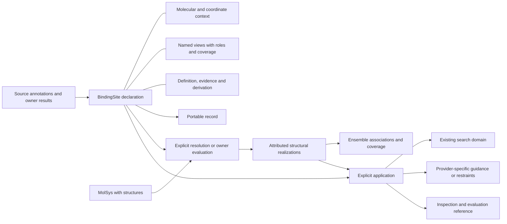

# Binding-site declarations and applications: design for review

Revision **2, audited edition**, 2026-11-11. Owner: [BindingMT #111](https://github.com/uibcdf/bindingmt/issues/111).
Status: **maintainer-review draft; no runtime implementation or frozen schema**.
The maintainer commissioned this design before implementation. Names and examples
below are proposed API sketches, not currently executable public operations.
The [owning record](pending_proposals/binding_site_public_contract.md) tracks
disposition, evidence and the next step. Other components have not accepted this
proposal merely because their existing contracts are referenced here.

This revision incorporates the [PeptideMT](https://github.com/uibcdf/bindingmt/issues/111#issuecomment-6811981030),
[PharmacophoreMT](https://github.com/uibcdf/bindingmt/issues/111#issuecomment-6812006751)
and [TopoMT](https://github.com/uibcdf/bindingmt/issues/111#issuecomment-6812012062)
contributions. The [first revision](https://github.com/uibcdf/bindingmt/blob/0ab5102e9221f42894a22dc27a0ee4570923d8d9/devguide/binding_site_design.md)
remains the immutable review baseline. Revision 2 changes the proposal, not a
package version or the proposed first wire-schema generation `@1`. Favorable
reviews are not frozen cross-owner agreement or runtime adoption.

The main refinements are ordinary definition/evidence operations, explicit view
relationships, operation-specific context checks, a direct resolved-region
handoff, actual application-input accounting and early bounded receiving cases.
The maintainer's subsequent review also changes the structural model: ordinary
work uses a `molsysmt.MolSys`; site definitions need not own copied coordinates,
and may be structure-independent, structure-scoped or realized across an ensemble.
Sections 11–14 identify dispositions, admission examples and remaining decisions.
The [point-by-point audit and worked receiving examples](binding_site_review.md)
identify what the three contributions cover, what this edition corrects and what
still needs implemented receiving or owner agreement. The [initial second draft](https://github.com/uibcdf/bindingmt/blob/54cfab985fd79c9e10922d412b068048412f1d0a/devguide/binding_site_design.md)
remains an immutable comparison baseline. This audit refines revision 2 rather
than declaring a final shared contract.
The subsequent favorable component reviews and authorized work order are tracked
in the [implementation/work plan](binding_site_implementation_plan.md). Its
per-increment acceptance keeps owner agreement and executed receiving distinct.

## 1. Design decision proposed

Introduce one public scientific entity, `BindingSite`: an immutable declaration
of a binding-region hypothesis or annotation over an explicit molecular and
structural scope. It can hold several explicitly related views, retain incomplete
information and refer to different realizations across structures. It is independent
of `SearchDomain`, a molecular system, a topographic feature, a pharmacophore
interaction site and an execution request.

Immutability concerns the declaration and its recorded observations; it does not
mean a physical site is static or must exist in every conformation. Ordinary
molecular operations receive a native `molsysmt.MolSys` with structures. MolSysMT
owns those coordinates, their structure axis and associated chemical states.
BindingMT does not introduce a parallel coordinate or trajectory container.

Keep three questions independent:

| Plane | Question | Examples |
| --- | --- | --- |
| Representation | What information is available? | Group membership; source structure references; a geometric realization; sphere; owner support reference or structure-resolved series. |
| Definition and evidence | Why was this region declared? | Curated annotation; a recorded contact criterion; provider topography; manual hypothesis. |
| Application | How is a particular operation allowed to use it? | Display; construct a search domain; guide sampling; impose an explicitly chosen restraint; evaluate a result. |

A pocket can motivate a binding hypothesis without establishing binding. A
membership list establishes neither a closed spatial region nor compulsory
contacts. A confidence, topographic measurement, interaction energy or affinity
endpoint keeps its original meaning and producer; there is no universal site
score or binding-probability field.

Calling a declaration factory without computed evidence records a caller's
binding-region hypothesis, with unknown biological support. It does not promote
a generic selection into an experimentally established site. Importing a
topographic record similarly retains the reported region and a new contextual
binding hypothesis as separate facts.

The catalogue enumerates representations and capabilities. Individual site
records contain particular contextual declarations; this proposal does not add
a site database, molecular ontology, scheduler or generic provenance service.

## 2. Use cases that shape the contract

| Consumer | Required exchange | Boundary that must survive |
| --- | --- | --- |
| Direct researcher / BindingMT | Declare a region, inspect it, save it and explicitly derive a Vina-compatible domain. | An enclosing box and its extra included space are a documented application. |
| MolSysMT | Supply molecular context, selections, maps and coordinate operations; receive explicit selections on a matching system. | BindingSite is not a new molecular-system form or topology. MolSysMT acquires no mandatory dependency on BindingMT. |
| TopoMT | Supply an attributed provider/native finding and available supports. | Keep original run/feature/support identities, atom roles and unsupported geometry. No binding-function promotion follows automatically. |
| PharmacophoreMT | Use a resolved region to delimit its own extraction or associate an existing hypothesis. | Preserve feature alternatives, directions, tolerances, exclusions, essential status and weights in the native owner. |
| PeptideMT | Supply permitted site information for one operation and retain the declarations actually used. | A no-supplied-site request does not acquire a site from evaluation references, previous requests or display state. |
| MolSysViewer | Display available molecular membership and geometric views. | Display IDs, regions, labels and visibility do not establish scientific site identity or geometry. |
| Praxis / project and recording owners | Reference the declaration/application and negotiate a method's supported capabilities. | Existing method, project, execution and artifact ownership remain intact; these are optional relationships. |

The first useful BindingMT workflow is explicit annotation or selection →
declared view → resolution on a chosen MolSys structure → existing box/domain → ordinary problem construction, with
inspection and saved-record replay at every boundary. It needs no new engine.

## 3. Scientific object and identity

Conceptual composition, not a requirement for eight public Python classes:



`BindingSite` declares a hypothesis and its scope, not universal existence in
every conformation of a molecular system. A **definition** states the region or
criterion; a **realization** records the result of resolving/evaluating it on a
particular source occurrence, structure, state and method context. An **ensemble**
retains an explicitly associated collection of those realizations and coverage.
These are record roles; they do not require three new public class hierarchies.

Source annotation identity, declaration identity, realization identity and
cross-structure correspondence are separate:

- `annotation_refs` retain owner/source annotation IDs and their revisions.
- `site_id` identifies this declaration. A display `name` is only a label.
- An exact record digest identifies saved content, not chemical equivalence,
  binding-site equivalence or independent experimental evidence.
- Independent declarations with equal coordinates or membership remain distinct.
  A faithful copy preserves identity. A remap, transform, added view or revised
  hypothesis creates a new declaration with an explicit parent relationship.
- A realization refers to the exact definition record/view, molecular source,
  source structure position, chemical-state association and owner finding where
  supplied. Multiple realizations can refer to one definition. They need not
  have identical membership, geometry or availability.
- Across structures, assemblies or sources, preserve explicit correspondence and
  its method. The same feature number in two detector outputs does not establish
  one persistent site. Distinct sites can coexist on one structure; correspondence
  may be many-to-many and retain splits/merges as attributed owner results.
  Automatic tracking, clustering and a new collection manager are not proposed.

Views belong to a declared definition and explicit structural scope, but their relationships
need explanation. A molecular membership and an enclosing box have a derivation
relationship; they are not interchangeable exact realizations. Adding a view
requires its role, dependencies and relationship to existing evidence. Views
from incompatible frames cannot be silently attached as equivalent alternatives.

A definition reference is `(record content reference, definition key)`, and a
view reference adds its local view key. It never means “the latest record with
this name”. The whole declaration's content reference is distinct from its
scientific interpretation. A new view creates a new declaration with a
`representation_derivation` parent link; changing the claim/criterion records a
`definition_revision`. Neither edge proves equivalence between physical sites.
Existing realizations or hypotheses keep their old exact references. An optional
explicit new association can reuse unchanged information without rewriting the
old record. No extra global site-identity registry or semantic hash is required.

An evidence observation retains its original source, scope and original claim
association. A definition revision must not retarget an old relative
`claim_ref="definition"` silently. Carry the old association as a historical
reference to the parent record; citing that observation for a revised claim
creates an explicit new interpretation/association. It creates no new measurement
or stronger support. This also avoids making a saved native hypothesis depend
on future view additions.

### 3.1 Small relationship vocabulary

Relationships refer to immutable record/view identities, not display labels.
They record the method, relevant context, coverage and limitations; they do not
assert scientific equivalence merely by existing.

| Relation | Proposed meaning and invariant |
| --- | --- |
| `derived_from` | The new view records its input views, operation and effective parameters. No geometric equivalence or extra evidence follows. |
| `encloses` | Under a named geometric convention, the output contains the specified input support or points. Record the scope and approximation; enclosure does not imply equality or molecular accessibility. |
| `covers` | A membership/view covers a stated part of another declared population or support. Preserve covered, omitted and unresolved entries, criterion and known/unknown completeness. A ratio alone is insufficient. |

`derived_from` can accompany a more specific relation. Complete or partial
coverage is an attribute of `covers`; unknown coverage is never rewritten as
complete. Enclosure can be claimed only by an operation qualified to establish
it, not by importing similarly named provider fields.
Relations identify their direction and domain: covering source annotation
entries, covering resolved molecular members and covering spatial support are
different assertions. Atom-map completeness is not spatial coverage. An
enclosure of points must name those points; it cannot claim to enclose the full
original pocket when that support is unavailable. Every relation retains its
source/target record/view references and structural scope.

For composite declarations, retain a separate composition discriminator:
`grouping` associates components without constructing geometry; `union` declares
a geometric set operation whose recovery requires supported geometry; and
`alternatives` preserves distinct hypotheses without merging their membership,
support or evidence. Components retain their individual contexts. A first core
can preserve component references and the discriminator while refusing numerical
union or automatic alternative selection. This is a small record vocabulary,
not an ontology or a general graph service.

### 3.2 Definitions, structural scope and ensembles

| Definition/scope | Meaning | What must not be inferred |
| --- | --- | --- |
| Structure-independent annotation or membership | A stated atom/group population or source annotation, independent of coordinate choice. Geometry is resolved on a selected structure when needed. | The region is geometrically open, accessible or binding-competent in every structure. |
| Structure-scoped annotation | A declaration applies to explicitly identified source structures/states; no detector evaluation is implied. | Other structures were evaluated and found negative. |
| Structure-dependent criterion | A recorded owner method/query defines what to evaluate on each requested structure; realized membership/support can change. | Saving a criterion runs it, or its output is one fixed membership set across all structures. |
| Observed realization/ensemble | Attributed results retain individual structure/state associations, available geometry and evaluated/unknown/failed coverage. | An average geometry, union, thermodynamic probability or kinetic process is implied. |

A cavity may satisfy a topographic criterion in one conformation and not in
another. A topology-defined region can still be retained on both. A completed
no-detection result is negative only for its stated method/query and scope; it
does not prove absence of every possible binding site or partner association.
Different detected regions can belong to different hypotheses unless an explicit
correspondence supports a shared interpretation.

A structure-independent definition can reference observations from selected
structures without becoming restricted to those structures. Definition scope,
evidence scope and an application's chosen structures are separate fields.
Adding new structures to the MolSys does not extend old evaluation coverage.

An ensemble records source structure positions and occurrence maps, requested
and evaluated scope, optional original times and explicitly supplied weights.
Independent conformations need not have time or temporal ordering. Repeated
requests such as `[2, 0, 2]` retain their delivery map; they do not create extra
independent observations or silently double an occupancy denominator. Chemical
state is associated per structure, not inferred from equal coordinates.

No average, union, consensus or prevalence is a default site view. Each needs a
named scientific operation, correspondence, alignment/PBC conventions where
relevant, aggregation/weighting rule and coverage. A union can include space
never jointly available; a mean of open/closed supports need not be a physical
pocket. Observed prevalence among evaluated structures is not binding probability,
thermodynamic population or a free-energy estimate. Dynamic pharmacophore
interpretation remains PharmacophoreMT-owned; trajectory handling remains
MolSysMT-owned.

### 3.3 Where coordinates belong

The ordinary declaration stores membership/criterion, structural scope and
source references, **without copying the MolSys coordinates**. Resolution and
domain construction receive the molecular system explicitly and read only the
requested structures through qualified public MolSysMT operations. A live Python
reference, source label or structure position alone is not a reproducible snapshot.

Distinguish three data cases:

- **Molecular coordinates:** MolSysMT owns the original or explicitly captured
  MolSys, including selected-structure copies and H5MSM persistence. A reproducible
  ensemble can reference that captured native artifact with its original→captured
  atom/structure/state maps. BindingMT should reuse it rather than embed a second
  trajectory in every site record. Capturing only lining atoms cannot recover
  the original detector's complete input or chemical recognition context.
- **Site-owned geometric results:** a sphere center/radius, provider support,
  surface, field or pharmacophore feature geometry may not be recoverable from
  membership alone. Preserve its owner-defined quantities or recoverable artifact
  reference when supplied; do not discard them merely because MolSys has coordinates.
- **Optional detached excerpts:** a small explicitly requested point snapshot may
  support offline geometric replay. It retains correspondence, structure/state,
  frame, units and capture scope. It is neither mandatory for a declaration nor
  proof of a complete molecular source. The initial ordinary API need not expose
  a second coordinate-capture mechanism.

Persistence can therefore save a definition with unresolved source references,
a definition linked to a separately saved native system, or attributed realized
geometry/ensemble records. Offline definition inspection requires no coordinates;
reproducing a molecular projection needs its qualified source artifact, while
replaying an already saved geometric result needs only that result's sufficient
payload. A future bundle convenience can orchestrate owner saves; it must not
introduce a new molecular serializer or be implied by a plain site `save()`.

## 4. Molecular context, addresses and frames

The context retains participants, original source references, available
topology/structure/chemical-state associations, assembly or symmetry occurrence,
coordinate-frame information and the strength of the available binding evidence.
Unavailable fields remain unavailable. BindingMT consumes owner descriptors;
it does not implement a second molecular snapshot or chemical-identity engine.

Three addressing cases must be unambiguous:

1. **Source annotations:** retain the original address scheme, entity/chain,
   residue/group ID and insertion-code information. Source IDs are not coerced
   into numerical indices. Sequence positions carry their source numbering base.
2. **Resolved MolSysMT membership:** indices are zero-based on a stated element
   axis of one identified source occurrence. Retain original addresses and maps
   where available. Group membership includes non-protein systems; residues are
   a convenience for a declared protein-residue addressing scheme.
3. **Unresolved or partial membership:** preserve every source entry and its
   position, with a mapping status and cause. Matching counts or labels do not
   supply a correspondence.

Known membership has unique indices on its declared axis; its recorded order
is preserved. Provider raw data retain original ordering/multiplicity. Any
normalization creates an explicit mapping rather than editing the native record.
Point and feature multiplicity follow their own owner semantics, not this
membership-set rule.

An arbitrary ID is a declared association, not verified origin. Distinguish
caller-declared context, a captured site-owned excerpt, and owner-verified source
binding. The extent of a receipt's guarantee is recorded. A selected coordinate
excerpt is useful geometry evidence but not a verified complete prepared system.
MolSysMT #624 is related snapshot/collection work, not an already available
universal snapshot API and not a prerequisite for coordinate-free declarations.

Geometry requires an explicit coordinate reference. An unknown molecular/frame
placement is readable but cannot be silently applied to a molecular problem.
Molecular/frame matching is distinct from unit conversion. The initial geometry
profile is a declared Cartesian snapshot/single image; PBC wrapping, image
choice, assembly generation and alignment require explicit owner operations.

### 4.1 Applicability checks and trust policy

Keep three distinct assessments in each relevant application:

1. **Saved geometry:** the known payload, quantities, correspondence and frame
   meet the selected operation's geometric contract.
2. **Current molecular correspondence:** the supplied target has the required
   membership, frame and, where needed, structure/chemical-state relationship.
3. **Original finding applicability:** the upstream finding's relevant input,
   query and method dependencies are unchanged or explicitly requalified.

Success in one assessment cannot supply missing evidence in another. In
particular, a mathematically valid enclosure is not proof that an old pocket
still characterizes the current molecular input.

The proposed minimal context descriptor contains these semantic fields. Their
adapter spelling and supported MolSysMT operations need owner review; these are
not claims that a universal descriptor or receipt API already exists.

| Field group | Required information and available authority |
| --- | --- |
| Source occurrence | Owner/source/revision, participant and assembly occurrence; available artifact identity and the guarantee attached to it. Caller IDs remain declared associations. |
| Element axes and addresses | Element kind, zero-based index space, source address scheme/numbering base, original ordered entries and axis sizes where known. Counts and matching labels do not prove correspondence. |
| Correspondence | Explicit source→target and group→atom maps from a supported owner operation or a declared caller map checked within the admitted profile; unmapped/generated entries and causes remain visible. A caller map is not promoted to owner-verified origin. |
| Structure and chemistry | Definition/evidence/application structure scopes; original→current structure occurrence maps; requested and effective state selectors and their per-structure associations. A selector such as `structure` is a policy, not a chemical identity. |
| Coordinate reference | Frame/image convention, coordinate reference, explicit transform where used, captured point correspondence and quantities. Comparison uses a declared numerical convention, not a new scientific distance cutoff. |
| Dependency coverage | What the check covers: selected positions, selected molecular attributes, the full producer input/query, or an explicitly qualified narrower dependency set. Missing coverage remains unknown. |

Use MolSysMT's public selection, attribute, extraction/map and XYZ operations
where qualified. Do not invent a general prepared-source authentication,
chemical equivalence or snapshot algorithm in BindingMT. Where the owner's
current public boundary cannot establish a required fact, the application
reports missing proof and the concrete owner acceptance item.

| Operation | Required checks and guarantee | Missing proof or contradiction |
| --- | --- | --- |
| Inspect/replay an annotation | Core schema and declared-field admission only. | Preserve unresolved context; no molecular lookup. |
| Enclose a chosen structure or sufficient saved geometry | Explicit structure choice when reading MolSys, finite length quantities, ordered point correspondence, frame and valid resulting extents. | Require the explicit source when the view is reference-only. Never open a provider or infer finding applicability. |
| Resolve/expand membership | Source/target axes, explicit correspondence, requested population, structure/state when relevant, expansion and coverage policy. | Default to complete coverage or refusal. An explicitly partial projection retains omissions and changed meaning. Contradictory maps are refused. |
| Place a derived box on a current problem | Required frame/source relationship and captured context for the declared `placed_geometry` scope. | Refuse before engine work unless the narrowly allowed declared-frame policy addresses only missing placement proof. No whole-source/finding verification is implied. |
| Claim an imported finding describes the current input | Producer-relevant input/query coverage, including changes outside exported membership; probe/radius/region definition where relevant. | Unknown or stale applicability; refuse an application requiring this claim. A valid saved box is not a fallback proof. |
| Request chemical features | Explicit molecular correspondence, effective structure/state and the consumer's chemical recognition/selection prerequisites. | Preserve the region but refuse or report the native owner's unsupported operation; matching coordinates alone are insufficient. |
| Transfer to another source/frame | Qualified owner correspondence/transform and coverage of the affected dependencies. | Preserve the old declaration; no implicit transfer by IDs/counts. |

`context_policy="require_match"` remains the ordinary default. It means the
checks required by the selected application and its declared assurance scope
must succeed; it is not a universal `verified=True`. Check outcomes are `match`,
`missing_proof`, `contradiction` or `not_required`, each with its inputs, coverage,
method/authority and remaining trust assumptions. `not_required` is not a match.

The first site-domain profile promises **placed geometry**, not automatic
revalidation of a detector's finding. A consumer requiring `current_finding`
must state that requirement and obtain its separate owner-qualified evidence;
it cannot silently downgrade the request to placed geometry. New finding
qualification is not a hidden consequence of `to_search_domain()`.

An advanced `context_policy="declared_frame"` records the caller's explicit
placement guarantee when that is sufficient for the selected geometry operation.
It addresses missing placement proof only: it cannot override a required check's
observed contradiction, establish chemical-state equivalence, fill a missing map
or certify upstream dependency coverage. The problem/execution boundary retains
and checks this policy. Plain BoxRegion and existing box recipes keep their
current admission rules.

For a fresh projection from a supplied MolSys, record that the geometry was
computed on that supplied structure; this does not verify an old finding or a
complete source snapshot. For reuse/transfer, a live object handle, unchanged
label, matching count or artifact digest alone is insufficient to establish
molecular correspondence. A conditional unchanged-input precondition is recorded
as caller trust, separately from performed checks. Where a required identity/map
guarantee is unavailable, `require_match` returns missing proof; it cannot be
made to pass by relabelling that missing proof as a successful check.

State policy also has scope. A topology-only membership can be resolved on a
structure-associated state without changing its membership claim. If membership
or evidence depended on another chemical state, overriding `chemical_state`
does not reinterpret it: require explicit owner-supported reevaluation/remapping
or refuse. The adapter forwards target-local structure/state selectors and
retains original→target associations. In a captured `[2, 0]` source, original
structure 2 is local structure 0; passing 2 to the captured system would be wrong.

### 4.2 Small context examples for owner review

- **Match within scope:** a source annotation uses author residue IDs `12`,
  `12A` and `15`, not group indices. A saved extraction/reordering map resolves
  these entries on the supplied target; explicit all-atom expansion produces
  the recorded ordered atoms. A coordinate comparison in equivalent units can
  establish the captured-point condition, under the stated unchanged-source
  precondition. It does not authenticate an entire prepared source.
- **Missing proof:** the source annotation is readable but its chain namespace
  or insertion-code correspondence is unavailable. Retain the entries and cause;
  do not substitute similarly numbered target groups. A pure annotation round
  trip remains available; a complete resolved-region request refuses.
- **Contradiction:** an available owner map binds an entry to a different state
  or an observed required coordinate relationship fails. Refuse the dependent
  application. Equal labels, coordinate counts or a declared frame do not repair
  that contradiction. Generated members retain their explicit origin and receive
  no inherited evidence/confidence.
- **Dependency outside exported membership:** a moved atom participated in pocket
  detection but is absent from its lining set. Unchanged lining coordinates
  cannot prove finding applicability. Historical geometry can remain usable
  under its stated geometry-only scope; `current_finding` remains unverified or
  stale until the owner supplies sufficient dependency evidence or reevaluation.

## 5. Representation catalogue and first-profile boundaries

| View | Meaning | Proposed first profile | Prohibited inference |
| --- | --- | --- | --- |
| Atom membership | Selected/contacted/lining/delimiting atoms on one source axis. | Declaration, inspection, explicit mapping and resolution on the supplied MolSys. | Atom membership is not exact spatial support or a mandatory-contact list. |
| Residue/group membership | Annotated or resolved molecular groups. | Source-addressed unresolved records and resolved group indices. | Expansion into atoms, side chains or hydrogens is not implicit. |
| Sphere | Center, positive radius and frame. | Complete physical declaration and record round trip. | Radius is not a contact cutoff or a calibrated binding boundary. |
| Box | Center, full edge lengths, orientation and frame. | Explicit axis-aligned boxes; orientation retained in the proposed record contract. | A rotated box is not the same axis-aligned BoxRegion. |
| Points | Positions with attributed optional provider data. | Captured atom-position views; general provider point payloads remain capability-limited. | A point cloud has no implicit interior, interpolation or point radius. |
| Surface | Owner-defined recoverable patch and orientation if meaningful. | Owner reference and preserved available payload; numerical applications deferred. | A displayed mesh is not automatically a closed or analysis-ready boundary. |
| Volume | Owner-defined spatial support with inclusion/exclusion conventions. | Owner reference and preserved available payload; numerical applications deferred. | No exact volume is reconstructed from lining atoms or a bounding box. |
| Ordered path/profile | Owner-defined ordered samples, connectivity and per-sample measurements. | Typed owner reference and preserved available payload; no numerical route reconstruction. | An access route is not automatically a binding region, closed volume or swept support. |
| Composite/disjoint support | Explicitly related component declarations/supports. | Preserve component references and their individual contexts. | A list does not automatically define a geometric union or an overlap-free sum. |

Use a small discriminated view vocabulary with immutable records, not one class
per catalogue spelling. `site_by_atoms` and related issue notation do not freeze
Python namespaces. Each view has a stable local key, kind, membership/support
role, context/dependencies, provenance, available payload and capability state.

The oriented-box decision is deliberately split: the portable declaration must
not lose axes, while the first guaranteed SearchDomain remains the existing
axis-aligned BoxRegion. General oriented-box projection/rotation can be a later
qualified capability; unsupported operations leave the original record intact.

For source selection, retain the expression/syntax, effective element axis,
state policy and resolved membership. A membership factory freezes that result;
it does not silently become a structural rule that reruns after molecular edits.
Coordinate-independent inventory selection needs no structural choice. A spatial
or state-dependent selection needs an explicit applicable structure/state policy.
An unevaluated method/criterion declaration is permitted without inventing results.

Use `structure_indices` for the general MolSysMT structure axis and singular
`structure_index` only at operations restricted to one realization. A per-structure
result cannot be recovered from an aggregate multi-structure selection. The first
box application selects one structure explicitly; a multi-structure enclosure is
a later, separately named aggregation with its own alignment and meaning.

Do not carry revision 1's coordinate-capture default into ordinary declaration.
Reference-state selections explicitly record `chemical_state="reference"`;
structure-resolved applications forward their effective state explicitly.
MolSysMT currently requires a known association and one shared state to resolve
`chemical_state="structure"` across a selected set. Mixed-state ensembles need
supported per-structure/state-group operations, not one silently inherited state.
Pure annotation factories need neither structure lookup nor molecular calls.

## 6. State, coverage and capability are different questions

Keep separate planes rather than one universal `valid` flag:

| Plane | Examples of states |
| --- | --- |
| Record interpretation | Recognized core schema; opaque extension; unsupported core schema. |
| Molecular resolution | Unresolved; partial; resolved; incompatible; context not verified. |
| View availability | Present payload; external reference; unavailable representation. |
| Computed evidence coverage | Not requested; not evaluated; completed populated; evaluated-empty; failed; unsupported. |
| Current application | Applicable under stated conditions; missing prerequisites; ambiguous; stale; unsupported. |

Manual annotations have no invented detector coverage. An empty resolved set
is inspectable, but cannot become an all-atom selection or full search. A
completed contact calculation returning zero observations is distinct from an
unresolved mapping or an absent calculation. Unknowns use explicit states and
causes, not NaN, a fabricated zero or an origin-centered geometric object.

`inspect()` reports these planes and each operation's missing prerequisites.
It performs no molecular calculation, external artifact retrieval or score
normalization. `describe()` formats that information for a human. Basic
inspection does not certify chemistry, applicability or the truth of metadata.

## 7. Proposed Python surface

One main public class; factories name the information supplied. These names
remain subject to review. Avoid parallel functional and classmethod spellings
for every operation in the first delivery.

Representative signature proposals make the ordinary path precise:

```text
BindingSite.from_selection(
    molecular_system, selection="all", *, element="atom", syntax="MolSysMT",
    structure_indices=None, chemical_state="reference",
    role="selected_members", definition=None, evidence=(), name=None,
) -> BindingSite

site.resolve_region(
    molecular_system, *, view=None, structure_index=None, chemical_state=None,
    expansion=None, coverage_policy="require_complete",
    context_policy="require_match",
) -> Mapping

site.to_search_domain(
    molecular_system=None, *, method, view=None, structure_index=None,
    chemical_state=None, expansion=None, padding=None,
    assurance_scope="placed_geometry",
    context_policy="require_match",
) -> BoxRegion
```

The first signature declares membership without copying coordinates. A source
expression is resolved by its declared MolSysMT syntax and element axis; effective
defaults and any structural evaluation scope are retained. `structure_indices=None`
means no structure scope for an admitted coordinate-independent definition, not
an implicit evaluation over a trajectory. Spatial selections require an explicit
scope and an owner-supported result; a geometry-dependent expression is never
silently declared structure-independent.

`resolve_region()` returns a detached, JSON-ready versioned projection record, not another
scientific object hierarchy. The initial molecular projection resolves one
structure when required; a series profile must preserve individual results and
coverage. `chemical_state=None` does not inherit an optional consumer's default:
reuse an unambiguous declared association or require an explicit choice for a
state-dependent operation. Pure geometry need not demand unrelated chemistry.

Domain construction reads the supplied MolSys only when the view needs it. A
sufficient saved box/sphere can be applied without a molecular lookup, under
its recorded placement conditions. `padding=None` is suitable only when no
padding is requested; enclosing projections require a length quantity.

The proposed `assurance_scope` makes the guarantee requested by a consumer
explicit, separately from the `context_policy` used for checks/trust. The first
profile can support `placed_geometry` while refusing `current_finding` when its
required profile/evidence is unavailable. The work plan's P0 closes the exact
admitted public mechanism and diagnostics before implementation; this signature
is a sketch, not a delivered operation or shared schema freeze.

| Surface | Proposed behavior |
| --- | --- |
| `BindingSite.from_definition(...)` | Declare a criterion/hypothesis and source/structural scope with no required membership or geometry. Coverage starts not requested; this is data, not a method dispatcher. |
| `BindingSite.from_atoms(...)` / `.from_groups(...)` | Declare explicit membership with its source context and role; no selection or coordinate extraction. |
| `.from_residues(...)` | Declare source-addressed protein residue annotations, including absent 3D mapping; bare numbers need an explicit numbering scheme. |
| `.from_selection(system, selection=..., ...)` | Explicit MolSysMT-backed membership resolution; record effective element axis, syntax, structural scope, state and coverage without a coordinate copy. |
| `.from_sphere(...)` / `.from_box(...)` | Declare explicit-unit geometry in a stated frame. Existing BoxRegion data can be copied without transferring its search intent. |
| `.from_topomt(record, ...)` | Optional, explicit adapter for the received ProviderRecord/run boundary; a later stage, not an assumed future Topography API. |
| `.views`, `.context`, `.definition`, `.evidence` | Read-only, detached information; no writable arrays or borrowed dictionaries. |
| `.inspect()` / `.describe()` | Structured capability/prerequisite report and human explanation. |
| `.to_dict()` / `.from_dict()`; `.save()` / `.load()` | One owned portable record profile, explicit schema admission and safe file lifecycle. |
| `.resolve(system, correspondence=..., ...)` | Return a new resolved declaration using owner maps; no source mutation or guessed numbering. |
| `.with_definition(...)` / `.with_evidence(...)` | Supply a criterion/claim or attributed observation through documented public fields; return a new declaration with explicit evidence associations. |
| `.with_view(...)`, `.remap(...)`, `.transform(...)` | Explicit derivations with dependency handling; only qualified view/operation profiles are callable. A new view supplies no new binding evidence by itself. |
| `.resolve_region(system, ...)` | Direct molecular projection for a consumer, preserving requested/resolved/exported membership and context. It does not create a search box or pharmacophore. |
| `.to_search_domain(method=..., ...)` | Return an existing BoxRegion with a complete site-application derivation. |

Nontrivial public normalization uses ArgDigest; physical admission uses
PyUnitWizard; actionable diagnostics use SMonitor with the operation, affected
view/field and missing prerequisite. Unsupported capability and malformed input
remain distinct. DepDigest guards only an explicitly selected optional adapter;
provider/import failures keep their cause instead of becoming absent data.
Reading/inspection never computes geometry or loads a referenced provider asset.
Large payload capture is explicit and needs a bounded receiving profile;
inspection reports existing counts/shapes without expanding them.

### Ordinary MolSys-backed workflow

Illustrative API sketch; `receptor` and `partner` are caller inputs. The group
indices and padding are arbitrary software-example parameters, not a scientific
prescription. `receptor` is a native MolSys with structures. The definition is
group membership; geometry is obtained only for the chosen application structure.

```python
site = bmt.BindingSite.from_selection(
    receptor,
    selection="group_index in [2, 4]",
    element="group",
    role="selected_region",
    name="region-A",
)
print(site.describe())

domain = site.to_search_domain(
    receptor,
    method="enclosing_box",
    expansion="all_atoms",
    structure_index=2,
    padding="0.4 nm",
)
problem = bmt.DockingProblem(
    receptor, partner, search_domain=domain, receptor_structure_index=2,
)
```

This path has one declaration and one explicit application. Group expansion is
an explicitly recorded substep through MolSysMT; an already resolved atom view
can avoid repeating it. The problem selects the matching receptor structure through its existing input
selection contract; a multi-structure source cannot silently use another one.
The definition freezes membership, while a later application on structure 0 can
produce a different box. That is a new application, not proof that the site is
binding-competent in either conformation. Mutating the source does not silently
rerun its selection or update a previously saved domain.

### Coordinate-free annotation

The exact source/address field vocabulary remains an owner-review item. This
sketch intentionally supplies no molecular indices or coordinate frame:

```python
site = bmt.BindingSite.from_residues(
    source={"owner": "caller", "id": "target-A", "revision": "r1"},
    address_space="author_residue",
    residues=[{"chain": "A", "id": "12", "insertion_code": ""}],
    name="annotated region",
)
site.save("region.binding-site.json")
restored = bmt.BindingSite.load("region.binding-site.json")
print(restored.inspect())
```

The result is readable/unresolved and refuses geometric application until
required mapping/coordinates are supplied. Unknown insertion-code information
is distinct from an explicitly empty insertion code. Resolving against a
different source requires a correspondence; the integer-looking source ID
does not become a group index.

### Definition, attributed evidence and immutable reinterpretation

All factories accept the same optional `definition`/`evidence` input profiles.
The named immutable operations also support ordinary callers without requiring
the complete interchange envelope. This synthetic annotation example records a
known inclusion criterion; it claims no experimental binding or computed score.
`from_definition()` also permits an unevaluated criterion without manufacturing
an empty membership view. Later attributed owner results can refer to that exact
definition; the ensemble association spelling remains for owner review.

```python
site = bmt.BindingSite.from_residues(
    source={"owner": "caller", "id": "target-A", "revision": "r1"},
    address_space="author_residue",
    residues=[{"chain": "A", "id": "12", "insertion_code": ""}],
    role="annotated_members",
)
site = site.with_definition(
    claim="Candidate association region; partner unknown",
    criterion={"kind": "annotation_membership", "rule": "exact_listed_entries"},
    participants=("target-A",),
    views=("membership",),
)
site = site.with_evidence(
    key="annotation-7",
    claim_ref="definition",
    kind="source_annotation",
    source={"owner": "caller", "id": "annotation-7", "revision": "r1"},
    observation={"reported_members": "membership", "binding_support": "unknown"},
    participants=("target-A",),
    views=("membership",),
    attribution={"producer": "example-curator", "revision": "r1"},
)
print(site.definition, site.evidence)
site.save("annotated-region.binding-site.json")
restored = bmt.BindingSite.load("annotated-region.binding-site.json")
revised = restored.with_definition(
    claim="Candidate region retained for annotation only",
    criterion=restored.definition["criterion"],
    participants=("target-A",),
    views=("membership",),
    evidence_refs=("annotation-7",),
)
print(revised.describe())
```

`with_evidence()` atomically adds the observation and its explicit association
with the current claim/participants/views. Revising the claim retains the old
record as a parent and distinguishes a new interpretation from a new observation.
The revised example's explicit `evidence_refs` requests a new association with
that observation; the previous association remains bound to the parent claim.
The source annotation still establishes only its reported membership. Adding an
enclosing view cannot strengthen it into biological binding support. Omitted
evidence leaves the default manual hypothesis with unknown support. No general
evidence-weight aggregation or universal confidence model is introduced.

### Direct region handoff

Propose `bindingmt.site_region_projection@1` for a bounded detached projection,
not a new public molecular representation. It retains:

- Exact definition record/content reference, selected view and definition scope.
- Supplied MolSys source occurrence and source→target atom/group/structure maps;
  source address/index spaces remain distinct from receiver-local indices.
- Requested entries, resolved membership, exported subset/order, missing entries
  and causes. Default complete coverage refuses missing members; explicit
  `coverage_policy="allow_partial"` records omissions and changed meaning.
- Structure choice, effective state/association, coordinate frame, membership
  role, expansion policy, checks and their assurance scope/trust assumptions.
- Any original owner finding/evidence links; geometry and unsupported capabilities
  are preserved without forcing an enclosure or silently fetching assets.

Multiple eligible views require an explicit choice; omission is permitted only
when exactly one is eligible. This is the same selection rule as domain projection.
No highest-score or first-view rule is implied.

```python
region = site.resolve_region(
    receptor,
    view="membership",
    structure_index=2,
    chemical_state="structure",
    expansion="all_atoms",
)
print(region["membership"], region["checks"])
```

The input selection handed to a consumer is auditable here. The consumer still
records what its final export/execution actually uses; an exported subset is not
proof that every entry influenced a result. No complete molecular snapshot or
chemical verification is required merely to inspect the original declaration.

The first `site_region_projection@1` profile admits molecular membership views.
It does not quietly turn a sphere, surface or provider volume into atom/group
membership. Such a projection needs a separately qualified geometric membership
rule (atom centers, complete chemical participants, any/all group members or
another explicitly defined rule), boundary/PBC conventions and owner operations.
Until that rule is admitted, preserve the geometry and report this particular
projection as unsupported. A search-box enclosure cannot substitute for it.

### Capturing an ensemble without a second trajectory store

This sketch uses an existing MolSysMT operation. The BindingMT associations and
receiving profile remain proposed:

```python
captured_system = msm.extract(
    receptor,
    selection="all",
    structure_indices=[2, 0],
    to_form="molsysmt.MolSys",
)
```

The source structure positions `[2, 0]` become captured positions `[0, 1]`; retain
that explicit map alongside atom/state correspondence and the captured source
identity. Persist the captured system through MolSysMT's qualified writer, and
reference that artifact from the site/realization records. Selecting structures
does not itself detect a pocket, evaluate binding or produce a dynamic
pharmacophore. Preserve per-structure owner results and requested/evaluated scope
if those operations were actually performed. A source reference can remain
unresolved when the companion artifact is unavailable; plain site loading does
not silently open it.

## 8. Explicit search-domain projection and other applications

Keep the BindingSite declaration independent of execution choices. A domain
application names its input view, algorithm, actual coordinates/frame, expansion
policy where needed, explicit padding, exclusions and approximation/losses.

- `method="identity"` is meaningful only for compatible axis-aligned box data
  without a requested geometric change.
- `method="enclosing_box"` requires declared length padding and a supported,
  recoverable geometric view or explicit resolution on a supplied MolSys
  structure. Membership expansion must be explicit, whether supplied as a prior
  region projection or performed as a recorded substep. No coordinate capture
  is required merely to compute the domain.
- Bounds of selected points are a constructed domain, not an exact original
  region. Extra included space is reported as unquantified when no source
  volume is known. No invented difference-of-volumes number is emitted.
- A sphere's enclosure retains the original sphere and its enlargement. Exact
  containment, molecular exclusion and PBC claims require the relevant profile.
- Non-positive resulting box extents fail before use. No hidden minimum side
  length repairs a degenerate selection.
- When several views could supply different domains, the caller names one.
  The convenience case can omit `view` only when exactly one view is eligible.
  No arbitrary first-view or highest-score selection is introduced.

Return BoxRegion, not a second public search-domain class. Preserve application
provenance through its existing `derivation` seam so ordinary problem/result
save/read does not lose the relationship. The existing
`bindingmt.box_derivation@1` recipe has strict fields/methods; do not stuff new
meaning into it or weaken its validation. Propose a separate nested
`bindingmt.site_domain_derivation@1` profile binding the original site record or
recoverable content reference, input view/context, effective choices, output
box, structural scope, assurance scope, checks, membership accounting and losses.
Keep old box recipes readable and unchanged. The new recipe's
reader and propagation require their own tests before implementation is received.

When a projection is checked against a live molecular problem, assess the
dependencies relevant to that application. A coordinate-only domain does not
claim chemical-state verification; a residue-to-contact application needs the
actual sequence/atom mapping. Missing proof is reported, and an operation that
requires it refuses. An explicit caller-declared common frame remains a stated
trust precondition, not a successful molecular-identity check.

HADDOCK active/passive interpretation and Boltz pocket/contact enforcement are
provider-adapter decisions under #109/#110. Neither is an automatic property
of the site. The current Vina protocol still rejects nonempty guidance and
constraints. Site presence does not enable those unsupported capabilities.
Application records distinguish requested meaning, accepted translation,
actual enforcement, omissions and information role. A projected request that
strengthens broad membership needs an explicit user/protocol choice.

### 8.1 Effective inputs and information roles

State the observation boundary: “actually used” means observed consumption by a
particular resolution/projection/export operation, not inferred scientific
influence inside an external program. Keep planned, exported/submitted,
execution-observed and enforcement-qualified facts distinct. An adapter can
demonstrate the exact submitted payload without proving every internal provider
decision; an unavailable execution/enforcement receipt remains unknown.

Each receiving application retains **requested → resolved → actually used**
membership, with maps, unresolved causes, explicit expansion/filtering and partial
coverage. A region projection's exported members describe that handoff; the final
consumer records the effective request/export payload rather than asserting that
all exported members were scientifically used. Retain the output view/structures,
parameters, allowed information role and actual enforcement alongside provenance.

The first implementation can use the site-domain recipe and the direct region
projection as these seams. This does not commission a general execution journal
or information-control framework. Later provider profiles must distinguish
candidate membership, an alternative-contact set, every-entry proximity and
specific partner-pair restraints, including their quantifiers, strength and
actual enforcement. Enclosing geometry alone does not define partner placement
or sampling policy.

For a no-supplied-site study arm, the request has no site application. It must
not acquire one through a cached declaration, previous run, known reference or
viewer. Consuming protocols own permitted-information rules; the declaration
retains evidence origins but is not an access-control or leakage-certification
system. Evaluation-only site information remains separately attributed.

The PeptideMT receiving control supplies both admitted site information and a
separately retained evaluation reference. Inspect the effective supplied-site
payload for only the admitted views/entries and selected source structures. Then
construct an independent absent-site request and inspect all effective exported
localization fields: no inherited box, selected region, contacts, template or
other site-derived cue is allowed from that retained reference, previous request
or viewer. Accessible provenance does not imply permission to include it in
generation inputs. This is a scoped consumer control, not certification against
every possible information leak.

No supplied site does not necessarily mean no search domain: a method may need
an independently declared global-domain policy. A method incapable of the
requested information regime reports that limitation; it must not derive a
domain from a withheld evaluation reference. Applications live in the consuming
request/result, not as an active engine choice inside BindingSite. Loading a
site never reactivates an earlier restraint or default sampling prior.

## 9. Lifecycle, transforms and changes to molecular inputs

Objects own their small records and quantities, not complete molecular systems.
Copy/read/inspection leaves inputs and native provider outputs unchanged.
Derived declarations carry parents; the original remains meaningful historical
evidence rather than being invalidated retroactively.

| Change | Required behavior |
| --- | --- |
| Atom/group permutation or extraction | Use an owner map; retain original positions/roles, omitted entries and correspondence coverage. No equal-count inference. |
| Missing members | Refuse an operation requiring complete membership; an explicitly requested partial derivation retains every unmapped entry and limitation. |
| Added atoms | No automatic inheritance of membership, contact evidence or prediction confidence. An explicit group-expansion policy can create a new view. |
| Coordinate/frame change | Retain a structure-independent definition where applicable. New geometry needs resolution/evaluation on the new input or an explicitly qualified transform; saved results do not update themselves. |
| Added, extracted, reordered or repeated structures | Preserve source→current structure occurrence maps and chemical-state associations. Old coverage does not extend to new structures; repeated delivery is not new evidence. |
| Rigid transform | Delegate XYZ rotation/translation to MolSysMT, preserve units and frame mapping, and transport only supported geometric views. Sphere radii and box edge lengths retain their declared meaning. |
| Rotated axis-aligned box | Retain orientation in a supported box view or refuse that transform; an enclosing axis-aligned box is a new explicit approximation. |
| Chemical-state change | Preserve source annotation history; reassess dependent membership/evidence through the owning molecular operation. Geometry alone does not verify chemistry. |
| Changed reference participant | Contact/interface observations retain their original context and become uncomputed for the new application until reevaluated. |
| Unknown provider geometry | Preserve the native reference in its original frame; do not silently mark it transformed/current. |

Native MolSysMT controlled coordinate/box edits already invalidate selected
structures in its attached named `Interactions` analyses. That supported owner
behavior is evidence for scoped coverage, **not** an existing observer mechanism
for external BindingSite, TopoMT or PharmacophoreMT records. BindingMT must not
claim automatic invalidation/refresh of these independent records. Checked reuse
or explicit reevaluation needs recorded dependency evidence and unchanged-input
preconditions. Direct mutable table/array edits have no invented notification
guarantee. A future system-attached site-analysis protocol would need MolSysMT
review and owner delivery; it is not a first-core requirement.

Dependency tracking is per view/evidence/application, not a global observer or
cache invalidation framework. Conservative refusal is appropriate when an
owner's dependency guarantee is unavailable. A partial transform explicitly
selects its views and retains other evidence as historical references, not as
active geometry in the new frame. Generic fitting, topology comparison,
chemical equivalence and molecular editing remain MolSysMT-owned.

## 10. Portable interchange and dependency direction

Proposed record family: `bindingmt.binding_site@1`, subject to review. The
minimum envelope has declaration identity, annotation references, context,
ordered named views, definition/evidence scopes, optional attributed realizations
and their coverage, derivation and namespaced extensions.
Unknown optional provider payloads can be preserved opaquely, with unavailable
operations. An unsupported required core schema is rejected by typed loading;
header inspection is separate. Stored code, arbitrary Python classes and
automatic network resolution are not part of the format.

Physical values use PyUnitWizard QuantityRecord/QuantityRecordBundle with named
field/dimension/shape handshakes. Do not introduce another quantity codec.
Preserve producer quantities and declared transformations, active unit policy
and the distinction between direction vectors and length-valued coordinates.
Equivalent units must preserve scientific values; byte hashes need not match
records that retain different original unit/provenance declarations.

The owning BindingMT implementation validates the scientific envelope; a
published schema and receiving examples support other components' bounded use.
Generic providers can consume a plain record or receive a validated explicit
selection/geometry projection. They need not import BindingMT, subclass its
class or emit its domain objects from their core APIs. Optional object adapters
belong at the consumer/integration boundary. No new shared package is proposed.

Replay levels must be stated precisely:

1. Plain record/known-field inspection is possible without BindingMT or original
   engines. Consumers use the shared quantity codec when interpreting values.
2. BindingMT's typed reader requires its declared core installation, but reading
   saved data invokes no molecular calculation, original pocket provider,
   pharmacophore engine, neural model, GPU or network.
3. Resolving molecular addresses or applying a new transform requires the
   appropriate qualified owner operation; absence is an explicit limitation.

The current package imports MolSysMT through its root/core. Therefore a claim
that `import bindingmt` works with MolSysMT entirely absent would require a
separate reviewed import/dependency change. This draft does not quietly promise
that stronger property or make a package-wide lazy-import rewrite a first-profile
prerequisite.

Initial persistence is one explicit JSON record with embedded known small views
and/or content-identified external owner references, including a separately
persisted MolSys when reproducible molecular resolution is required. A path alone is not durable
identity or proof of recoverability. Reading never silently fetches that path or
URL. New reports use exclusive creation by default; incomplete writes must not
replace an existing valid file. Generic large-asset stores, H5MSM integration,
archive formats and provenance services remain with their owners or later scopes.
Saving a BindingSite does not silently save or freeze a supplied mutable MolSys.

### 10.1 Reviewable record outline

The following is a field proposal, not a released JSON schema. Provider-owned
subrecords keep their original identities and explicitly scoped guarantees.

```text
BindingSite record
  schema                 bindingmt.binding_site@1 (proposed)
  site_id, name          declaration identity; optional human label
  annotation_refs[]      source/owner/id/revision and evidence links
  context
    sources[]            owner descriptors and available integrity references
    participants[]       contextual roles; source selection and addresses
    structure_scope      independent / explicit source positions / criterion scope
    structure/state      source occurrence maps and per-structure state associations
    frame                stated reference, Cartesian/PBC convention, transforms
    binding              declared/captured/owner-verified scope and evidence
  views[]                ordered named, discriminated view records
    key, kind, role      local key; representation and membership/support role
    context_ref          compatible site context/participant/frame
    structure_scope      independent / selected structures / one realization
    availability         payload / external-reference / unavailable, with cause
    payload              typed indices/addresses/geometry or owned reference
    dependencies[]       the actual source/coordinate/state conditions
    provenance           original owner/run/support identity and derivations
  view_relations[]       derived_from / encloses / covers, method and limits
  composition            grouping / union / alternatives when applicable
  definition             claim, criterion/method/policy, parameters and evidence refs
  evidence[]             attributed observations, claim/participant/view/structure scope
  realizations[]         optional owner results, each with definition/source/structure refs
  realization_coverage   requested/evaluated/unknown/failed scope and occurrence maps
  derivation             parent record references and explicit changes/losses
  extensions             preserved namespaced optional owner data
```

Required discriminants and core invariants are closed/validated; optional
namespaced owner payloads can remain opaque. An unsupported required section
prevents typed admission or the affected application, not a successful empty
result. The common record does not standardize every owner's feature dictionary.

For the elementary geometric profile, positions have shape `(3,)`, sphere radius
is a positive scalar length, box lengths are three positive full edge lengths,
and optional box axes have a declared orthonormal right-handed convention.
An optional single-structure atom excerpt is `(n_selected_atoms, 3)` with matching
ordered correspondence, not residue centroids. Molecular ensembles retain the
native MolSys `(n_structures, n_atoms, 3)` structure axis and explicit maps rather
than changing a point excerpt's interpretation. A series of owner geometries
may be ragged; do not force changing membership into a dense atom trajectory or
flatten its structure axis. Vector/normal conventions belong
to their supported view profile; arbitrary provider arrays are never coerced
into these meanings.

Known quantities use the shared sealed quantity record, including field and
dimension handshake. Missing data carry a state/cause rather than an invalid
known payload. JSON extension keys do not gain execution or dynamic import
semantics. Record ordering and repeated evidence occurrences are preserved.

History is bounded: store the complete current small declaration and parent/
owner content references, rather than recursively embedding every ancestor or
duplicating full molecular/provider assets. Embedded known views are sufficient
for their declared offline operations. A referenced-only rich support remains
unresolved until an explicit owner-supported resolution operation succeeds.
Schema/content consistency does not authenticate the original calculation.

### 10.2 Small semantic record examples

These are reviewable field fragments, not files emitted by a runtime or a
complete released JSON schema. Example IDs are labels, not authentic source
receipts. Implementation qualification must generate complete records through
the public API, including actual content references and shared quantity records.

```json
{
  "site_id": "annotation-example",
  "context": {
    "source": {"owner": "caller", "id": "system-A", "revision": "r1"},
    "structure_scope": {"kind": "independent"}
  },
  "views": [{
    "key": "membership", "kind": "group_membership", "role": "annotated_members",
    "payload": {"axis": "source-group-index", "index_base": 0, "indices": [4, 9]}
  }],
  "definition": {"criterion": "explicit_membership", "binding_support": "unknown"},
  "realization_coverage": {"state": "not_requested"}
}
```

The definition contains no copied molecular positions and applies no detector.
It can be resolved differently on two chosen structures of the same MolSys.
An ensemble observation adds individual records conceptually like these:

```json
{
  "definition_ref": "example:criterion-record",
  "source_ref": "example:captured-native-system",
  "requested_structure_indices": [2, 0, 1],
  "realizations": [
    {"source_structure_index": 2, "owner_finding_ref": "example:run-2/feature-A"}
  ],
  "coverage": {
    "evaluated_structure_indices": [2, 0],
    "evaluated_empty_structure_indices": [0],
    "not_evaluated_structure_indices": [1],
    "empty_query_ref": "example:run-0/query"
  }
}
```

The empty result qualifies only its recorded criterion/query. Structure 1 is
unknown, not negative. References require their original method, source/state,
coverage and attribution in complete records. Different per-structure membership
or support is retained in the referenced results. MolSysMT `Interactions` already
provides useful occurrence/coverage concepts, but its typed relation model and
uniform analysis-level scope are not a generic container for arbitrary sites or
changing per-structure topographic scopes.

## 11. Concrete cross-component integration proposals

| Boundary | First handoff | Decision needing owner review |
| --- | --- | --- |
| MolSysMT | Native MolSys source/structure/state references; explicit group→atom expansion; XYZ transforms; atom/structure extraction/permutation maps. | Supported scoped descriptors, captured-system persistence and checked rebinding; do not turn related #624 into an unconditional full-collection dependency or invent an external-record observer. |
| TopoMT | Adapter for current ProviderRecord/run, native role, available geometry and explicit unavailable mapping. | Recoverable support references and portable payload/profile guarantees; keep future public Topography adoption separate from current provider records. |
| PharmacophoreMT | Selected-view region projection → declared recognition context → native feature inventory → explicitly selected hypotheses; native hypothesis references in the reverse direction. | Effective structure/state, complete chemical participants, native coverage/admission and essential/optional/weight/exclusion meaning. Dynamic/ensemble interpretation remains prospective and owner-led. |
| PeptideMT | Versioned site/application input separate from the evaluation reference and an absent supplied-site case. | Permitted-information policy and consumer receiving. No target-specific public fields or biological validation follows. |
| MolSysViewer | Resolved membership plus declared shapes in a matching source/frame, with unavailable-view explanation. | Attachment/remapping/cleanup through public host mechanisms; scientific identity remains BindingMT-owned. Live canvas is a separate receiving scope. |
| MolSysSuite | Shared vocabulary, ownership/dependency directions, portable record and adversarial examples. | Agreement/adoption record and receiving owners before claiming suite-wide compatibility. Rename #190 is a different coordination theme. |

For TopoMT specifically, consume attributed `record.measurements` when
interpreting physical quantities. Preserve raw `record.fields` in their original
provider conventions instead of assigning units or scientific equivalence to
similarly named numbers. `ProviderRun.save/load` preserves original evidence;
it does not by itself promise reconstruction of every parsed rich support.

Do not modify siblings or treat this document as their approval. Related provider
issues retain their scopes. New concrete provider gaps receive evidence in their
owning issue, with a proposed narrow operation and consumer acceptance case.

### 11.1 TopoMT ProviderRecord receiving profile

Propose a small versioned receiving profile, `bindingmt.topomt_provider_receiving@1`
within the BindingMT adapter contract. This is a proposed consumer profile name, not
a new TopoMT public schema or an assertion of native DFND delivery.

| Admission item | Required receiving behavior |
| --- | --- |
| Identity and origin | Retain `record.source_id`, `record.run_id`, original `record_kind`, provider/backend and available producer versions. A new site ID cannot replace the original finding/run IDs. |
| Molecular association | Preserve source occurrence, supplied selection, structure/state/frame associations and mapping evidence. Unavailable mapping remains explicit. |
| Membership | Retain atom labels, source index space and `atom_role`; absent mapping is not an evaluated empty set. Normalization retains a positional map to native data. |
| Geometry/support | Preserve available public geometries or typed owner references, supported recovery operations and unavailable causes. Do not infer extent from a center or volume from lining atoms. |
| Measurements | Use attributed `record.measurements`; retain definition, units, uncertainty/maturity when supplied, parameters and original attribution. Raw fields keep native conventions. Provider volume, DFND region volume and a new box volume are different measurements. |
| Replay and dependencies | Retain content/recovery references to original ProviderRun artifacts and reported input/query coverage. Save/read credits no new engine execution; artifact replay alone need not reconstruct all parsed support. |

Minimum admission requires the original record/run identity and kind, membership
role/index convention, declared context/limitations and valid known quantities.
Mapping, support or chemistry may be explicitly unavailable without invalidating
an otherwise readable declaration. In contrast, a contradictory run association,
malformed known geometry, wrong quantity dimension or unsupported required
profile must not be reported as a successful receiving result. Preserve the
original owner output; do not repair it by inventing a map, extent or unit.

Native DFND receiving additionally needs input/query/support identity, probe,
radius model and region definition. A support key alone is insufficient.
Coordinate this later profile with [TopoMT #60](https://github.com/uibcdf/topomt/issues/60).
Many site hypotheses may reference one finding and one hypothesis may cite
several findings without modifying them or inventing equivalent occurrences.
Ordered channel samples/connectivity/measurements can remain typed owner
references; their preservation does not supply a swept or closed volume.

The first implemented bridge should exercise one admitted saved provider record:
public import → inspection → save/read → explicit projection on a selected MolSys
structure or sufficient saved support → ordinary problem/result persistence.
Use a case whose supplied geometry/mapping actually supports that projection.
An unavailable operation stays unavailable; no provider rerun is needed for
saved-data receiving.

### 11.2 PharmacophoreMT region receiving profile

The direct boundary is:

`definition + selected view + chosen MolSys structure → resolved region/context → chemical recognition selection → native inventory → selected hypotheses`

Keep three populations explicit: **regional membership**, **chemical recognition
context** and **retained pharmacophoric features**. A region can contain only
part of a ring or omit a donor's hydrogen; PharmacophoreMT's extractor needs the
complete participants in its admitted selection. Its owner chooses any chemical
context expansion and feature-retention policy; MolSysMT resolves molecular
participants. The original region stays unchanged. Expansion, filtering,
omissions and maps must be recorded; there is no silent ring completion,
hydrogen addition or promotion of every region member into a constraint.

Forward the chosen structure and effective chemical state explicitly into native
`modeler.get_features()` / `capture_features()` as appropriate. Their current
default is `reference`; a structure-associated region must not silently use it.
A mixed-state ensemble needs qualified per-structure/state-group operations.
Matching positions does not prove state equivalence, and a region record cannot
bypass native quantity, inventory, profile or applicability checks.

Native receptor hypothesis generators currently make positive sites essential
with weight one under their declared profiles. Therefore feature choice,
complementary targets, essential/optional status, weights, directions, tolerances
and exclusions remain explicit PharmacophoreMT decisions. One region can yield
zero, one or several hypotheses; retain feature indices, omissions and enumeration
limits. Test that zero weight does not make an essential site optional and that
an exclusion retains its veto semantics through the native owner contract.
BindingMT records references and declared application intent; it implements no
competing matcher or constraint interpretation.

An associated hypothesis binds the exact site record/content, selected view,
source/structure/state and recognition policy. Its saved association does not
follow a mutable live source. Adding an unrelated view leaves the old hypothesis
and referenced declaration unchanged; relevant molecular or structural changes
require reassessment through the owning operations. Replay preserves the
original recognition attribution without running it again.

The inspected first capture/persistent-inventory profile admits **at most 256
total source atoms, 64 features and 2 MiB of sealed observation**. A small
selection on a larger source does not bypass that source-atom limit. This is
narrower than general feature extraction and is not a BindingMT-wide limit.
Choose a small admitted source for initial persistence receiving. Larger-source
support or explicitly mapped molecular extraction needs owner contract and
qualification, never a hidden truncation workaround.

Dynamic pharmacophores are a prospective PharmacophoreMT direction. BindingMT's
structural scopes and realization records should permit later per-structure
feature/hypothesis associations, coverage and declared correspondence. They do
not deliver clustering, occupancy/kinetic interpretation, dynamic scoring or a
pharmacophore trajectory format. Review that extension with its owner before
freezing the ensemble receiving profile.

### 11.3 Saved native hypotheses and references

An association record can refer to both an exact site record/view/projection and
an exact native PharmacophoreMT artifact. It need not add fields to the native
schema or require PharmacophoreMT to import BindingMT. The worked public route
uses the existing `with_evidence()` operation for an owner-hypothesis reference;
its declared use is annotation, with unknown biological support and no active
constraint. A later consumer separately chooses evaluation/guidance/enforcement.

Save site S0, derive/save native hypothesis H through its owner, then create a
new declaration S1 referencing S0 and H. Keep their exact artifact digests and
source/structure/state/selection association. H may optionally refer to S0 through
an owner-supported metadata route; it must not require the future S1 digest.
This directed construction avoids circular content hashes. Subsequent unrelated
view S2 leaves H's old association intact, without searching for a “latest site”.

Saving/reading S1 preserves the association even if H's bytes are unavailable.
Describe its availability honestly. Interpreting or applying H requires the
native owner reader and its schema/unit/profile/applicability checks; unknown
owner semantics may be retained as a reference but cannot become an enforced
request. Native essential status, weights and exclusions are preserved through
that reader, not decoded into a competing BindingMT matcher. File digests check
stored content consistency, not authentic preparation or scientific validity.

## 12. Delivery sequence and acceptance

| Stage | Delivered outcome | Required boundary before proceeding |
| --- | --- | --- |
| A: this design | Maintainer-review draft, source-backed owner matrix, API sketches, tradeoffs and explicit scope. | Maintainer disposition; no runtime is implemented by this stage. |
| B: small public core | Immutable declaration/inspection/JSON profile; atom/group/residue annotations including unresolved ones; independent/explicit structure scopes; public definition/evidence operations; elementary sphere/box data. | Accepted local contract and the cross-owner meanings exercised. Ordinary declarations need no coordinate copy or universal snapshot provider. |
| C: useful applications and early receiving | Direct region projection and explicit site→existing BoxRegion on a chosen MolSys structure; normal problem/result provenance; one admitted ProviderRecord bridge and a small PharmacophoreMT boundary case in independently closable increments. | Qualified maps/units/context and effective-input accounting. Review concrete records during B/C before freezing exercised shared meanings; no requirement that every consumer adopt first. |
| D: separately received extensions/adoption | Owner-specific adoption records; per-structure finding/ensemble profiles, richer geometry and later non-box consumers when their workflows require them. | Source-pinned receiving and central agreement for the actual shared boundary. Dynamic pharmacophores, finding tracking, engine execution and live browser evidence keep their own owners. |

Minimum independent controls for B/C:

1. An annotation without coordinates or current indices survives copy/save/read,
   and geometric application explains the missing prerequisites.
2. A group/residue annotation preserves source numbering/insertion codes and
   explicit expansion; reorder, partial mapping and added-atom controls retain
   roles and causes without changing inputs.
3. Known empty selection, evaluated-empty contact evidence, unknown coverage,
   unavailable geometry and failed resolution stay distinguishable.
4. Sphere/box and selected MolSys coordinates preserve finite unit-bearing values
   under normal and pm/fs policies, including malformed shape/dimension/bool/
   extent controls. Optional excerpt profiles require their own admission.
5. Compatible rigid transforms preserve declared geometry; an unsupported
   rotated-box operation refuses or explicitly records its enclosure.
6. Domain derivation preserves the original site, recipe, output geometry and
   limitations through ordinary problem/result save/read, alongside unchanged
   original BoxRegion derivations.
7. Provider records with identical lining atoms but different supports do not
   become the same site or acquire an exact shared volume. Missing mappings are
   not evaluated-empty membership.
8. Relevant view/source edits trigger scoped applicability reassessment; missing
   dependency evidence refuses checked reuse. Do not claim an external-record
   observer. Original evidence retains its participants, structures and frame.
9. Fresh-process replay uses no optional engines/models/network and does not
   credit a new calculation. Optional provider sections remain faithful or opaque.
10. A supplied-site and absent-site request remain independent. A projection
    that changes membership into mandatory contacts is refused unless its
    provider-specific interpretation was explicitly selected and supported.
11. One structure-independent membership can resolve to different geometry on
    two selected structures without duplicating the molecular trajectory or
    claiming conformation-independent binding competence.
12. The early PharmacophoreMT case distinguishes region, chemical recognition
    context and retained features; forwards effective state/structure; preserves
    native hypotheses and associations through owner-supported save/read.

### 12.1 Review and receiving matrix

These are **proposed acceptance cases**, not observations executed by this
documentation revision. Some review the ensemble schema before implementation;
they do not all become prerequisites for B. Use synthetic or existing saved
records and the ordinary public boundary, preserving exact implementation/input
identities and remaining capability limits.

| Case | Required observation when its profile is implemented | Stage/scope |
| --- | --- | --- |
| Public criterion/evidence | Inspect/save/read the section 7 annotation; revise its interpretation without altering the original observation; a new view adds no binding evidence. | B |
| MolSys-backed static membership | Resolve the same group definition on structures 2 and 0; derive separately attributed domains and select the matching structure in the problem. No copied site trajectory is required. | B/C |
| Structural criterion with open/empty/unknown results | Preserve a finding on one structure, evaluated-empty under the stated criterion on another and unevaluated coverage on a third. Geometry and evidence scope remain distinct. | Ensemble design review; D receiving |
| Different findings across structures | Preserve distinct hypotheses and only explicitly supplied correspondence; equal detector-local IDs do not create a persistent site. | Ensemble design review; D receiving |
| Captured ensemble | A native MolSys subset `[2, 0]` retains original→captured structure/state maps; a repeated request retains occurrence mapping without duplicate evidence. Companion native persistence and site references survive replay. | Source/ensemble profile, separately qualified |
| Source numbering and partial mapping | Insertion codes/gaps, extraction/reordering, explicit group expansion and generated members preserve requested/resolved/exported maps and causes. A complete request refuses missing proof. | B/C |
| Changed detector input outside lining | Unchanged lining coordinates do not validate a pocket after another input atom changes. Historical geometry remains readable; required finding applicability is unknown/stale. | C; finding guarantees owner-qualified |
| P2Rank center without atom mapping | Retain the center, original finding and mapping limitation. Invent no extent/volume; any separately chosen geometric application discloses its additional assumptions. | Receiving review; adapter only when selected |
| Membership without complete support | Keep supported membership operations available; exact geometry/volume applications explain their missing prerequisites. | C |
| Native DFND query/support | Preserve probe/radius/region/input/query context; equal support keys do not equate differing physical definitions. | Later TopoMT receiving under #60 |
| Supplied-assembly interface | Preserve participants and distinguish contact membership from buried-area membership and energetic interpretation. | Heterogeneous schema review; later adapter |
| Ordered channel/profile | Retain ordering/connectivity and per-sample measurements as owner data; no implicit swept volume or closed binding support. | Heterogeneous schema review; later adapter |
| Chemical boundary and state | A region intersecting an incomplete feature receives an explicit recognition-context policy; preserve effective state, retained features, omissions, known-empty versus unknown coverage and unsupported persistence. | Early B/C consumer case on admitted source |
| Native hypothesis semantics | Retain essential status at zero weight, exclusion veto, alternative features and enumeration limits through owner-supported association/replay. | Qualified PharmacophoreMT boundary |
| Supplied/absent information | Inspect final effective payloads with both admitted-site and evaluation-only data available; independent absent-site input contains no inherited localization cue. | Consumer receiving; engine-specific work separate |

Repeat applicable quantity boundaries under ordinary and non-default pm/fs
policies. Source binding, geometry correctness, unchanged native constraint
semantics and offline replay are separate assertions. Small data-only controls
do not certify biological usefulness, a dynamic detector or package delivery.

Use small saved/synthetic records and controlled owner seams first. Existing
scientific admission, installed/platform checks and the interrupted full-suite
backlog retain their owners; this design starts no new scientific campaign,
acquires no model/engine, and sets no new automatic 1.0/release gate.

## 13. Decisions requested from the maintainer

| Decision | Recommendation | Consequence |
| --- | --- | --- |
| Main scientific entity | One immutable declaration with explicit definition, structural scope and attributed realizations. | Physical sites can vary across structures without conflating their definition with one snapshot. |
| Molecular coordinates | Ordinary operations receive MolSys; reference its structures and captured native artifacts. Keep site-owned geometry or optional excerpts only when needed. | No mandatory coordinate copy or second trajectory serializer; reproducibility still requires sufficient source/result custody. |
| Public surface | Class factories and operations, with a plain portable record for interchange. | Simple direct use; providers do not acquire a mandatory reverse dependency. |
| First useful scope | Annotations, elementary geometry, saved replay and explicit existing-box projection. | Useful before #109/#110; richer geometry/providers advance through capability-specific increments. |
| Identity/lifecycle | Preserve annotation identity separately; derived contextual declarations are new records with parents. | Equal labels/membership/hashes do not invent correspondence or scientific equivalence. |
| Domain integration | Existing BoxRegion with a new, independently validated site-derivation profile. | Application provenance survives normal problem/result persistence without replacing current domain classes. |
| Non-box exchange | A detached resolved-region record, followed by consumer-owned selection/interpretation. | Region, chemical recognition context and retained features remain distinct. |
| Ensemble scope | Design per-structure associations/coverage now; receive dynamic/aggregation operations independently. | No hidden mean/union, automatic site tracking, inherited chemical state or invented kinetic/affinity meaning. |
| Source/replay guarantee | Explicit scoped source guarantees and the three replay levels above. | Data-only use is possible without promising unimplemented molecular snapshot or import independence. |
| Cross-owner agreement | Review concrete records/cases before freezing shared meanings; record adoption separately. | A BindingMT delivery cannot announce another component's compatibility. |

The descriptor and check proposals above need MolSysMT review. Definition versus
realization identity, ensemble persistence/reference packaging and future
per-structure consumer semantics also remain open design decisions. The first
implementation must not accidentally freeze these through an all-structures
default, a dense-coordinate field or a single global state flag. Oriented-box
callable profiles and richer owner references remain separately received scope.

### 13.1 Disposition of the three contributions

“Included” means incorporated into this owner draft, not accepted as a shared
contract or implemented by a sibling.

| Contribution | Included in revision 2 | Separately owned/later scope |
| --- | --- | --- |
| PeptideMT | Ordinary definition/evidence API and immutable revision; scoped checks; requested/resolved/actually-used accounting; effective-payload supplied/absent controls. | HADDOCK3/Boltz non-box enforcement and protocol-specific placement/sampling under #109/#110. |
| PharmacophoreMT | Direct region handoff; separate chemical recognition context and retained features; explicit state forwarding; native hypothesis semantics and immutable saved associations; current capture limits. | Larger-source persistence, dynamic pharmacophore/ensemble interpretation and owner-qualified extraction/capture extensions. |
| TopoMT | Versioned ProviderRecord receiving proposal; view relations/compositions; dependency coverage outside lining; original measurement meanings; heterogeneous examples and attribution. | Native DFND profile, all provider bridges, numerical rich geometry and a controlled supporting/challenging-evidence interpretation. |

For later evidence interpretation, preserve participant/conditions/provenance:
an observation can support, challenge or leave a hypothesis unresolved. A
negative observation for one partner never establishes universal nonbinding.
Optional owner observations can already be retained faithfully without promising
an implemented evidence-combination model.

## 14. Inspected evidence and limitations

This is source/contract inspection, not executed integration qualification.
Revision 1's read-only suite status refreshed the related repositories. Concurrent sibling
changes and local/remote differences were preserved; no pull, installation,
native build or sibling worktree edit was performed. Baselines:

| Owner | Inspected source | Relevant evidence |
| --- | --- | --- |
| BindingMT | `c4ba46ec1ad39dd59deede41fbe5887924ed615b` | Existing SearchDomain abstract geometry, strict BoxRegion derivation, problem persistence and Vina intent rejection. |
| MolSysMT | `aee7aa65da56e896d1cb2d655bf73736f6453a43`; refreshed remote `f0dbb58e0c0a2d29bdc74024a3f888c002a9a2f0` | Public element/state selection, XYZ rotate/translate and interaction query/invalidation contracts. The inspected local runtime source was ten commits behind remote; no compatibility is inferred. |
| TopoMT | `3a8ee979db8de6f6345de74558a878bb96ba3234` | [Accepted conceptual direction](https://github.com/uibcdf/topomt/blob/3a8ee979db8de6f6345de74558a878bb96ba3234/devguide/topography_conceptual_contract.md), current provider-output contract/classes and ProviderRun. A generated version-file change was preserved. |
| PharmacophoreMT | `ecd16946d64dd5cdc64132b026aaf12be2c0ef3a` | [Native constraint semantics](https://github.com/uibcdf/pharmacophoremt/blob/ecd16946d64dd5cdc64132b026aaf12be2c0ef3a/devguide/native_constraint_semantics.md), prepared-feature and search-asset identity contracts; planned guarantees are not assumed implemented. |
| MolSysViewer | `1187fc187247aa2d20d01791856a541d50562bcb`; refreshed remote `d0d52c942bbe475061098045c59c63142506d9cd` | Annotation/region/shape vocabulary; local source was behind remote. No new current-host or canvas compatibility is claimed. |
| PeptideMT | `359b778293a6dfcc9ef3f8f8e85a5ee038f63d0e` | Target-directed question/evidence ownership and #33's separate source, preparation, method and execution decisions. |

PyUnitWizard's synchronized guide supplies the owned QuantityRecord interchange
route. [MolSysMT #624](https://github.com/uibcdf/molsysmt/issues/624) remains a
related open provider proposal. [BindingMT #111](https://github.com/uibcdf/bindingmt/issues/111)
is the design/implementation owner; #109/#110 retain engine-adapter work.
This draft changes no accepted scientific measurements or provider contracts.

Revision 2 rechecks the same local MolSysMT source at `aee7aa65` without pulling
or editing it. In particular, the [native-domain specification](https://github.com/uibcdf/molsysmt/blob/aee7aa65da56e896d1cb2d655bf73736f6453a43/devguide/CORE_SPECIFICATION.md),
[public structure/state queries](https://github.com/uibcdf/molsysmt/blob/aee7aa65da56e896d1cb2d655bf73736f6453a43/molsysmt/basic/get.py),
[native MolSys](https://github.com/uibcdf/molsysmt/blob/aee7aa65da56e896d1cb2d655bf73736f6453a43/molsysmt/native/molsys.py),
[extraction](https://github.com/uibcdf/molsysmt/blob/aee7aa65da56e896d1cb2d655bf73736f6453a43/molsysmt/basic/extract.py),
[iteration](https://github.com/uibcdf/molsysmt/blob/aee7aa65da56e896d1cb2d655bf73736f6453a43/molsysmt/basic/iterator.py)
and [analysis coverage/edit contract](https://github.com/uibcdf/molsysmt/blob/aee7aa65da56e896d1cb2d655bf73736f6453a43/devguide/interactions_api.md)
support the revised source/structure model. MolSys permits missing domains; the
maintainer's ordinary BindingMT workflow specifically supplies a native MolSys
with structures. These are compatible scope statements, not a new MolSys
constructor invariant.

PharmacophoreMT's [capture implementation](https://github.com/uibcdf/pharmacophoremt/blob/ecd16946d64dd5cdc64132b026aaf12be2c0ef3a/pharmacophoremt/modeler/feature_capture.py)
supports the recorded current persistence limits. Its [dynamic/MSM design](https://github.com/uibcdf/pharmacophoremt/blob/ecd16946d64dd5cdc64132b026aaf12be2c0ef3a/devguide/dynamics_and_msm.md)
explicitly remains prospective; it motivates compatible ensemble references,
not an assertion of delivered dynamic pharmacophores. The three linked review
comments and the maintainer's structural-scope feedback are design inputs, not
new scientific measurements or cross-owner implementation acceptance.

The audited edition adds the linked request-by-request review, public-call
sketches inspected against current owner source, and three authored JSON
specimens. One synthetic point quantity is sealed/read through PyUnitWizard at
`c81916e65ce61e905008e8931af3c0e527157251`, with an explicit field and nm/pm unit
handshake; its module/content digests are in the example manifest. This limited
codec operation does not execute BindingMT's proposed API, parse a real provider
run, perform molecular recognition or qualify a cross-component workflow.
