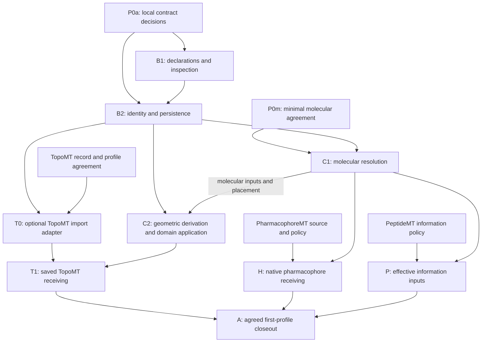

# BindingSite implementation and work plan

Owner: [BindingMT #111](https://github.com/uibcdf/bindingmt/issues/111).
Recorded: 2026-11-11. Work-plan revision **2, reviewed**.
Status: **maintainer-requested work plan; implementation pending**.
This plan turns the [audited design](binding_site_design.md) and its
[worked handoffs](binding_site_review.md) into independently reviewable increments.
It records work order and acceptance, not a release schedule or an implemented API.

The maintainer authorized proceeding and then requested that the detailed plan
be recorded before implementation. This checkpoint changes documentation only.
Existing development authorization remains in force; the plan adds no recurring
permission round. Cross-owner agreements are required for the particular shared
meanings exercised, rather than approval from every possible future consumer.

This review refines the [initial work plan](https://github.com/uibcdf/bindingmt/blob/5694f55c98056cf017924fed4349f1006c686b1c/devguide/binding_site_implementation_plan.md).
It is a work-plan revision, not a package or wire-schema version change. The
architecture and owner boundaries remain appropriate; the corrections make the
implementation order and completion conditions more precise:

- Separate local contract decisions, molecular agreements, shared coordination
  and each consumer's inputs; they are not one all-or-nothing prerequisite.
- Decide identity/version invariants before the first constructors, then obtain
  emitted-record/replay evidence after implementation, avoiding a circular gate.
- Give `from_selection` and the optional TopoMT import adapter explicit work.
- Separate offline geometric derivation from placement on the actual molecular
  problem; require checks at the boundary where the input is used.
- Add structural-scope, repeated-structure and dependency-change controls, plus
  explicit milestones and a shared closeout that does not certify untested owners.

## 1. Starting point and useful outcomes

The design reviewed by the owners is BindingMT
`c299cd5cfacd737f785d65814da026f63bdbb777`. This work-plan review starts from
`5694f55c98056cf017924fed4349f1006c686b1c`; inspection of its existing
DockingProblem normalization grounds the input/lifetime controls below.
The follow-up responses are favorable at design level:

- [TopoMT](https://github.com/uibcdf/bindingmt/issues/111#issuecomment-6814170065)
  considers its six original recommendations addressed and proposes three
  bounded agreements/receiving steps.
- [PeptideMT](https://github.com/uibcdf/bindingmt/issues/111#issuecomment-6814181022)
  considers its four concerns incorporated and offers a concrete consumer
  specification for supplied/absent site information.
- [PharmacophoreMT](https://github.com/uibcdf/bindingmt/issues/111#issuecomment-6814401915)
  considers its four requests substantively addressed and offers a small
  prepared source, recognition policy and retained-feature choices.

These reviews do not freeze a shared schema or demonstrate executed compatibility.
The offered consumer inputs have not been received merely because they were
proposed in a comment. BindingSite runtime code is absent at this starting point.

Inspected provider baselines for preparing this plan are MolSysMT `aee7aa65`,
TopoMT `3a8ee979`, PharmacophoreMT `ecd16946` and PyUnitWizard `c81916e6`.
These are source-inspection identities, not advertised dependency floors or
qualified public artifacts. Refresh and record the actual participating
source/native closure before each executed receiving profile.

The first implementation must make these ordinary workflows useful:

1. Declare an annotation or membership with the information available; inspect
   its meaning, context, evidence and limitations; save/read it faithfully.
2. Resolve an admitted molecular view on an explicitly chosen native MolSys
   structure and export a region or an existing BoxRegion with full derivation.
3. Receive one saved TopoMT finding and one admitted small PharmacophoreMT case
   through public operations, preserving original context and native meanings.
4. Give a consumer inspectable effective inputs for independently constructed
   supplied-site and absent-site requests.

Ordinary use must not require hand-building the complete interchange envelope.
Expert use must expose source/index spaces, structural scope, checks, quantities,
coverage, original references and effective application choices. The same
scientific definition supports both interfaces.

## 2. Scientific and architectural boundaries

- One immutable declaration can have structure-independent or explicit
  structural scope and attributed realizations. Immutability does not make the
  underlying physical region static.
- Ordinary molecular coordinates remain in a native MolSys. Use qualified
  MolSysMT extraction/persistence when a reproducible context must be captured;
  retain site-owned geometry or sufficient owner references separately.
- An annotation, molecular membership, topographic support, pharmacophore
  hypothesis, search domain and enforced restraint retain different meanings.
- Unknown, unresolved, partial, evaluated-empty, failed, stale and unsupported
  remain distinguishable. A readable declaration need not be applicable.
- Molecular representation, chemistry, selections, maps and transforms remain
  MolSysMT-owned; topographic methods remain TopoMT-owned; pharmacophoric
  recognition and native hypotheses remain PharmacophoreMT-owned.
- A generic owner need not import BindingMT. Optional adapters and portable
  records preserve dependency direction. No new shared package, molecular
  snapshot engine, site database or generic execution framework is commissioned.
- Existing SearchDomain, BoxRegion recipes, problem/result records and Vina
  capability rejection keep their current contracts.

Structures/ensemble associations belong in the model from the beginning. The
first qualified operations can nevertheless be static/single-structure. Dynamic
evaluation, tracking, consensus/union, kinetic interpretation and population
estimation need their own concrete workflows and qualification. They are not
implicit meanings of an array of realizations.

## 3. Decisions to settle for the first exercised profile

| Decision | Proposed resolution | Evidence/owner needed |
| --- | --- | --- |
| D1: requested assurance | Expose a public `assurance_scope`, initially `placed_geometry`; keep `context_policy` separate. A requested `current_finding` guarantee needs its own qualified evidence or an explicit refusal. | BindingMT API decision, reviewed with TopoMT and affected consumers. |
| D2: minimal molecular checks | Name the public MolSysMT facts, checks and caller preconditions required by each operation. A matching ID/count or map-range check does not authenticate a source. | Focused MolSysMT agreement; no universal receipt/observer prerequisite. |
| D3: identity and revision | Decide exact record/definition/view references and revision/parent semantics before B1. Revising a claim creates an explicit interpretation, preserving old observation associations. | Local semantic decision first; actual emitted-record and replay controls in B1/B2. |
| D4: first portable profile | Decide the minimal envelope, quantity fields, compatibility and experimental/frozen status before B1/B2. Proposed `@1` names are not already frozen formats. | Candidate examples support the decision; implemented emission/replay supplies later evidence. Agree exercised shared meanings before freezing that boundary. |
| D5: initial projections | Admit specified molecular membership views and selected elementary geometry operations. Geometric-to-molecular selection requires its own membership rule. | BindingMT/MolSysMT profile; PharmacophoreMT owns recognition selection. |
| D6: source/structure/state scope | Keep original and target-local axes and associations explicit. State-dependent membership cannot be reinterpreted by overriding a selector. | MolSysMT facts and nonidentity-map tests. |
| D7: observed information use | Distinguish requested, resolved and exported/submitted data from observed execution and qualified enforcement. | BindingMT export seam and PeptideMT case P specification. |
| D8: first owner inputs | Select one source-bound saved TopoMT record; receive the small PharmacophoreMT source/policy and PeptideMT permitted-input specification. | Named owners supply exact artifacts, versions and intended observations. |

D1 should be visible in a public sketch such as the following, before the
operation is implemented. The spelling is a proposed decision, not a new callable:

```text
site.to_search_domain(
    molecular_system, *, method, view=None, structure_index=None,
    assurance_scope="placed_geometry", context_policy="require_match", ...
)
```

`assurance_scope` says what must be established; `context_policy` governs the
admitted checks/trust policy. Missing proof, an observed contradiction and an
unsupported assurance profile have different diagnoses. A stronger request must
not silently become a weaker one or launch an original detector automatically.

## 4. Dependency order and current status



P0 is a coordination umbrella, not a single barrier. B1/B2 need the local data
contract P0a; they do not wait for T/H/P assets or a universal MolSysMT receipt.
C1 needs P0m for its actual operations. Offline geometry work in C2 can start
after B2 and the assurance decision; molecular placement still needs its own
qualified facts and the corresponding C1 work. T0 needs its exercised TopoMT
profile, not PharmacophoreMT or PeptideMT readiness.

Shared coordination P0s runs across these tracks. It records the agreements
before their shared boundaries are frozen; it does not impose whole-suite
adoption before a local implementation checkpoint. T1/H/P need not finish
together. The arrows describe required input for a complete increment, not
permission to publish partial enforcement or a callable stub.

| Increment | Status at this checkpoint | Completion condition |
| --- | --- | --- |
| P0a | Next: local decisions to close | Minimal public operations, identity/version rules, source/structural scope, quantity fields and failure semantics are explicit before B1/B2; later execution evidence is not a precondition for writing the first implementation. |
| P0m | Pending request/agreement | D2/D5/D6 identify actual public molecular facts, checks and preconditions for each admitted operation. |
| P0s | Pending central coordination | Shared agreements/adoption records are linked; stabilization is limited to the meanings exercised, with remaining owners explicit. |
| P0t/h/p | Inputs offered, not yet received | Each consumer supplies its relevant source/policy/expected observations; a missing H/P input does not block C1 or T0. |
| B1 | Pending P0a | Useful public declarations/inspection with meaningful focused tests. |
| B2 | Pending | Immutable revision and faithful, safe, versioned persistence. |
| C1 | Pending molecular agreement | A qualified direct region projection on a chosen MolSys structure. |
| C2 | Pending B2/assurance contract; molecular use also needs C1 | Offline geometry and actual problem placement retain distinct checks; normal record propagation and admission are qualified before the public application is received. |
| T0 | Pending B2/TopoMT profile and input | A real optional public import adapter preserves the received record without rerunning or reinterpreting it. |
| T1 | Pending T0/C2/owner input | One complete public saved-provider workflow and its refusal controls. |
| H | Offered source/policy pending | One bounded native hypothesis and association workflow with owner controls. |
| P | Offered consumer specification pending | Supplied/absent effective-input controls with declared information origins. |
| A | Pending agreed first-profile evidence | Close the declared initial scope with exact shared disposition; record each consumer's implemented/received/adopted state separately. |

## 5. P0: coordinate the finite contract and inputs

BindingMT owns the handoff and follows up on its consumer evidence. The provider
owns its public API, scientific semantics and acceptance.

P0a records the smallest local contract in the design/owning issue: proposed
signatures and return meanings, required versus optional fields, identity and
revision rules, unit/shape conventions, structural scopes, unknown/empty states
and schema compatibility. Candidate records are adequate design inputs here;
API-emitted records are the subsequent B1/B2 acceptance evidence. Do not make
the first constructor depend on tests that can exist only after that constructor.
Close the local decisions needed for the first data slice, especially D3/D4.
Application-specific assurance details and foreign receiving terms can remain
explicitly pending until their own entry condition; they are not extra B1 gates.

P0m/P0s and input requests P0t/h/p proceed for their respective boundaries.
An owner-specific change needs that owner's disposition before its profile is
claimed as agreed; an unanswered consumer example does not freeze unrelated work.

### P0.1 MolSysMT agreement

Search for an existing owning issue; reuse it or open a focused proposal before
creating another durable provider report. Supply the reviewed BindingMT source,
the three follow-up comments, concrete operations and this finite matrix:

| Operation | Facts to agree | What success must not imply |
| --- | --- | --- |
| Inspect/read an unresolved annotation | BindingMT core admission only; no molecular lookup required. | Complete molecular or structural verification. |
| Resolve/expand atom/group membership | Source/target axes, correspondence authority, requested/resolved coverage, explicit expansion and generated/removed entries. | Equal counts/labels prove chemical identity or original evidence transfers to generated atoms. |
| Read geometry for one structure | Selected structure, coordinates/units, frame/image convention and relevant source relationship. | An old detector finding is current. |
| Forward chemistry to a consumer | Effective target-local state/structure, their original associations and state-dependent membership conditions. | Coordinate equality establishes chemical-state equivalence. |
| Reuse or transfer a saved finding | Available owner guarantees and original-to-current maps; missing/contradictory evidence. | A byte digest or selected lining excerpt verifies the complete prepared source/input query. |

Ask which existing public operations establish these facts, which remain caller
preconditions and which gaps require separately owned work. Exercise matching,
missing-proof and contradictory examples. Include insertion codes/gaps,
extraction/reordering, generated members and original structure 2 becoming target
structure 0. Keep related MolSysMT #624 in its own broader scope.

### P0.2 Consumer inputs

- **TopoMT:** agree one saved bundle plus the full original molecular source,
  supported recovery route, saved selection/frame/reference chemistry, intended
  projection and expected limitations. Include exact content/source identities.
- **PharmacophoreMT:** receive the admitted prepared source, regional membership,
  recognition-context policy, retained feature/projection choices and native
  semantic controls. A participant crossing the regional boundary must be visible.
- **PeptideMT:** receive case P's admitted molecular inputs/structures, supplied
  priors, allowed candidate-derived observations, evaluation-only references and
  effective export boundary. These policy choices are not selected by BindingMT.

Record offered, received, admitted and qualified as different states. Do not
substitute arbitrary scientific choices for an owner's promised input.

Each input handoff identifies the source/producer versions, artifact names and
hashes, source/index/structure/state/frame associations, intended public route,
limits and independent expected observations. Availability or a label alone is
not admission. If an input is delayed, advance ready local increments and record
the missing owner item; do not guess its scientific policy, weaken assurance,
silently fork the provider or poll indefinitely.

### P0.3 Central coordination

Search MolSysSuite for an existing binding-site agreement issue; open or update
that topic with ownership, dependency direction, the first profiles and owner
responses. Rename/adoption work under MolSysSuite #190 is a separate topic.
Use current published registry/label tools and inspect participating checkouts
before coordinated changes, preserving dirty work and source/native identities.
Keep the existing qualified publication SDK pin for its own validation purpose.
Shared agreement, BindingMT implementation, each consumer's adoption and public
package qualification remain separately recorded outcomes.

## 6. B1: useful declarations and inspection

Deliver a public BindingSite entry point with a small actual implementation:

- Atom/group membership and source-addressed residue annotations, including
  coordinate-free and unresolved cases. Preserve order, numbering/insertion
  information, roles and source/index spaces.
- Pure definition/criterion construction without manufactured empty membership.
  Manual hypotheses carry unknown support when no evidence is supplied.
- Elementary sphere/axis-aligned box declarations with explicit units and frame.
  Rich supports can remain owner references with honest unavailable operations.
- Public definition/evidence construction and immutable ownership; ordinary
  users do not assemble the whole record. Revision operations land in B2 using
  the identity semantics already decided in P0a. Properties return detached data.
- Definition/evidence/application scopes and structure-independent versus
  explicit-structure scope remain distinct. Inspection reports prerequisites
  without computing geometry, fetching artifacts or executing optional engines.

Use existing ArgDigest, SMonitor and PyUnitWizard integration. Reuse owner
operations rather than introduce a molecular parser or alternative quantity
codec. Add only implemented exports; avoid empty classes/methods for deferred
catalogue entries. Review actual dependency floors if a new provider capability
is consumed; source availability alone is not public package compatibility.

Expected code areas are `bindingmt/core/`, public exports, owned argument
contracts/diagnostics and focused tests. The exact module split is an
implementation choice; the plan is not a mandate for one class per view.

Start with one complete declaration/inspection slice, then complete its B2
round trip before expanding every convenience factory. Owner-backed
`from_selection`/resolution belongs to C1; B1 does not fake a molecular adapter
with a caller label or borrowed mutable handle. Publish documentation only for
the callable surface actually delivered, with later operations clearly pending.

**Exit:** a researcher can construct, inspect and understand a useful declaration
through the public API. Independent tests cover unresolved annotations, empty
membership, invalid index/quantity inputs, detached ownership and unchanged
source data. No molecular applicability claim is invented.

## 7. B2: identity, revision and portable persistence

Close the first implemented record's required fields, discriminants, units and
schema/version admission. Preserve unknown optional namespaced owner data;
unsupported required semantics refuse the affected typed operation.
Existing legacy admission for other BindingMT records does not authorize a
missing schema on a new BindingSite record or a silent format migration.

Implement:

- Faithful copy/read identity and exact content references, separate from labels
  and scientific equivalence. New derivations retain parents and their reasons.
- Immutable definition/view/evidence revision. Old observations retain their
  original claim/view/participant/structure associations; new interpretation
  creates an explicit new association, not another measurement.
- A JSON-safe envelope using shared sealed quantity records with explicit
  field/dimension/shape handshakes. A changed unit encoding need not share a hash.
- Safe file lifecycle with exclusive creation by default, preserved existing
  valid files on failure, detached reading and no automatic foreign-asset lookup.
- Data-only replay without original engines, models, GPU or network. BindingMT's
  existing declared core installation remains required; do not promise that its
  root import works with MolSysMT absent.

No live mutable MolSys handle becomes a frozen source receipt. Definition
persistence and native-system custody remain explicit. Future incompatible wire
changes require a version/admission decision; do not silently reinterpret an
already admitted format identifier.

Explicitly admit the initial structural-scope profile: independent definitions,
selected structure references and their source/occurrence maps. Scope of a
definition, scope of evidence and scope of an application are separate. Exercise
round trips with original positions `[2, 0, 2]`; repeated delivery is not extra
evidence. Where realization/ensemble payloads are not yet supported, preserve
permitted owner references or refuse required semantics rather than claiming
full ensemble support because a field exists. No dynamic detector is needed
for these data-level controls.

**Exit:** real API-emitted records survive save/read and immutable revision;
malformed/tampered/unsupported records fail honestly; no user or owner artifact
is overwritten or silently upgraded. The illustrative review JSON is not used
as proof that the implementation emitted those records.

## 8. C1: direct molecular region projection

Implement the agreed `resolve_region` profile against public MolSysMT operations.
The ordinary input is a native MolSys; read only the explicitly relevant
structure/state data, without copying its trajectory into each declaration.

Assign the public entry routes explicitly. `from_selection` delegates the
declared syntax/element/state/structure request and retains resolved membership;
`resolve` derives a new declaration when addressing/context changes;
`resolve_region` exports the admitted consumer projection. Final spellings stay
with the accepted API contract; do not leave these routes implied between B1
and receiving or ship parallel aliases without a distinct user need.

Admit and document the actual selection subset. An inventory selection can be
coordinate-independent; a spatial/state-dependent selection needs the relevant
explicit context. Do not implement a competing MolSysMT parser, silently combine
trajectory selections into one membership or select a default structure from
a multi-structure input. Tests cover these distinctions through owner operations.

The detached projection records the exact site/definition/view reference,
original/current axes and maps, requested/resolved/exported entries, effective
target-local structure/state, frame, roles, checks, trust preconditions, losses
and coverage. Complete coverage is the default requirement. An explicit partial
application keeps every omission and its changed meaning visible.

Group→atom expansion is an explicit operation. Generated members acquire no
inherited evidence/confidence. A structure-associated chemical selection cannot
silently inherit another component's `reference` default. Mixed-state or
multi-structure requests use only an explicitly supported owner operation.

First admit molecular membership views. Converting a sphere/surface/volume into
membership requires a separate scientific inclusion/boundary/PBC policy and
qualification. A box enclosure cannot substitute for that rule.

**Exit:** public projections on matching native inputs pass; missing proof,
contradictions, partial mapping and generated-member cases retain their distinct
outcomes. Case R's map/state expectations are demonstrated by actual API output,
not copied into a successful report as authored assertions.

## 9. C2: explicit search-domain application

Implement the accepted public assurance request and first placed-geometry
profile. Return existing BoxRegion, preserving its current behavior.

Treat two boundaries separately. First derive geometry from a self-contained
box/sphere or other admitted payload; that work can start after B2 without a
molecular map. Then establish its placement/applicability for an actual problem.
A record's declared coordinate frame is not evidence that a target shares it.
The public domain application is received only when its required problem/export
admission and recipe propagation work; offline geometric success cannot bypass
those checks or discard provenance by returning an unqualified plain box.

- Select one eligible view explicitly when choices differ. Apply declared
  method, structure, expansion and length-valued padding; preserve effective
  choices, exclusions and approximation losses.
- Reject invalid/degenerate geometry. Do not infer an interior or original
  volume from membership/points; unknown extra included space remains unknown.
- Distinguish saved geometric validity, current molecular correspondence and
  upstream finding applicability. Apply `require_match` to the facts required
  by the selected scope; `declared_frame` cannot repair contradictions or maps.
- Treat unsupported assurance and missing required evidence explicitly. A request
  for `current_finding` is never satisfied by unchanged lining positions alone.
- Use an independently validated site-domain derivation profile, preserving the
  original declaration/view/context, request, output and limitations through
  normal problem/result records. Existing strict box recipes stay unchanged.

Check against the molecular input actually used by the problem/export, retaining
its normalization maps. Existing DockingProblem normalization extracts one
selected structure; source structure 2 can therefore be local problem structure
0. Compare that declared relationship rather than numeric index equality.
The existing file/text fingerprint helper is not a native-MolSys mutation
receipt; do not assume it supplies the new guarantees.

State the check/use lifetime. Reuse/transfer checks and the final export boundary
must cover the facts required by the selected scope. If those facts change
between projection and use, reassess or refuse before backend work. A qualified
captured input and an unchanged-live-input precondition have different scopes;
record which is used. Do not add a generic mutation observer or promise atomic
behavior under concurrent source edits. Historical declarations remain readable.

**Exit:** ordinary problem/result round trips preserve the derivation; the
problem's chosen molecular structure agrees with the application. Historical
geometry stays readable when a detector-input change outside lining invalidates
the stronger applicability claim. No automatic detector rerun occurs.

## 10. T: one complete saved TopoMT receiving workflow

T has two explicit deliverables. **T0 implements the optional public import
adapter** (proposed `BindingSite.from_topomt`); **T1 qualifies the complete saved
workflow**. T1 cannot assume an adapter exists merely because C1/C2 are complete.

T0 consumes current public ProviderRecord/ProviderRun output and preserves native
run/finding IDs, source context, index/role meaning, geometry availability,
attributed measurements and original bibliography. It creates a binding-domain
declaration with appropriately unknown support, not another execution of the
topographic method. Original fields with unqualified conventions stay opaque;
use the owner's attributed measurements for interpreted quantities.

Use the existing DepDigest guard and lazy import only on the selected TopoMT
adapter route. Reading a saved BindingSite or inspecting an owner reference
needs no TopoMT or original engine. Unsupported
geometry/map operations remain explicit; the first adapter is not a plugin
framework, new topographic engine or mandatory reverse dependency.

**T0 exit:** an admitted public record is imported, inspected and saved/read
without owner-output mutation or new engine credit; center-only/unavailable-map
and unsupported-required cases retain correct meaning. T0 can proceed after B2
and its TopoMT profile agreement while unrelated H/P inputs are pending.

For T1, choose the owner-admitted record and pin source/input identities:

`saved output → public TopoMT recovery → BindingMT import/inspection → save/read → domain projection → problem/result persistence`

Use `topomt.load_provider_output(bundle, molecular_system=full_original_source)`
for an admitted saved route. Its reader restores/verifies saved context; do not
replace its selection/frame/reference chemistry through the bridge. Evidence
that lacks that context may remain inspectable through the owner's evidence
route without becoming a successfully source-bound recovered output.

Preserve original run/finding IDs, index spaces, roles, producer versions,
measurement definitions/units, bibliography and support availability. The new
projection retains its own provenance, with no new original-engine credit.

**T1 exit:** one positive complete public route plus incompatible-context,
unavailable-map versus evaluated-empty, center-only and stronger-assurance
refusal controls. Replaying requires no original scientific engine. Success
qualifies this profile, not every provider or native DFND.

## 11. H: one bounded native PharmacophoreMT receiving workflow

Use the supplied admitted source and distinguish:

`regional membership → explicit chemical recognition context → native inventory → explicitly retained hypotheses`

Forward target-local structure/state and retain original associations. A feature
crossing the region boundary must cause explicit context expansion, omission or
refusal according to the owner policy. Expansion does not enlarge the original
binding claim or make every recognized feature mandatory.

Use native capture/projection and native JSON readers/writers. The current first
capture profile admits at most 256 **total source atoms**, 64 features and 2 MiB
of sealed observation. Selecting fewer atoms does not bypass it. Mapped extraction
or larger-source persistence needs its own owner qualification.

Reading the BindingSite association can preserve a native-H reference without
PharmacophoreMT. Decoding that artifact uses its admitted owner reader; an absent
reader or artifact leaves a reference-only record, not a recovered hypothesis.
Neither route launches recognition or fetches missing assets automatically.

Save S0 and native H, then a new S1 association referencing their exact artifacts,
view/projection, recognition policy, coverage, producer and original attribution.
Keep the reference graph acyclic. Native hypothesis persistence does not imply
recovery of the full feature inventory or verified source from a capture digest.

The receptor-projection constructor currently creates positive sites as essential
with weight one. Test zero-weight essential status and exclusion veto through
separate owner-native hypothesis fixtures/operations, not invented constructor
options. Preserve native feature alternatives, directions, tolerances, omissions
and enumeration limits without a competing BindingMT matcher.

**Exit:** public construction, native save/read and association replay pass under
equivalent units and nonidentity maps. Replay performs no recognition. Relevant
coordinate/state changes require reassessment; an unrelated later view leaves
the original H association intact. Incomplete/empty/unevaluated/unsupported
cases and missing native artifacts stay distinct.

## 12. P: supplied-site and independent absent-site consumer controls

Turn PeptideMT's supplied specification into a concrete effective-input test.
Retain separate origins for primary molecular inputs, supplied priors,
candidate-derived observations and evaluation-only references. The consumer
decides which of these are permitted in each request.

Build the absent-site request independently while the evaluation reference and
previous request remain available for provenance. Inspect final native export,
service/library arguments and selected structures: no prohibited localization
information may enter from an evaluation artifact, previous request or viewer.
Any required global search-domain policy has independent provenance.

Record requested/resolved/exported/submitted populations separately from observed
execution and qualified enforcement. An absent-site flag alone proves no export
property; exact submitted data also do not prove internal scientific influence.
Later contact quantifiers, strength, placement and enforcement under #109/#110
remain provider-specific profiles.

**Exit:** both information regimes have explicit admitted inputs and assertions
on effective payloads. This is a scoped consumer control, not general leakage
certification or a choice of target-specific region/scientific parameters.

## 13. Acceptance matrix and evidence to retain

| Control | Independent observation | Increment |
| --- | --- | --- |
| Annotation without geometry | Addresses/roles/unknowns survive; geometry operations explain missing prerequisites. | B1/B2 |
| Immutability and meaning | Source data and old observation associations remain unchanged after derivation/reinterpretation. | B1/B2 |
| Structural scope and coverage | Definition/evidence/application scopes remain distinct; `[2, 0, 2]` retains occurrence maps without duplicate evidence; admitted observed/evaluated-empty/unevaluated records stay distinct. Unsupported richer series remain explicit. | B1/B2/C1 |
| Quantity integrity | Equivalent physical values under ordinary and pm/fs policies; finite shape/dimension/bool/extent admission; wrong field/unit records refuse. | B1/B2/C |
| Frames and transforms | An admitted owner-backed rigid transform preserves membership associations and transforms eligible geometry consistently; absent frame proof or unsupported orientation refuses without dropping axes. | C1/C2 |
| Persistence failures | Existing good file is preserved; invalid/unknown required formats refuse; optional owner data survive without execution. | B2 |
| Molecular correspondence | Original numbering/insertion, nonidentity atom/group/structure maps, removed/generated entries and partial scope are independently checked. | C1 |
| Chemistry scope | Effective target state is forwarded; missing or contradictory associations refuse; coordinates alone prove no chemistry. | C1/H |
| Selection semantics | Native inventory selection is distinguished from structural/spatial selection; multiple structures need an explicit admitted policy, not an accidental union/default. | C1 |
| Domain propagation | Original site/view/request/output/limitations remain in ordinary problem/result records alongside unchanged old recipes. | C2/T |
| Offline geometry versus placement | A valid saved box/sphere can supply geometric work without a molecular map; acceptance on a current problem still requires its placement facts and recipe checks. | B2/C2 |
| Assurance request | Stronger guarantee is not weakened; changed detector input outside lining does not certify a current finding. | C2/T |
| Check/use input and local axes | Validate the actual selected/exported input, including source structure 2 → local problem structure 0; a relevant edit between projection and use is reassessed/refused under the declared lifetime. | C2 |
| Dependency-specific changes | Coordinate edits do not erase topology-only annotation history; affected geometric/chemical/finding applications are reassessed, while unrelated saved evidence remains unchanged. No external observer is presumed. | B2/C1/C2/H |
| Provider quantities/support | The explicit T0 adapter preserves native meanings; equal lining or labels do not equate supports; center-only and unavailable-map limits survive. | T0/T1 |
| Native pharmacophore meaning | Regional, recognition and retained populations differ explicitly; zero-weight essential and exclusion veto remain native. | H |
| Saved association | S0/H/S1 references replay without recognition or cycles; unavailable H is reference-only; unrelated S2 does not retarget it. | H |
| Effective information inputs | Supplied and independent absent requests obey the consumer's origin policy at the final export boundary. | P |
| Fresh reader | Core record reading uses declared core dependencies; foreign-artifact decoding uses its declared owner reader or remains reference-only. No original optional engines/models/GPU/network or automatic artifact fetch. | B2/T/H |

The matrix is an assertion map, not permission to implement every future
variant. Test the first admitted profiles and explicit refusal/preservation at
their boundaries. For example, a box with unsupported orientation must not lose
its axes and become an axis-aligned box silently. Geometry on two admitted
structures may differ while the source membership definition remains the same.
Data-level coverage controls need no new dynamic detection campaign.

### 13.1 Useful milestones and A closeout

| Milestone | Required evidence | What can remain pending |
| --- | --- | --- |
| M1: data core | P0a and B1/B2: real public declarations, inspection, immutable revision and portable round trips with focused tests. | Molecular operations, foreign adapters and consumer adoption; unsupported operations are documented. |
| M2: first molecular application | P0m plus C1/C2 for the admitted MolSys/view/assurance profile, including normal problem/result propagation and refusal controls. | Other molecular profiles, rich geometry, T1/H/P receiving and later engines. |
| M3: agreed initial receiving | T0/T1, H and P meet the declared first-profile controls with exact owner inputs and source identities. | Every other provider, native DFND, dynamic methods, broad receptor capture and whole-suite adoption. |

A records shared acceptance for the exercised boundary, the M1–M3 evidence and
each consumer's actual implementation/receiving/adoption state. A consumer's
adoption may remain a named owning follow-up; our successful test or its stated
intent cannot be recorded as completed adoption. No milestone is a tag, package
release or general scientific qualification.

Close #111 only when its accepted implementation/receiving and handoff scope is
evidenced. If an agreed initial case remains unavailable, keep that work pending
or obtain an explicit maintainer scope decision with an owning follow-up and
revisit condition. Do not silently remove it to declare completion. M1/M2 can
still be useful delivered checkpoints while that case is pending.

### 13.2 Evidence and focused validation

For every implemented increment retain exact BindingMT/provider sources,
relevant native identity, input/output artifact hashes, actual commands/selection,
unit policy, counts/skips/failures, resource outcome and remaining limits. A
corrected attempt is a new record; preserve failed/interrupted attempts.

Planned tests belong in focused `tests/test_binding_site*.py` modules and the
actual integration owners' tests as needed. Those paths are planning notation,
not existing guard selectors. Register real addressable guards only after the
corresponding tests exist and protect the failure mechanism.

Run applicable Ruff, format, report-index and shared-resource/Conda-contract
checks after final edits, including a fresh committed export. Runtime increments
also need their focused `pytest --receptor=llm` selection, with complete selected
results. Documentation, syntax checks and synthetic specimens do not qualify
new runtime behavior. Broaden testing when changes or failures justify it.

Each increment's completion record names the delivered callable/profile,
actual test selection and outcomes, exact source/artifact identities, owning
agreement/receiving links, unsupported scope and next action. Syntax/collection
success alone is not executed acceptance. Distinguish the new feature controls,
focused old-API regression checks and the separately owned full-suite backlog.

## 14. Execution, checkpoint and publication discipline

Routine development uses the declared Python 3.14 Conda environment; metadata
and release support retain Python 3.11–3.14. Verify the selected interpreter,
dependency health and actual editable origins before runtime qualification.
Do not replace sibling source/native state merely to simplify a test.

For new shipped modules/exports, include the focused import/resource and
dependency-closure checks appropriate to the actual installation route. A
source pytest pass alone does not establish installed payload availability or
another interpreter/platform. Keep test helpers in unshipped `bmt_test_support`;
when an installed selection consumes changed helper/data inputs, update their
exact `devtools/conda-build/resources.toml` declaration. Freeze live guides used
as test fixtures at immutable paths; keep historical producer/input identities.
These obligations do not require a new package build for every source edit.

Keep local qualification serial, on one allowed logical CPU at low priority,
with native/build workers limited to one. Check RAM/CPU/swap/pressure/scheduler
conditions before costly cells; record an operation-specific reserve and monitor
owned work. Free RAM is not a reservation. Start with a small representative
case when consumption is unknown, and preserve interrupted attempts. The
existing full scientific selection stopped for resources remains on hold; this
plan does not restart it automatically.

Each completed increment updates its owning contract/report, PUBLIC_API when
applicable, README/document map and current ROADMAP/PRE_STABILIZATION_PLAN/
MACHINE_HANDOFF checkpoint. Keep exact completed evidence and the next action
visible. Archive resolved records through the local reporting protocol.

Use focused commits with `[skip ci]` and the authorized direct-push route. Batch
remote validation at explicit authorized checkpoints; skipped CI is not a pass.
Installed/platform/release/publication evidence keeps its own scope. This plan
creates no tag, package/release, new version deadline or automatic remote run.

## 15. Boundaries with the broader plan

The original product objective under #73 remains active. Its #28/#33/#49/#60
validation, state/environment/panel and browser limits keep their owners.
Source-only 0.1.0 and historical scientific inputs/producers remain immutable.

Native DFND/rich geometry, dynamic/ensemble operations, broad receptor capture
and new provider execution advance through separately qualified profiles. The
[BindingInterface discussion #112](https://github.com/uibcdf/bindingmt/issues/112)
now has a [first detailed design](binding_interface_design.md). It does not
commission a new class and need not block the useful BindingSite core.
HADDOCK3 #109 and Boltz-2 #110 retain their separate adapter work. No molecular
preparation, binding campaign, GPU/model acquisition or new affinity/free-energy
calculation is commissioned by this implementation plan.

## 16. Next actionable checkpoint

Start P0a by recording the minimal B1/B2 signatures, fields, identity/revision,
structural-scope and version/admission decisions in the design/owning issue.
Use the candidate examples to make those decisions; emitted-record qualification
follows implementation. Then complete the first B1/B2 declaration/replay slice.

Deliver the finite P0m MolSysMT request, register P0s shared coordination and ask
for the offered T/H/P inputs through their owner routes without waiting for B1/B2
to finish. Each operation proceeds when its own facts/profile are ready; no
unrelated missing consumer asset becomes a global barrier. T0 must be implemented
explicitly before claiming T1. Do not mark C/T/H/P complete from authored examples
or owner intent.

The reviewed plan is the delivered checkpoint here. The next development
checkpoint should identify the local contract decisions, actual coordination
issues/owner responses or first implemented/tested slice. Further requested
planning refinements remain planning evidence. Preserve these dispositions so a
new contributor can resume without reconstructing conversation history.
