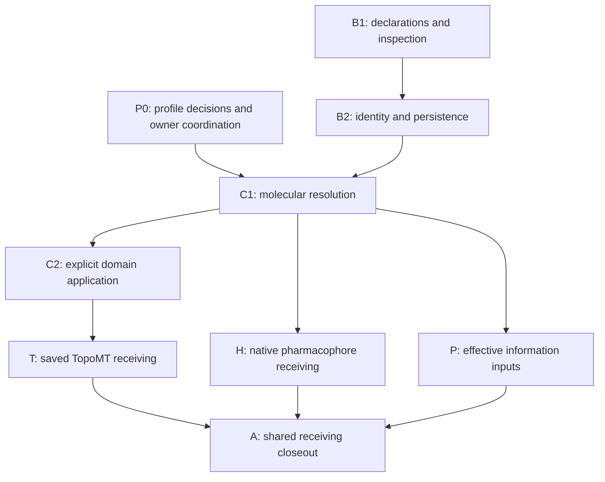

# BindingSite implementation and work plan

Owner: [BindingMT #111](https://github.com/uibcdf/bindingmt/issues/111).
Recorded: 2026-11-11. Status: **maintainer-requested work plan; implementation pending**.
This plan turns the [audited design](binding_site_design.md) and its
[worked handoffs](binding_site_review.md) into independently reviewable increments.
It records work order and acceptance, not a release schedule or an implemented API.

The maintainer authorized proceeding and then requested that the detailed plan
be recorded before implementation. This checkpoint changes documentation only.
Existing development authorization remains in force; the plan adds no recurring
permission round. Cross-owner agreements are required for the particular shared
meanings exercised, rather than approval from every possible future consumer.

## 1. Starting point and useful outcomes

The reviewed source is BindingMT `c299cd5cfacd737f785d65814da026f63bdbb777`.
The follow-up responses are favorable at design level:

- [TopoMT](https://github.com/uibcdf/bindingmt/issues/111#issuecomment-6814170065)
  considers its six original recommendations addressed and proposes three
  bounded agreements/receiving steps.
- [PeptideMT](https://github.com/uibcdf/bindingmt/issues/111#issuecomment-6814181022)
  considers its four concerns incorporated and offers a concrete consumer
  specification for supplied/absent site information.
- [PharmacophoreMT](https://github.com/uibcdf/bindingmt/issues/111#issuecomment-6814401915)
  considers its four requests substantively addressed and offers a small
  prepared source, recognition policy and retained-feature choices.

These reviews do not freeze a shared schema or demonstrate executed compatibility.
The offered consumer inputs have not been received merely because they were
proposed in a comment. BindingSite runtime code is absent at this starting point.

Inspected provider baselines for preparing this plan are MolSysMT `aee7aa65`,
TopoMT `3a8ee979`, PharmacophoreMT `ecd16946` and PyUnitWizard `c81916e6`.
These are source-inspection identities, not advertised dependency floors or
qualified public artifacts. Refresh and record the actual participating
source/native closure before each executed receiving profile.

The first implementation must make these ordinary workflows useful:

1. Declare an annotation or membership with the information available; inspect
   its meaning, context, evidence and limitations; save/read it faithfully.
2. Resolve an admitted molecular view on an explicitly chosen native MolSys
   structure and export a region or an existing BoxRegion with full derivation.
3. Receive one saved TopoMT finding and one admitted small PharmacophoreMT case
   through public operations, preserving original context and native meanings.
4. Give a consumer inspectable effective inputs for independently constructed
   supplied-site and absent-site requests.

Ordinary use must not require hand-building the complete interchange envelope.
Expert use must expose source/index spaces, structural scope, checks, quantities,
coverage, original references and effective application choices. The same
scientific definition supports both interfaces.

## 2. Scientific and architectural boundaries

- One immutable declaration can have structure-independent or explicit
  structural scope and attributed realizations. Immutability does not make the
  underlying physical region static.
- Ordinary molecular coordinates remain in a native MolSys. Use qualified
  MolSysMT extraction/persistence when a reproducible context must be captured;
  retain site-owned geometry or sufficient owner references separately.
- An annotation, molecular membership, topographic support, pharmacophore
  hypothesis, search domain and enforced restraint retain different meanings.
- Unknown, unresolved, partial, evaluated-empty, failed, stale and unsupported
  remain distinguishable. A readable declaration need not be applicable.
- Molecular representation, chemistry, selections, maps and transforms remain
  MolSysMT-owned; topographic methods remain TopoMT-owned; pharmacophoric
  recognition and native hypotheses remain PharmacophoreMT-owned.
- A generic owner need not import BindingMT. Optional adapters and portable
  records preserve dependency direction. No new shared package, molecular
  snapshot engine, site database or generic execution framework is commissioned.
- Existing SearchDomain, BoxRegion recipes, problem/result records and Vina
  capability rejection keep their current contracts.

Structures/ensemble associations belong in the model from the beginning. The
first qualified operations can nevertheless be static/single-structure. Dynamic
evaluation, tracking, consensus/union, kinetic interpretation and population
estimation need their own concrete workflows and qualification. They are not
implicit meanings of an array of realizations.

## 3. Decisions to settle for the first exercised profile

| Decision | Proposed resolution | Evidence/owner needed |
| --- | --- | --- |
| D1: requested assurance | Expose a public `assurance_scope`, initially `placed_geometry`; keep `context_policy` separate. A requested `current_finding` guarantee needs its own qualified evidence or an explicit refusal. | BindingMT API decision, reviewed with TopoMT and affected consumers. |
| D2: minimal molecular checks | Name the public MolSysMT facts, checks and caller preconditions required by each operation. A matching ID/count or map-range check does not authenticate a source. | Focused MolSysMT agreement; no universal receipt/observer prerequisite. |
| D3: identity and revision | Exact record/definition/view references; derived declarations retain parents. Revising a claim creates an explicit interpretation, preserving old observation associations. | BindingMT record invariants and consumer replay controls. |
| D4: first portable profile | Close the actual data-only envelope, quantity fields and admission/compatibility rules before promising its version. Proposed `@1` names are not already frozen formats. | Concrete emitted records, applicable cross-owner review and MolSysSuite shared disposition. |
| D5: initial projections | Admit specified molecular membership views and selected elementary geometry operations. Geometric-to-molecular selection requires its own membership rule. | BindingMT/MolSysMT profile; PharmacophoreMT owns recognition selection. |
| D6: source/structure/state scope | Keep original and target-local axes and associations explicit. State-dependent membership cannot be reinterpreted by overriding a selector. | MolSysMT facts and nonidentity-map tests. |
| D7: observed information use | Distinguish requested, resolved and exported/submitted data from observed execution and qualified enforcement. | BindingMT export seam and PeptideMT case P specification. |
| D8: first owner inputs | Select one source-bound saved TopoMT record; receive the small PharmacophoreMT source/policy and PeptideMT permitted-input specification. | Named owners supply exact artifacts, versions and intended observations. |

D1 should be visible in a public sketch such as the following, before the
operation is implemented. The spelling is a proposed decision, not a new callable:

```text
site.to_search_domain(
    molecular_system, *, method, view=None, structure_index=None,
    assurance_scope="placed_geometry", context_policy="require_match", ...
)
```

`assurance_scope` says what must be established; `context_policy` governs the
admitted checks/trust policy. Missing proof, an observed contradiction and an
unsupported assurance profile have different diagnoses. A stronger request must
not silently become a weaker one or launch an original detector automatically.

## 4. Dependency order and current status



B1/B2 can advance while P0 owner details are resolved, once their local data-only
contract is closed. C1/C2 must use agreed guarantees for the operations they
exercise. T/H/P need not finish together; one consumer's availability is not a
prerequisite for every useful core operation.

| Increment | Status at this checkpoint | Completion condition |
| --- | --- | --- |
| P0 | Next: requests/agreements not yet delivered | D1–D8 have explicit dispositions for the first operation; owner inputs and remaining limits are tracked. |
| B1 | Pending | Useful public declarations/inspection with meaningful focused tests. |
| B2 | Pending | Immutable revision and faithful, safe, versioned persistence. |
| C1 | Pending molecular agreement | A qualified direct region projection on a chosen MolSys structure. |
| C2 | Pending C1/profile decisions | Existing BoxRegion integration with scoped assurance and normal record propagation. |
| T | Provider input selection pending | One complete public saved-provider workflow and its refusal controls. |
| H | Offered source/policy pending | One bounded native hypothesis and association workflow with owner controls. |
| P | Offered consumer specification pending | Supplied/absent effective-input controls with declared information origins. |
| A | Pending implemented evidence | Exact shared disposition and independently recorded consumer adoption. |

## 5. P0: coordinate the finite contract and inputs

BindingMT owns the handoff and follows up on its consumer evidence. The provider
owns its public API, scientific semantics and acceptance.

### P0.1 MolSysMT agreement

Search for an existing owning issue; reuse it or open a focused proposal before
creating another durable provider report. Supply the reviewed BindingMT source,
the three follow-up comments, concrete operations and this finite matrix:

| Operation | Facts to agree | What success must not imply |
| --- | --- | --- |
| Inspect/read an unresolved annotation | BindingMT core admission only; no molecular lookup required. | Complete molecular or structural verification. |
| Resolve/expand atom/group membership | Source/target axes, correspondence authority, requested/resolved coverage, explicit expansion and generated/removed entries. | Equal counts/labels prove chemical identity or original evidence transfers to generated atoms. |
| Read geometry for one structure | Selected structure, coordinates/units, frame/image convention and relevant source relationship. | An old detector finding is current. |
| Forward chemistry to a consumer | Effective target-local state/structure, their original associations and state-dependent membership conditions. | Coordinate equality establishes chemical-state equivalence. |
| Reuse or transfer a saved finding | Available owner guarantees and original-to-current maps; missing/contradictory evidence. | A byte digest or selected lining excerpt verifies the complete prepared source/input query. |

Ask which existing public operations establish these facts, which remain caller
preconditions and which gaps require separately owned work. Exercise matching,
missing-proof and contradictory examples. Include insertion codes/gaps,
extraction/reordering, generated members and original structure 2 becoming target
structure 0. Keep related MolSysMT #624 in its own broader scope.

### P0.2 Consumer inputs

- **TopoMT:** agree one saved bundle plus the full original molecular source,
  supported recovery route, saved selection/frame/reference chemistry, intended
  projection and expected limitations. Include exact content/source identities.
- **PharmacophoreMT:** receive the admitted prepared source, regional membership,
  recognition-context policy, retained feature/projection choices and native
  semantic controls. A participant crossing the regional boundary must be visible.
- **PeptideMT:** receive case P's admitted molecular inputs/structures, supplied
  priors, allowed candidate-derived observations, evaluation-only references and
  effective export boundary. These policy choices are not selected by BindingMT.

Record offered, received, admitted and qualified as different states. Do not
substitute arbitrary scientific choices for an owner's promised input.

### P0.3 Central coordination

Search MolSysSuite for an existing binding-site agreement issue; open or update
that topic with ownership, dependency direction, the first profiles and owner
responses. Rename/adoption work under MolSysSuite #190 is a separate topic.
Use current published registry/label tools and inspect participating checkouts
before coordinated changes, preserving dirty work and source/native identities.
Keep the existing qualified publication SDK pin for its own validation purpose.
Shared agreement, BindingMT implementation, each consumer's adoption and public
package qualification remain separately recorded outcomes.

## 6. B1: useful declarations and inspection

Deliver a public BindingSite entry point with a small actual implementation:

- Atom/group membership and source-addressed residue annotations, including
  coordinate-free and unresolved cases. Preserve order, numbering/insertion
  information, roles and source/index spaces.
- Pure definition/criterion construction without manufactured empty membership.
  Manual hypotheses carry unknown support when no evidence is supplied.
- Elementary sphere/axis-aligned box declarations with explicit units and frame.
  Rich supports can remain owner references with honest unavailable operations.
- Public definition/evidence fields and immutable operations; ordinary users do
  not assemble the whole record. Properties and inspection return detached data.
- Definition/evidence/application scopes and structure-independent versus
  explicit-structure scope remain distinct. Inspection reports prerequisites
  without computing geometry, fetching artifacts or executing optional engines.

Use existing ArgDigest, SMonitor and PyUnitWizard integration. Reuse owner
operations rather than introduce a molecular parser or alternative quantity
codec. Add only implemented exports; avoid empty classes/methods for deferred
catalogue entries. Review actual dependency floors if a new provider capability
is consumed; source availability alone is not public package compatibility.

Expected code areas are `bindingmt/core/`, public exports, owned argument
contracts/diagnostics and focused tests. The exact module split is an
implementation choice; the plan is not a mandate for one class per view.

**Exit:** a researcher can construct, inspect and understand a useful declaration
through the public API. Independent tests cover unresolved annotations, empty
membership, invalid index/quantity inputs, detached ownership and unchanged
source data. No molecular applicability claim is invented.

## 7. B2: identity, revision and portable persistence

Close the first implemented record's required fields, discriminants, units and
schema/version admission. Preserve unknown optional namespaced owner data;
unsupported required semantics refuse the affected typed operation.
Existing legacy admission for other BindingMT records does not authorize a
missing schema on a new BindingSite record or a silent format migration.

Implement:

- Faithful copy/read identity and exact content references, separate from labels
  and scientific equivalence. New derivations retain parents and their reasons.
- Immutable definition/view/evidence revision. Old observations retain their
  original claim/view/participant/structure associations; new interpretation
  creates an explicit new association, not another measurement.
- A JSON-safe envelope using shared sealed quantity records with explicit
  field/dimension/shape handshakes. A changed unit encoding need not share a hash.
- Safe file lifecycle with exclusive creation by default, preserved existing
  valid files on failure, detached reading and no automatic foreign-asset lookup.
- Data-only replay without original engines, models, GPU or network. BindingMT's
  existing declared core installation remains required; do not promise that its
  root import works with MolSysMT absent.

No live mutable MolSys handle becomes a frozen source receipt. Definition
persistence and native-system custody remain explicit. Future incompatible wire
changes require a version/admission decision; do not silently reinterpret an
already admitted format identifier.

**Exit:** real API-emitted records survive save/read and immutable revision;
malformed/tampered/unsupported records fail honestly; no user or owner artifact
is overwritten or silently upgraded. The illustrative review JSON is not used
as proof that the implementation emitted those records.

## 8. C1: direct molecular region projection

Implement the agreed `resolve_region` profile against public MolSysMT operations.
The ordinary input is a native MolSys; read only the explicitly relevant
structure/state data, without copying its trajectory into each declaration.

The detached projection records the exact site/definition/view reference,
original/current axes and maps, requested/resolved/exported entries, effective
target-local structure/state, frame, roles, checks, trust preconditions, losses
and coverage. Complete coverage is the default requirement. An explicit partial
application keeps every omission and its changed meaning visible.

Group→atom expansion is an explicit operation. Generated members acquire no
inherited evidence/confidence. A structure-associated chemical selection cannot
silently inherit another component's `reference` default. Mixed-state or
multi-structure requests use only an explicitly supported owner operation.

First admit molecular membership views. Converting a sphere/surface/volume into
membership requires a separate scientific inclusion/boundary/PBC policy and
qualification. A box enclosure cannot substitute for that rule.

**Exit:** public projections on matching native inputs pass; missing proof,
contradictions, partial mapping and generated-member cases retain their distinct
outcomes. Case R's map/state expectations are demonstrated by actual API output,
not copied into a successful report as authored assertions.

## 9. C2: explicit search-domain application

Implement the accepted public assurance request and first placed-geometry
profile. Return existing BoxRegion, preserving its current behavior.

- Select one eligible view explicitly when choices differ. Apply declared
  method, structure, expansion and length-valued padding; preserve effective
  choices, exclusions and approximation losses.
- Reject invalid/degenerate geometry. Do not infer an interior or original
  volume from membership/points; unknown extra included space remains unknown.
- Distinguish saved geometric validity, current molecular correspondence and
  upstream finding applicability. Apply `require_match` to the facts required
  by the selected scope; `declared_frame` cannot repair contradictions or maps.
- Treat unsupported assurance and missing required evidence explicitly. A request
  for `current_finding` is never satisfied by unchanged lining positions alone.
- Use an independently validated site-domain derivation profile, preserving the
  original declaration/view/context, request, output and limitations through
  normal problem/result records. Existing strict box recipes stay unchanged.

**Exit:** ordinary problem/result round trips preserve the derivation; the
problem's chosen molecular structure agrees with the application. Historical
geometry stays readable when a detector-input change outside lining invalidates
the stronger applicability claim. No automatic detector rerun occurs.

## 10. T: one complete saved TopoMT receiving workflow

Choose the owner-admitted record from P0 and pin source/input identities:

`saved output → public TopoMT recovery → BindingMT import/inspection → save/read → domain projection → problem/result persistence`

Use `topomt.load_provider_output(bundle, molecular_system=full_original_source)`
for an admitted saved route. Its reader restores/verifies saved context; do not
replace its selection/frame/reference chemistry through the bridge. Evidence
that lacks that context may remain inspectable through the owner's evidence
route without becoming a successfully source-bound recovered output.

Preserve original run/finding IDs, index spaces, roles, producer versions,
measurement definitions/units, bibliography and support availability. The new
projection retains its own provenance, with no new original-engine credit.

**Exit:** one positive complete public route plus incompatible-context,
unavailable-map versus evaluated-empty, center-only and stronger-assurance
refusal controls. Replaying requires no original scientific engine. Success
qualifies this profile, not every provider or native DFND.

## 11. H: one bounded native PharmacophoreMT receiving workflow

Use the supplied admitted source and distinguish:

`regional membership → explicit chemical recognition context → native inventory → explicitly retained hypotheses`

Forward target-local structure/state and retain original associations. A feature
crossing the region boundary must cause explicit context expansion, omission or
refusal according to the owner policy. Expansion does not enlarge the original
binding claim or make every recognized feature mandatory.

Use native capture/projection and native JSON readers/writers. The current first
capture profile admits at most 256 **total source atoms**, 64 features and 2 MiB
of sealed observation. Selecting fewer atoms does not bypass it. Mapped extraction
or larger-source persistence needs its own owner qualification.

Save S0 and native H, then a new S1 association referencing their exact artifacts,
view/projection, recognition policy, coverage, producer and original attribution.
Keep the reference graph acyclic. Native hypothesis persistence does not imply
recovery of the full feature inventory or verified source from a capture digest.

The receptor-projection constructor currently creates positive sites as essential
with weight one. Test zero-weight essential status and exclusion veto through
separate owner-native hypothesis fixtures/operations, not invented constructor
options. Preserve native feature alternatives, directions, tolerances, omissions
and enumeration limits without a competing BindingMT matcher.

**Exit:** public construction, native save/read and association replay pass under
equivalent units and nonidentity maps. Replay performs no recognition. Relevant
coordinate/state changes require reassessment; an unrelated later view leaves
the original H association intact. Incomplete/empty/unevaluated/unsupported
cases and missing native artifacts stay distinct.

## 12. P: supplied-site and independent absent-site consumer controls

Turn PeptideMT's supplied specification into a concrete effective-input test.
Retain separate origins for primary molecular inputs, supplied priors,
candidate-derived observations and evaluation-only references. The consumer
decides which of these are permitted in each request.

Build the absent-site request independently while the evaluation reference and
previous request remain available for provenance. Inspect final native export,
service/library arguments and selected structures: no prohibited localization
information may enter from an evaluation artifact, previous request or viewer.
Any required global search-domain policy has independent provenance.

Record requested/resolved/exported/submitted populations separately from observed
execution and qualified enforcement. An absent-site flag alone proves no export
property; exact submitted data also do not prove internal scientific influence.
Later contact quantifiers, strength, placement and enforcement under #109/#110
remain provider-specific profiles.

**Exit:** both information regimes have explicit admitted inputs and assertions
on effective payloads. This is a scoped consumer control, not general leakage
certification or a choice of target-specific region/scientific parameters.

## 13. Acceptance matrix and evidence to retain

| Control | Independent observation | Increment |
| --- | --- | --- |
| Annotation without geometry | Addresses/roles/unknowns survive; geometry operations explain missing prerequisites. | B1/B2 |
| Immutability and meaning | Source data and old observation associations remain unchanged after derivation/reinterpretation. | B1/B2 |
| Quantity integrity | Equivalent physical values under ordinary and pm/fs policies; finite shape/dimension/bool/extent admission; wrong field/unit records refuse. | B1/B2/C |
| Persistence failures | Existing good file is preserved; invalid/unknown required formats refuse; optional owner data survive without execution. | B2 |
| Molecular correspondence | Original numbering/insertion, nonidentity atom/group/structure maps, removed/generated entries and partial scope are independently checked. | C1 |
| Chemistry scope | Effective target state is forwarded; missing or contradictory associations refuse; coordinates alone prove no chemistry. | C1/H |
| Domain propagation | Original site/view/request/output/limitations remain in ordinary problem/result records alongside unchanged old recipes. | C2/T |
| Assurance request | Stronger guarantee is not weakened; changed detector input outside lining does not certify a current finding. | C2/T |
| Provider quantities/support | Equal lining or labels do not equate supports; original measurements and center-only limits survive. | T |
| Native pharmacophore meaning | Regional, recognition and retained populations differ explicitly; zero-weight essential and exclusion veto remain native. | H |
| Saved association | S0/H/S1 references replay without recognition or cycles; unavailable H is reference-only; unrelated S2 does not retarget it. | H |
| Effective information inputs | Supplied and independent absent requests obey the consumer's origin policy at the final export boundary. | P |
| Fresh reader | Required core installation only; no original optional engines/models/GPU/network or automatic artifact fetch. | B2/T/H |

For every implemented increment retain exact BindingMT/provider sources,
relevant native identity, input/output artifact hashes, actual commands/selection,
unit policy, counts/skips/failures, resource outcome and remaining limits. A
corrected attempt is a new record; preserve failed/interrupted attempts.

Planned tests belong in focused `tests/test_binding_site*.py` modules and the
actual integration owners' tests as needed. Those paths are planning notation,
not existing guard selectors. Register real addressable guards only after the
corresponding tests exist and protect the failure mechanism.

Run applicable Ruff, format, report-index and shared-resource/Conda-contract
checks after final edits, including a fresh committed export. Runtime increments
also need their focused `pytest --receptor=llm` selection, with complete selected
results. Documentation, syntax checks and synthetic specimens do not qualify
new runtime behavior. Broaden testing when changes or failures justify it.

## 14. Execution, checkpoint and publication discipline

Routine development uses the declared Python 3.14 Conda environment; metadata
and release support retain Python 3.11–3.14. Verify the selected interpreter,
dependency health and actual editable origins before runtime qualification.
Do not replace sibling source/native state merely to simplify a test.

Keep local qualification serial, on one allowed logical CPU at low priority,
with native/build workers limited to one. Check RAM/CPU/swap/pressure/scheduler
conditions before costly cells; record an operation-specific reserve and monitor
owned work. Free RAM is not a reservation. Start with a small representative
case when consumption is unknown, and preserve interrupted attempts. The
existing full scientific selection stopped for resources remains on hold; this
plan does not restart it automatically.

Each completed increment updates its owning contract/report, PUBLIC_API when
applicable, README/document map and current ROADMAP/PRE_STABILIZATION_PLAN/
MACHINE_HANDOFF checkpoint. Keep exact completed evidence and the next action
visible. Archive resolved records through the local reporting protocol.

Use focused commits with `[skip ci]` and the authorized direct-push route. Batch
remote validation at explicit authorized checkpoints; skipped CI is not a pass.
Installed/platform/release/publication evidence keeps its own scope. This plan
creates no tag, package/release, new version deadline or automatic remote run.

## 15. Boundaries with the broader plan

The original product objective under #73 remains active. Its #28/#33/#49/#60
validation, state/environment/panel and browser limits keep their owners.
Source-only 0.1.0 and historical scientific inputs/producers remain immutable.

Native DFND/rich geometry, dynamic/ensemble operations, broad receptor capture
and new provider execution advance through separately qualified profiles. The
[BindingInterface discussion #112](https://github.com/uibcdf/bindingmt/issues/112)
does not commission a new class and need not block the useful BindingSite core.
HADDOCK3 #109 and Boltz-2 #110 retain their separate adapter work. No molecular
preparation, binding campaign, GPU/model acquisition or new affinity/free-energy
calculation is commissioned by this implementation plan.

## 16. Next actionable checkpoint

Start P0 with the explicit assurance proposal and a finite MolSysMT review
request. Register the shared coordination topic and ask for the offered T/H/P
inputs through their owning issue routes. Close the local B1/B2 data contract
and begin those useful operations while the molecular/consumer details are
being agreed. Do not mark C/T/H/P complete from authored examples or owner intent.

The plan itself is the delivered checkpoint here. Its next update should name
the actual coordination issues/owner responses or the first implemented/tested
increment, preserving this starting disposition rather than reconstructing it
from conversation history.
