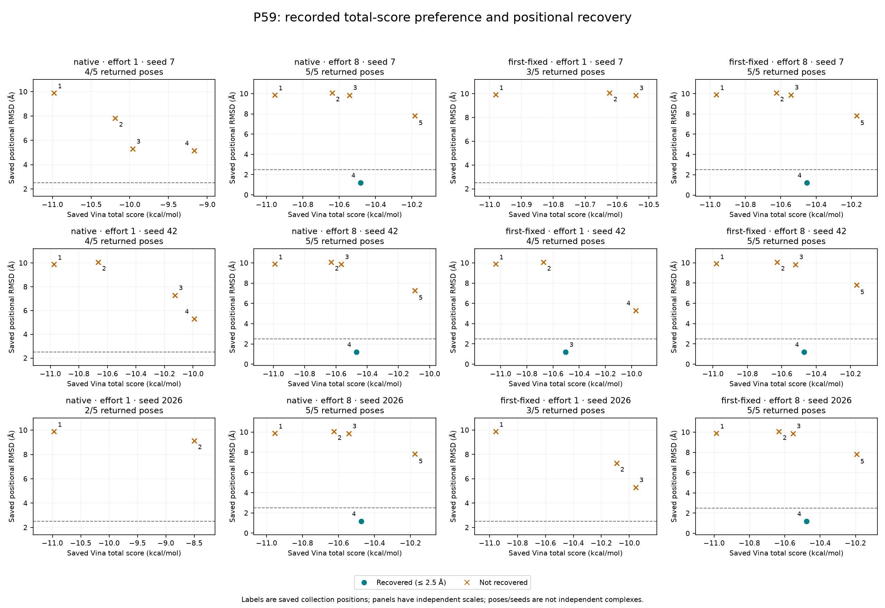

# P59 total-score preference versus positional recovery — 2026-11-05

Owner: [BindingMT #69](https://github.com/uibcdf/bindingmt/issues/69), following
audit E6/Q2 and [#67's saved-search analysis](saved_search_variability_2026-11-05.md).
The [prescription at 414ff0e](https://github.com/uibcdf/bindingmt/blob/414ff0e4e0a3932261b7eeb36c10594deb4ba4f9/devguide/pending_proposals/diagnose_p59_score_preference.md)
precedes the new score-pairing calculation. This is retrospective description of
the previously observed P59 ordering gap, with no new docking experiment.

All twelve saved P59 lists follow the recorded ascending total-score policy,
with the first pose their unique score minimum. In every run containing a
recovered pose, its score is less preferred than the first pose's score. This
describes a finite mismatch between recorded score preference and the declared
RMSD criterion. It does not establish the chemical cause or a general scoring
defect, affinity error or corrected model.

## Frozen inputs and producer relationships

| Input under `validation/data/` | SHA-256 |
| --- | --- |
| `5x72_root_order/audit_2026-10-09.json.gz` | `2129d7eed2b73bcf90737b2a6c722e3b8e9269abeba0ca3b1444df51f046634e` |
| `saved_search_variability_2026-11-05/frozen_20261105_summary.json` | `0d88030650a768c14e9940b2c58dd21c16465550518cedd5f64c557e3e7369fc` |

The original projection is retained byte-for-byte at the frozen path above
after the 2026-11-11 canonical presentation refresh. The current `summary.json`
and plots have new presentation producer bytes with identical observations.

The original archive is the molecular/search evidence authority. The second
input reuses #67's validated numerical RMSD projection, with producer module
SHA-256 `91ef4d7a591ff0d9904d5d26be93e9b1bad6116bbeba004325ea3974664064a5`
published at `9b8677d82f37af3b916950516e0a888e378f55d9`. Before joining scores,
the reader authenticates both inputs, their linkage and every projected ROOT
result digest against the full original result record. Run keys and saved pose
identities/positions/ranks bind each score to its original RMSD. It does not
import or execute the earlier reader or recalculate molecular geometry.

The original ROOT-order producer remains consumer base
`357cd87f273360a30af4fe67f0a5df7b9b21a4e7` with its retained qualified-provider
identity and source-record digest. This diagnostic retains those identities,
the distinct #67 producer and its own helper/prescription fingerprint. Original
archive bytes and all #67 outputs remain unchanged.

## Population and methods

The archive's 24 runs comprise twelve P59 and twelve P69 runs. Select P59's
twelve runs and fifty returned poses: native/first-fixed ROOT, seeds 7/42/2026,
exhaustiveness 1/8, five poses requested per run. The #67 input also describes
3PTB; those observations and P69 remain outside this diagnostic. P59 was chosen
after the earlier recovery-gap observation. All its declared cells, including
nonrecoveries, remain present. Poses and seeds are not independent complexes.

Use the saved `vina` empirical **total docking score**, declared method
`AutoDock Vina/vina` 1.2.7, unit `kilocalorie / mole`, preferred direction
`lower`. Preserve complete definitions, weights/grid/input contexts, protocol
and ranking history. The receptor/partner hashes and numerical box must agree
with the original input context. The score box records center/size/unit; the
input context separately retains its six-decimal projection marker. These
different metadata shapes are compared explicitly, without stripping the marker
or changing numerical values. Contexts must remain fixed within each ROOT arm.

Use the original positional RMSD: 24 experimental heavy atoms, original shared
frame, no alignment or symmetry correction, recovery at RMSD ≤ 2.5 Å. Existing
preparation assessments remain **unassessed**. Joining scalar observations
neither validates chemistry nor establishes that the reference/preparation is
scientifically adequate for an affinity question.

Collection positions are one-based in saved order; declared ranks are separate.
The first pose is position one. Closest is the minimum saved RMSD, with the
earliest position selected for its representative and all exact tied positions
retained. Earliest recovered means the first saved position meeting the cutoff.
Lowest recovered score is the minimum recorded total over the recovered set,
with all exact ties retained. Minimum-score ties also remain explicit.

For each pose, compute `score(pose) − score(first)` within its own run. Positive
differences mean less preferred total scores under the recorded direction.
Report the closest-pose contrast and the lowest recovered-score contrast; the
latter is null when no recovered pose exists. Missing recovery is not a zero
contrast. Deriving minima does not change result order or assign new ranks.
The reader reports any score/order discordance rather than selecting it away.

Only finite real scores and finite nonnegative saved RMSDs are admitted.
Counts, units, score definitions/context, recovery and ranking evidence are
checked. No molecular import, atom inspection, correspondence, RMSD operation,
unit conversion, native scoring/search, component-score reconstruction or
reranking occurs. There is no pooled correlation or significance test.

## Observations

The [twelve-run table](data/p59_score_diagnostic_2026-11-05/runs.md) shows first
and closest observations, positions/ranks and score contrasts. The
[fifty-pose CSV](data/p59_score_diagnostic_2026-11-05/poses.csv) retains every
score/RMSD pair, original order/rank, contrast and explicit score/RMSD units.
Absent ranks would use blank CSV fields and JSON null, never inferred ranks.
The [summary JSON](data/p59_score_diagnostic_2026-11-05/summary.json) also retains
definitions/context, original ranking evidence, ties and all source pointers.

Each group below contains three evaluated runs. The contrast is the lowest
recovered total minus first total within that same run, in kcal/mol. Dashes
denote unavailable recovered comparisons. Numbers retain three decimal places,
matching the archived total-score reporting precision; full computed floats
remain in JSON, without an extra accuracy claim.

| ROOT | Effort | Returned poses | First-pose recovered runs / 3 | Returned-set recovered runs / 3 | Recovered score − first, seeds 7 / 42 / 2026 |
| --- | ---: | ---: | ---: | ---: | --- |
| native | 1 | 10 | 0/3 | 0/3 | — / — / — |
| native | 8 | 15 | 0/3 | 3/3 | +0.472 / +0.523 / +0.480 |
| first-fixed | 1 | 10 | 0/3 | 1/3 | — / +0.535 / — |
| first-fixed | 8 | 15 | 0/3 | 3/3 | +0.512 / +0.511 / +0.510 |

At effort 8, each seed in each ROOT arm returns one recovered pose first at
position four. Their closest saved RMSDs are 1.166–1.190 Å in native ROOT and
1.184–1.200 Å in first-fixed ROOT, while their first poses fail recovery. The
first-fixed seed-42 effort-1 recovery is at position three and has a +0.535
kcal/mol score contrast. Nonrecovering runs retain their scores/RMSDs and
unavailable recovered contrasts.

Both arms, at every recorded seed/effort, have a closest-RMSD representative with
a higher saved score than first. Their actual returned lists are nondecreasing
under the recorded total score; the first position is the unique score minimum
in each of the twelve runs. Thus the observed ordering is consistent with its
recorded score preference, while that preference disagrees with the positional
recovery criterion in the recovering cases.



The [standalone SVG](data/p59_score_diagnostic_2026-11-05/score_rmsd.svg) is
available for export. Each panel is one run with its own axes; labels denote
saved collection positions, colors/markers denote recovery, and the dashed line
is the original cutoff. Points are not pooled into an independent-pose model.

## Interpretation and next scientific boundary

The subsequent [integrated 5X72 synthesis](5x72_control_synthesis_2026-11-05.md)
places this original protein-only subset alongside already executed occupancy,
reciprocal, reference, rigid, distance and displacement controls. In particular,
fixed P69 changes P59's model preference on unchanged saved geometries; the
P69 reciprocal retains adverse ordering outcomes. Interpret the present docking
score contrasts within that full context, keeping fixed-score evaluations and
their different definitions separate. These earlier controlled observations
were outside this diagnostic's declared two inputs and remain unchanged.

The result supports a finite score-preference mismatch relative to this
structural criterion. It motivates diagnosis of the scoring/model/preparation
relationship in the declared case. Existing chemical states, reference/model
suitability, environmental treatment and output plausibility remain unassessed
where the original record says so. These data do not separate their possible
contributions or identify a chemical cause. A roughly 0.5 kcal/mol empirical
score difference is not a measured binding free-energy difference.

Do not fit a new score, change defaults, rerank results or estimate predictive
accuracy from these selected fifty poses. No additional independent complexes
were measured, and retrospective selection limits generalization. #33 retains
the admitted-panel/model questions. A future molecular assessment or experiment
needs its owning provider, declared hypothesis, preparation/reference choices
and budget; those provider issues remain deferred. Public package and visible
C4/C6 gates remain separate.

## Reproduction and verification

From the checkout, run the standard-library check:

```bash
python -m bmt_test_support.p59_score_diagnostic --check
```

It authenticates both frozen inputs, recomputes JSON/Markdown/CSV and verifies
retained PNG/SVG bytes through the
[artifact manifest](data/p59_score_diagnostic_2026-11-05/artifacts.json).
It does not rerender images. The manifest records the actual Matplotlib
renderer; hashes assert retained-file integrity rather than cross-version
rendering identity. Explicit regeneration of derived outputs additionally uses
Matplotlib:

```bash
python -m bmt_test_support.p59_score_diagnostic
```

The [new guards](../../tests/test_p59_score_diagnostic.py) exercise byte/join
integrity, declared definitions/units/context, finite observations, complete
selection, exact known score gaps, rank/position/tie behavior, retained ordering
discordance, absent recovery and tampered outputs. A fresh subprocess blocks
molecular and plotting imports during check mode. Figures were inspected for
readable units, position labels and clipping. The helper and six derived files
have exact installed-support declarations; no runtime payload is extended.

The 29 new guards and 20 existing #67 controls pass together (49 tests) with
the owner root excluded from Python paths through shared support's 585-file declaration. Four
shared integrity checks pass; staged resources and imports retire, with the
owner absent from Python paths. This is bounded working-tree helper receiving,
with published Pytest Receptor 1.2.2 on Python 3.14, not an installed BindingMT
artifact or full installed matrix. Another 24 reporting/distribution/support
administrative controls pass. Exact-head hosted observation remains #28.
Ruff, generated indexes, both earlier synthesis/check modes and shared
publication/resource preflights also pass. These software checks do not add
independent molecular observations or qualify a public package.
