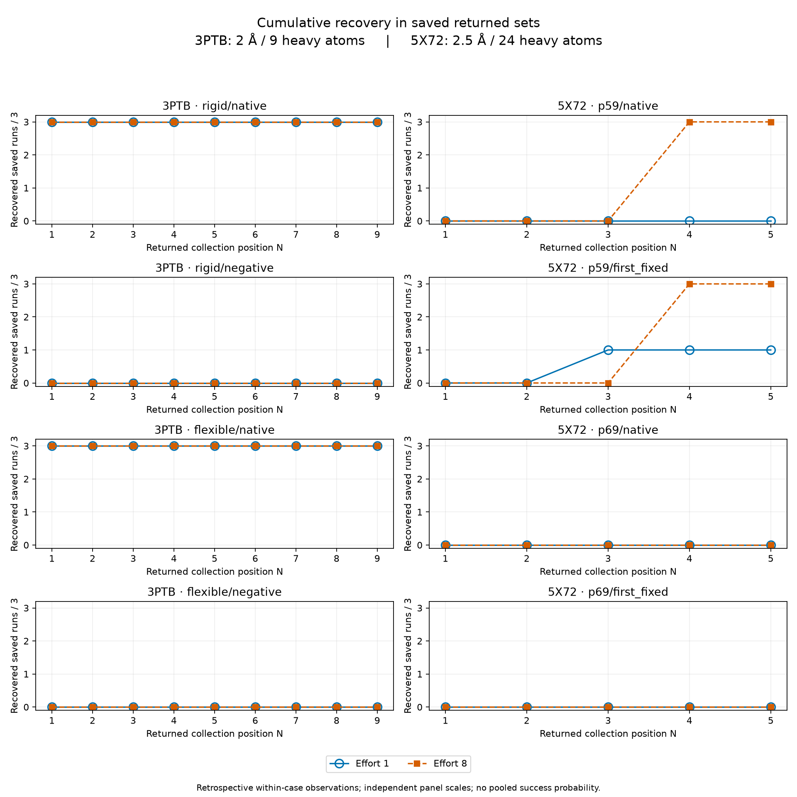
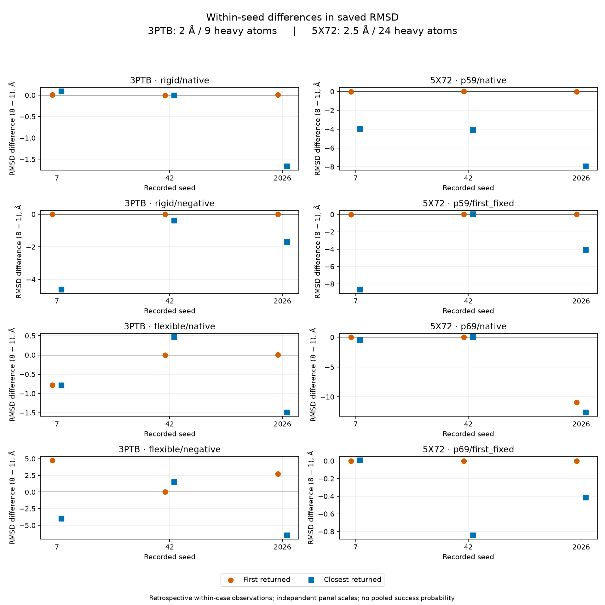

# Saved-search seed, effort and ordering observations — 2026-11-05

Owner: [DockingMT #67](https://github.com/uibcdf/dockingmt/issues/67).
This is a retrospective descriptive analysis of frozen records, supporting
audit E5/E6/Q2. The [prescription at d1435ff](https://github.com/uibcdf/dockingmt/blob/d1435ff8662787afa29798fc0824ac30d9d0c6b6/devguide/pending_proposals/describe_saved_search_variability.md)
precedes this new calculation; the original experiments remain historical.

The principal observation is an ordering gap in 5X72 P59: at effort 8, both
ROOT arms contain a recovered pose at collection position four for all three
seeds, while none of their first poses recover. More effort does not uniformly
lower the closest saved RMSD. These are within-case observations, without a
general recovery probability, significance or affinity claim.

## Inputs, producers and denominators

The reader authenticates these compressed bytes before parsing. Originals are
unchanged; the analysis introduces no replacement molecular record.

| Input under `validation/data/` | SHA-256 |
| --- | --- |
| `3ptb_search/audit_2026-10-10.json.gz` | `97104903c93b3f7a729a5a6ac196cdb7b59d686e318efdcf324f70131abba1f2` |
| `3ptb_search/evaluation_2026-10-10.json.gz` | `8351d4db25b2ad25de413158a8d3dc0a5e4fee31678ea06649994a1832fa53af` |
| `5x72_root_order/audit_2026-10-09.json.gz` | `2129d7eed2b73bcf90737b2a6c722e3b8e9269abeba0ca3b1444df51f046634e` |

3PTB has 24 searches and 167 returned poses. Its original 24 RMSD reports failed;
the separate saved receiver later evaluates those same results successfully,
executing zero new searches. Failed reporting is retained as its own stage and
is not reclassified as docking nonrecovery. Source/receiver rows are joined by
their recorded run index and checked against protocols, input hashes and pose
identities. The original search and receiving producers use consumer base
`105dfc15d47cde7005137f3e7405e2b515107c4f`, with distinct driver hashes
`28fd3cbd41f871e54ac704628166186d622160d52630f3b4661f6ce0253a1b76`
and `4a61ff485d3a53da9edfdc63eae2c8a5eeb2581dac0204209c9bcb28a1545dc4`.

5X72 contributes 24 different saved searches and 99 returned poses, from consumer
base `357cd87f273360a30af4fe67f0a5df7b9b21a4e7`. Its P59 and P69 ligands/sites
remain distinct arms within the same complex. Their ROOT-order challenge is
not pooled with 3PTB or with the separate installed 3PTB walkthrough. Exact
original producer records remain in their archives; selected identities and
digests are retained in the derived JSON, separately from the new reader hash.

There are eight arms, each with seeds 7, 42 and 2026 at exhaustiveness 1 and 8:
48 saved runs, 16 arm/effort groups and 24 comparisons at the same recorded seed.
Each group has three evaluated runs. Seeds, poses and repeated evaluation are
not independent complexes. Across this finite inventory there are 266 poses,
with the separate 167/99 populations retained in every interpretation.

## Methods and controls

The case-specific [reader](../../dmt_test_support/saved_search_variability.py)
uses saved numerical observations. It performs no molecular import, preparation,
selection, correspondence calculation, RMSD measurement, search, scoring or
reranking. Any future molecular operation remains provider-owned.

Retain the original positional RMSD criteria: 3PTB uses nine heavy atoms and
2 Å; 5X72 uses 24 experimental heavy atoms and 2.5 Å. Recovery is saved RMSD
less than or equal to the applicable cutoff, without alignment or symmetry
correction. Reference records and the caller-declared frame remain those of the
original case. Their original scientific suitability is not established anew
by a numerical record check.

Collection positions are one-based in the saved result list. Declared ranks are
retained separately, including absent ranks; neither sorting nor an inferred
rank defines top-N. Closest means the minimum saved RMSD among returned poses,
with the first saved position retained for a tie. First recovered means the
earliest saved position meeting the cutoff.

For each N, cumulative recovery counts runs with at least one recovered pose in
their first `min(N, returned)` poses. The denominator remains three evaluated
runs, including nonrecoveries. Requested, returned and considered counts are
distinct; no absent pose is imputed. Requested counts are nine for 3PTB and five
for 5X72. The JSON retains per-seed considered counts at every N.

The reader requires every expected arm/seed/effort cell, finite nonnegative real
RMSDs, internally consistent recorded recovery and pose summaries, literal
criteria/units and matching source/receiver associations. Within an arm, actual
submitted input hashes, preparation digest, box, reference, backend (Vina 1.2.7)
and protocol parameters other than seed/exhaustiveness must remain fixed. CPU
is one and scoring is `vina`. Unsupported or inconsistent records fail rather
than silently changing the denominator.

Differences are effort-8 minus effort-1 RMSD at the same recorded seed and arm.
Negative values indicate a smaller saved RMSD. Searches with the same seed but
different effort are separate searches; this is not a nested-trajectory or
paired causal experiment. Three selected seeds do not justify confidence
intervals, significance testing or population-level effectiveness estimates.

## Observations

The [48-run table](data/saved_search_variability_2026-11-05/runs.md) gives first
and closest RMSD, requested/returned counts and recovered/closest positions and
ranks. The [summary JSON](data/saved_search_variability_2026-11-05/summary.json)
retains full recorded protocols, input contexts, source pointers, per-pose
observations, cumulative counts and all 24 effort differences.

In the following table, each entry in the last column is a recovered-run count
out of three, for N = 1 through nine (3PTB) or five (5X72). Returned poses are
the total across the three seeds, not the recovery denominator.

| Population / arm | Effort | Returned poses | Cumulative recovered runs / 3, by N |
| --- | ---: | ---: | --- |
| 3PTB rigid/native | 1 | 14 | 3, 3, 3, 3, 3, 3, 3, 3, 3 |
| 3PTB rigid/native | 8 | 27 | 3, 3, 3, 3, 3, 3, 3, 3, 3 |
| 3PTB rigid/negative | 1 | 12 | 0, 0, 0, 0, 0, 0, 0, 0, 0 |
| 3PTB rigid/negative | 8 | 27 | 0, 0, 0, 0, 0, 0, 0, 0, 0 |
| 3PTB flexible/native | 1 | 14 | 3, 3, 3, 3, 3, 3, 3, 3, 3 |
| 3PTB flexible/native | 8 | 27 | 3, 3, 3, 3, 3, 3, 3, 3, 3 |
| 3PTB flexible/negative | 1 | 19 | 0, 0, 0, 0, 0, 0, 0, 0, 0 |
| 3PTB flexible/negative | 8 | 27 | 0, 0, 0, 0, 0, 0, 0, 0, 0 |
| 5X72 P59/native | 1 | 10 | 0, 0, 0, 0, 0 |
| 5X72 P59/native | 8 | 15 | 0, 0, 0, 3, 3 |
| 5X72 P59/first-fixed | 1 | 10 | 0, 0, 1, 1, 1 |
| 5X72 P59/first-fixed | 8 | 15 | 0, 0, 0, 3, 3 |
| 5X72 P69/native | 1 | 10 | 0, 0, 0, 0, 0 |
| 5X72 P69/native | 8 | 15 | 0, 0, 0, 0, 0 |
| 5X72 P69/first-fixed | 1 | 9 | 0, 0, 0, 0, 0 |
| 5X72 P69/first-fixed | 8 | 15 | 0, 0, 0, 0, 0 |



The [SVG version](data/saved_search_variability_2026-11-05/top_n.svg) is suitable
for export. Each panel retains its original criterion and three-run denominator;
coincident curves remain visible through hollow circles and filled squares.

3PTB native-domain arms already recover in the first pose at either effort;
negative-domain arms never recover within the saved returned set. This bounded
contrast does not demonstrate flexibility benefit or general robustness.

In P59, effort 8 returns a recovered pose first at position four for all three
seeds in both ROOT arms, while every first pose fails. At effort 1, only the
first-fixed arm's seed 42 recovers, first at position three. That seed's closest
RMSD difference is exactly zero, with its first recovered position changing
from three to four; equal scalar RMSD does not identify equal molecular poses.

P69 never recovers under its declared 2.5 Å criterion. Native-order seed 2026
has first/closest RMSD differences of approximately −10.946/−12.628 Å, yet
still fails that criterion. Improvement of a continuous metric and threshold
recovery are different observations.



The [SVG version](data/saved_search_variability_2026-11-05/effort_differences.svg)
retains each panel's independent vertical scale. Markers are offset horizontally
for visibility, without changing their recorded seed or RMSD difference.
Closest RMSD sometimes increases: 3PTB rigid/native seed 7 (+0.092 Å),
flexible/native seed 42 (+0.461 Å), flexible/negative seed 42 (+1.506 Å) and
P69/first-fixed seed 7 (+0.008 Å). No uniform improvement rule follows.

Every effort-8 run returns the requested count; effort-1 runs often return fewer.
These records therefore do not isolate sampling, scoring, filtering or output
count as the cause of the observed changes. A recovered returned pose with a
failing first pose motivates ordering/model diagnosis within this case; absence
of recovered poses alone does not uniquely diagnose inadequate search.

## Reproduction, verification and next boundary

From the checkout, verification reads saved records and checks committed outputs:

```bash
python -m dmt_test_support.saved_search_variability --check
```

This recomputes the numerical JSON and run table, verifies original input and
analysis-producer identities, and checks every figure's bytes against
[the artifact manifest](data/saved_search_variability_2026-11-05/artifacts.json).
It imports only the standard library and does not rerender figures. Image hashes
establish retained artifact integrity, not a cross-version rendering guarantee.

An explicit write run regenerates only these derived outputs and requires
Matplotlib (the retained rendering uses 3.11.2):

```bash
python -m dmt_test_support.saved_search_variability
```

The [20 controls](../../tests/test_saved_search_variability.py) cover fixed
populations, denominators, source/receiver index joins, corrupt hashes,
missing/duplicate cells, context/unit/status changes, invalid RMSD, output
tampering and position/rank independence. A fresh subprocess blocks molecular
and plotting imports during `--check`. The helper and seven derived files have
exact declarations in the shared unshipped installed-test support profile.
Figures have also been inspected for readable labels, visible coincident
curves and clipping. This static figure review does not qualify live C4/C6.

The 20 controls also pass on Python 3.14 with published Pytest Receptor 1.2.2
with the owner root excluded from Python paths, using shared support's 578-file declaration.
Only the helper namespace is bound; the owner is absent from Python paths.
Four shared integrity checks pass, and the staged resources and imports are
retired. This is bounded helper/test receiving of the working tree, not a new
installed DockingMT artifact or full installed-matrix qualification.

Another 24 reporting, distribution and installed-support administrative controls
pass with the accepted dependency SDK selected explicitly. Ruff, generated
report indexes, the original four-input synthesis check and shared publication
and resource validation pass. Exact-head hosted science CI remains separately
observed under #28; earlier source successes do not qualify this new reader.

No new scientific campaign, runtime API, public artifact or provider capability
is qualified here. #33 retains independent-complex panel acceptance; its
provider-dependent admission remains deferred. Any next experiment needs its
own declared question, inputs, preparation, metric and budget. Preserve these
historical outcomes when providers or DockingMT advance.

The subsequent [#69 P59 diagnostic](p59_score_diagnostic_2026-11-05.md) reuses
this unchanged numerical projection, binding it to the original archive before
adding saved total-score contrasts. It describes the recorded score preference
within each P59 run without reranking, rescoring or changing these results.
